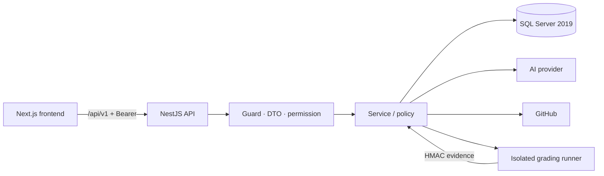

<div align="center">

# V-Intern Backend

**API của nền tảng thực tập ảo** — tuyển dụng, phiên thực tập, dự án, GitHub, đánh giá, KPI và chứng nhận.

[](https://github.com/vanhoi04082006-pixel/V-Intern-BE/actions/workflows/backend-ci.yml)
[](https://github.com/vanhoi04082006-pixel/V-Intern-BE/actions/workflows/grading-runner.yml)


[Quick start](#quick-start) · [Tài liệu](docs/README.md) · [Kiến trúc](docs/architecture/domain-model.md) · [API](docs/api/README.md) · [Database](docs/database/MIGRATION_POLICY.md)

</div>

---

## V-Intern là gì?

V-Intern mô phỏng một kỳ thực tập phần mềm có đầy đủ vòng đời: ứng viên làm bài tuyển dụng, giảng viên mở phiên và phân công, sinh viên nhận dự án/Sprint/task, nộp bài qua GitHub, hệ thống chấm và giảng viên quyết định, cuối kỳ tổng hợp đánh giá — KPI — lương ảo — chứng nhận.

Backend là nơi giữ **quyền quyết định**: danh tính, phân quyền, trạng thái dữ liệu, công thức điểm, điều kiện chuyển bước và bằng chứng. AI chỉ tạo đề xuất/nội dung; con người và policy chốt kết quả.

| Vai trò | Backend cung cấp |
|---|---|
| **Sinh viên** | Tuyển dụng, workspace own, task/spec, nộp bài, Mentor, đánh giá/KPI/chứng nhận của chính mình |
| **Giảng viên** | Mẫu dự án, phiên, phân công, kế hoạch AI, Sprint/task, chấm bài, báo cáo trong scope |
| **Quản trị viên** | Người dùng/quyền, nghề nghiệp, câu hỏi, kho tri thức, cấu hình AI/GitHub, KPI, chứng nhận |
| **Hệ thống** | Worker GitHub, grading runner, thông báo, audit, health và read model |

## Kiến trúc trong 30 giây



- **Một process NestJS**, chia module theo nghiệp vụ; controller mỏng, service giữ policy, entity/migration giữ schema.
- **SQL Server 2019** là nguồn dữ liệu chuẩn; transaction + optimistic version + idempotency cho luồng nhiều bước.
- **AI/GitHub/runner là tích hợp ngoài**, có adapter riêng; lỗi provider không được biến thành điểm/kết quả giả.
- **Swagger** tại `/api/docs` mô tả route/DTO của đúng bản đang chạy.
- **Runner tách process**; API không chạy code không tin cậy trong process của mình.

## Công nghệ

| Lớp | Công nghệ |
|---|---|
| Framework | NestJS 11, TypeScript 5, Node 22 |
| Dữ liệu | TypeORM 0.3, SQL Server 2019, migration có version |
| Auth | JWT access token, refresh cookie HttpOnly, RBAC + ownership |
| Validation | DTO + `class-validator`, whitelist/forbid unknown |
| AI | LangChain/LangGraph, Gemini qua adapter, structured output + trace |
| Tài liệu | Swagger/OpenAPI, tài liệu Markdown trong `docs/` |
| Kiểm thử | Jest unit, HTTP/SQL E2E, harness provider/runner |
| Chất lượng | ESLint, build, `npm audit --omit=dev --audit-level=high`, schema audit |

## Quick start

### Yêu cầu

- Node.js **22+**, npm
- SQL Server **2019** (local hoặc container) và một database được chỉ định
- Quyền tạo/đọc database, chạy migration trên môi trường bạn sở hữu

### Cài đặt

```powershell
# Tại thư mục gốc repository Backend
& .\scripts\Use-ProjectStorage.ps1
Copy-Item .env.example .env      # chỉ khi chưa có .env
npm ci
```

Điền tối thiểu: `DB_HOST`, `DB_PORT`, `DB_NAME`, `DB_USERNAME`, `DB_PASSWORD`, `JWT_SECRET`, `PORT`, `CORS_ORIGINS`. Xem [Configuration](docs/CONFIGURATION.md).

### Chuẩn bị database

```powershell
& .\scripts\Use-ProjectStorage.ps1
npm run migration:show   # xem migration đang chờ
npm run migration:run    # chỉ trên database đã xác nhận đúng
```

> `migration:run`, `migration:revert`, `seed:dev` **thay đổi dữ liệu/schema**. Không chạy trên database bàn giao, database chính hoặc ba tài khoản trắng gốc.

### Chạy API

```powershell
npm run start:dev
```

| Dịch vụ | Địa chỉ |
|---|---|
| API | `http://localhost:8080/api/v1` |
| Swagger | `http://localhost:8080/api/docs` |
| Health | `http://localhost:8080/api/v1/health` |

Health phải trả `database: ok` từ truy vấn SQL thật. Nếu dùng launcher của workspace, kiểm tra đúng DB/cổng thay vì suy từ `.env`.

## Lệnh thường dùng

| Lệnh | Tác dụng |
|---|---|
| `npm run start:dev` | Nest watch mode |
| `npm run build` | Build production vào `dist/` |
| `npm start` | Chạy `dist/main.js` |
| `npm run lint` | ESLint `src` + `test` |
| `npm test` | Jest unit, chạy tuần tự |
| `npm run test:e2e` | HTTP/SQL E2E trên DB riêng |
| `npm run test:coverage` | Unit + coverage |
| `npm run migration:show` | Danh sách migration đã/chưa chạy |
| `npm run migration:run` | Áp migration đang chờ |
| `npm run migration:revert` | Revert migration gần nhất |
| `npm run audit:schema` | Kiểm schema/constraint/index |
| `npm run bootstrap:admin` | Tạo admin ban đầu |
| `npm run seed:dev` | Seed dev — **không dùng trên DB bàn giao** |

## Cấu trúc repository

```text
src/
├─ auth/ users/ rbac/ groups/     # danh tính, token, quyền
├─ recruitment/                   # bài tuyển dụng, câu hỏi, chấm, kết quả
├─ templates/ projects/ sessions/ # mẫu dự án, phiên, đội hình
├─ assignments/ sprints/ tasks/   # phân công, kế hoạch, công việc
├─ submissions/ code-review/      # nộp bài, review, evidence
├─ github/                        # OAuth, repo, invitation, webhook
├─ ai/ ai-generation/ agents/     # provider, structured output, agent runtime
├─ evaluation/ performance/ kpi/  # đánh giá, hiệu suất, KPI
├─ salary/ certificates/ reports/ # lương ảo, chứng nhận, báo cáo
├─ notifications/ audit/ admin/   # thông báo, giám sát, quản trị
├─ common/ config/ database/      # guard, decorator, config, entity, migration
└─ health/                        # health check
test/                             # E2E, SQL spec, fixture
grading-runner/                   # worker chấm code tách biệt
docs/                             # tài liệu kỹ thuật và lịch sử
```

## Kiểm thử và chất lượng

```powershell
& .\scripts\Use-ProjectStorage.ps1
npm run lint
npm test
npm run build
```

- **Unit:** policy, calculator, parser, guard, service — hiện **113 suite / 849 test**.
- **SQL/HTTP E2E:** DTO/guard/service/transaction trên database riêng — hiện **34 suite / 316 test** trong CI.
- **Schema audit:** bảng, sequence, unique index, CHECK, kiểu dữ liệu sau migration.
- **Provider/runner:** fixture deterministic cho CI; live GitHub/AI/Docker kiểm riêng, không gọi là unit test.

CI `backend-ci` chạy lint → unit → build → SQL Server 2019 disposable → migration từ DB rỗng → schema audit → boot API → health/Swagger → E2E → migration revert/reapply. Không cần secret thật.

**Quy tắc:** không merge khi gate đỏ; không skip/xóa test, hạ threshold hoặc dùng DB chính để làm xanh.

## Tài liệu

| Bắt đầu ở đâu | Nội dung |
|---|---|
| [Mục lục tài liệu](docs/README.md) | Toàn bộ tài liệu theo nhu cầu |
| [Bắt đầu từ đây](docs/START-HERE.md) | Sản phẩm, thuật ngữ, hành trình xuyên suốt |
| [Chạy local](docs/LOCAL-DEVELOPMENT.md) | Cài đặt, cấu hình, khởi động, xác nhận |
| [Kiến trúc domain](docs/architecture/domain-model.md) | Module, quan hệ dữ liệu, ownership |
| [Bản đồ code](docs/CODE-MAP.md) | Tìm file/module theo chức năng |
| [API](docs/api/README.md) | Gọi API, route, schema, lỗi |
| [Cấu hình](docs/CONFIGURATION.md) | AI, GitHub, SQL, runner, mail |
| [Bảo mật](docs/SECURITY.md) | Ranh giới tin cậy, auth, secret, audit |
| [Kiểm thử](docs/TESTING.md) | Unit, E2E, provider, runner, CI |
| [Database](docs/database/MIGRATION_POLICY.md) | Migration, rollback, SQL Server 2019 |
| [Tìm lỗi](docs/TROUBLESHOOTING.md) | Chẩn đoán theo dấu vết |
| [Bàn giao](docs/HANDOVER.md) | Checklist tiếp nhận và giới hạn |
| [Kiểm chứng](docs/VERIFICATION.md) | Bằng chứng hiện hành và lịch sử |
| [Đóng góp](docs/CONTRIBUTING.md) | Nhánh, commit, PR, gate |

### Tài liệu nghiệp vụ

[Người dùng & phân quyền](docs/architecture/registration.md) · [Tuyển dụng](docs/architecture/recruitment-chat.md) · [Dự án & phiên](docs/architecture/academic-core.md) · [Sprint/task](docs/architecture/sprint-task-core.md) · [GitHub & review](docs/architecture/github-code-review.md) · [Runner](docs/architecture/grading-runner.md) · [Đánh giá/KPI](docs/architecture/evaluation-performance-kpi.md) · [Chứng nhận](docs/architecture/certificates.md) · [Báo cáo](docs/architecture/reports.md) · [AI Mentor](docs/architecture/ai-mentor.md)

## Quy ước quan trọng

- **SQL Server là nguồn chuẩn.** Không sửa tay dữ liệu để ép trạng thái; dùng migration/service.
- **Permission ≠ ownership.** Có quyền `tasks.view` không có nghĩa đọc được mọi task; service phải scope theo project/session.
- **AI không phải authority.** AI đề xuất; giảng viên/policy quyết định. Không fallback điểm giả khi provider lỗi.
- **Snapshot và lịch sử bất biến.** Sửa template không sửa run cũ; đổi PR không đổi SHA đã nộp; chứng nhận giữ dữ liệu tại thời điểm cấp.
- **Không commit secret.** `.env`, token, khóa và dữ liệu runtime chỉ ở máy.
- **Giữ ba tài khoản trắng gốc** và database bàn giao; không reset/seed để demo.

## Trạng thái

| Hạng mục | Giá trị |
|---|---|
| Nhánh chính | `main` |
| Commit | `ca60e16` |
| API | NestJS `/api/v1`, Swagger `/api/docs` |
| Database | SQL Server 2019, migration có version |
| Unit test | 849 (113 suite) |
| E2E | 34 suite / 316 test |
| Phạm vi | Local + CI; chưa production |

> Repository nội bộ. Thông tin đăng nhập, khóa, `.env` và cấu hình provider được bàn giao qua kênh riêng.
