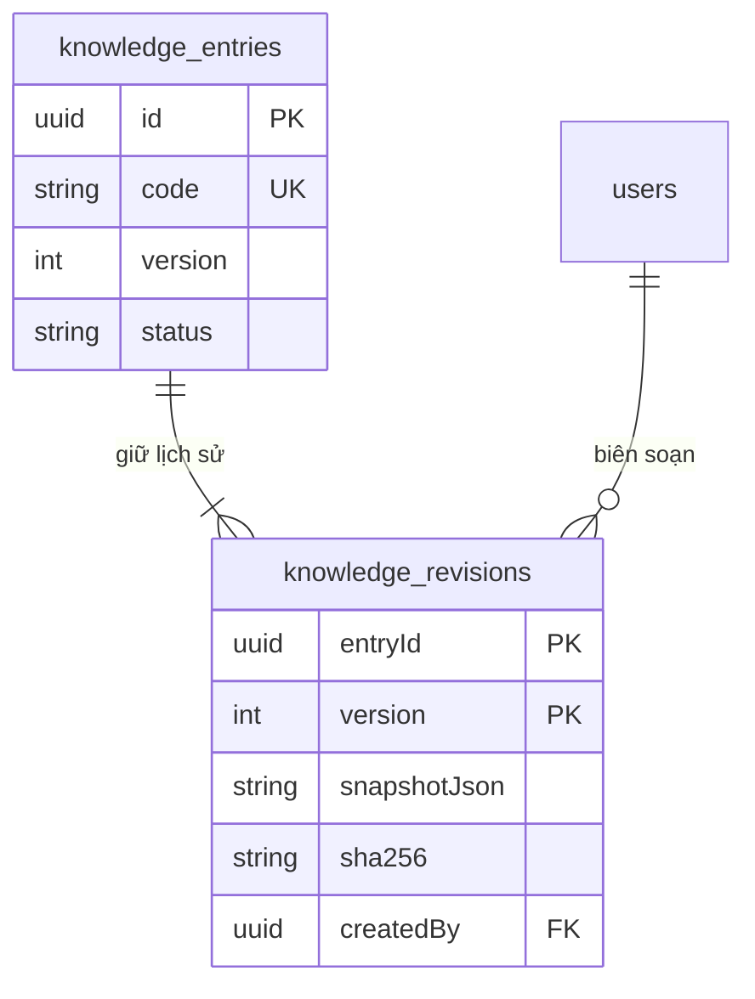

# M02 — Kho tri thức có phiên bản cho toàn bộ Agent

> Phạm vi đã duyệt trong [kế hoạch](tasks/plan.md). K01 xây nền lưu trữ và quyền; K02 thêm API/duyệt nội dung; K03 thêm UI; K04 mới kết nối retrieval. Không coi lưu được bản nháp là Agent đã sử dụng được tri thức.

## 1. Mục đích

Một hướng dẫn có thể phục vụ Mentor, Planner hoặc Reviewer; câu trả lời mẫu và rubric cần phạm vi hẹp hơn. Kho này giữ nội dung được biên soạn cùng nguồn và phiên bản. Nó không huấn luyện lại trọng số model, không tự nhập CV/bài nộp hoặc trace vào tài liệu đã duyệt, và không thay ngân hàng phỏng vấn hiện tại trong K01.

## 2. Hợp đồng K01

- Mã tài liệu ổn định, 2–80 ký tự thường/số/gạch dưới/gạch ngang; bắt đầu bằng chữ. Mã không đổi qua các revision.
- Loại: `qa`, `guide`, `exercise`, `solution`, `rubric`, `plan_template`, `communication`.
- Metadata: tiêu đề, mô tả ngắn, ngôn ngữ vi/en, độ khó tùy chọn, nghề liên quan (rỗng = dùng chung), tags, mục đích và nguồn.
- Mục đích: `interview`, `interview_evaluation`, `planning`, `code_review`, `mentoring`, `evaluation_assistance`, `recommendation`, `cv_screening`, `communication`. Đây là mục đích tri thức, không phải quyền được gọi tool hoặc danh sách Agent đã triển khai.
- Nội dung draft là object JSON hữu hạn, tối đa 80.000 ký tự sau chuẩn hóa; không chứa giá trị ngoài JSON, khóa gây prototype pollution hay cấu trúc sâu hơn 12 tầng. K02 kiểm schema Q&A/điều kiện publish riêng; lưu draft không chứng minh chất lượng nội dung.
- Nguồn có tên và URL HTTPS hoặc tham chiếu tài liệu. Hệ thống chỉ lưu trích dẫn; không tự tải URL. Không nhận URL chứa user/password. Draft cho phép chưa có nguồn để biên soạn tiếp; publish sẽ yêu cầu nguồn có ý nghĩa.

### Phân loại truy cập

| Audience | Ý nghĩa | Ví dụ |
|---|---|---|
| `student_safe` | Nội dung có thể đưa vào hỗ trợ sinh viên khi đúng scope | Hướng dẫn Git, cách đọc đề |
| `staff_only` | Tài liệu vận hành/quy trình nội bộ | Hướng dẫn lập kế hoạch |
| `grading_only` | Đáp án, lời giải, rubric dùng trong công việc chấm được cấp quyền | Q&A đầy đủ, đáp án mẫu, hidden rubric |

`qa`, `solution`, `rubric` bắt buộc `grading_only`. Mentor không có quyền đọc chúng. Nếu cần giải thích khái niệm cho sinh viên, biên soạn một `guide` riêng đã duyệt. Bản ghi thông tin nhạy cảm của một sinh viên không thuộc kho chung này.

K01 chỉ cho Admin hiệu lực đọc/ghi/lịch sử qua dịch vụ nội bộ; giảng viên và sinh viên bị từ chối trước khi tra tài liệu. Chưa có endpoint public hoặc tool retrieval. K02 thêm permission guard ở HTTP; K04 cấp scope ở server, lọc quyền/trạng thái trước ranking, không tin audience/actor do model hoặc trình duyệt tự khai.

## 3. Dữ liệu và trạng thái

Mỗi lần sửa tạo revision mới, gồm schema version, mã, version, status và toàn bộ metadata/nội dung. Current + revision + audit cùng một transaction; hai sửa cùng version chỉ một thành công, một nhận conflict. Audit tổng quát chỉ lưu mã/version/hash, không chép đáp án hoặc rubric.

Revision không có API sửa/xóa; SQL trigger chặn UPDATE/DELETE trực tiếp. SHA-256 xác minh snapshot nhất quán, không thay chữ ký bảo mật hoặc kiểm định chất lượng. Nghề trong draft được kiểm tồn tại ở catalog trong cùng transaction; archive nghề không xóa metadata cũ.

K02 áp dụng chu trình `draft → published → archived`; mọi lần sửa nội dung đưa current về draft và phải publish lại. Bản cũ vẫn giữ để các run đã chụp tham chiếu đọc đúng snapshot, nhưng không được dùng cho lượt retrieval mới chỉ vì từng published. Không xóa vật lý tài liệu đã dùng. Rollback nội dung sẽ tạo revision mới từ bản cũ, không quay lùi số version.

Migration chỉ tạo bảng/constraint/trigger/index, không seed hay sửa dữ liệu cũ. Down chỉ được phép khi kho còn rỗng; nếu có tài liệu thì dừng để bảo toàn. Không áp migration K01 lên DB chính trước khi kiểm thử xong và có kế hoạch kích hoạt.

## 4. Nghiệm thu theo lớp

| Lớp | Cần chứng minh | Trạng thái khi bắt đầu |
|---|---|---|
| K01 policy/unit | JSON/metadata hợp lệ; phân loại tài liệu chấm không bị hạ quyền; hash ổn định | Đạt local, 25 case |
| K01 SQL | Bảo toàn dữ liệu cũ; lưu/sửa/lịch sử; conflict; rollback transaction; quyền Admin; revision bất biến | Đạt local, có lifecycle K02; nguồn trong báo cáo |
| K02 API | Validation, quyền HTTP, nhiều đáp án đúng/rubric, publish/archive/restore/import dry-run | Đạt local + CI: 22 SQL/HTTP tổng cộng, thêm 15 unit publication; đã kích hoạt hai API, nguồn trong báo cáo |
| K03 UI | CRUD, preview, trạng thái Agent được dùng, tìm/lọc/history/keyboard | Đạt local + CI, kích hoạt runtime; [nguồn 24/10](docs/reports/knowledge-ui-20261024.md). Nêu rõ kho chưa nối vào Agent; không xóa vật lý revision |
| K04 retrieval | Chỉ nội dung đã duyệt, scope trước ranking, citation/version, chống lộ rubric và prompt injection | Cổng nội bộ đã đạt local: 13 policy + 8 SQL; [hợp đồng và giới hạn](docs/KNOWLEDGE-RETRIEVAL.md). CI/runtime G1 chưa chốt |

Các kết quả phải ghi lệnh, commit, giờ kiểm và nguồn log. Không dùng số test M01 để tick K01.

## 5. API biên soạn K02

Tất cả endpoint dưới `/api/v1/admin/knowledge`, yêu cầu đăng nhập và vai trò Admin hiệu lực. Permission HTTP phân tách đọc (`knowledge.read`), soạn/lưu trữ/khôi phục (`knowledge.manage`) và xuất bản (`knowledge.publish`). Cấp các permission này cho một role khác vẫn không vượt được kiểm vai trò Admin ở dịch vụ. Không có endpoint public trả đáp án/rubric.

| Method/path | Tác dụng |
|---|---|
| GET `/` | Metadata có phân trang/tìm/lọc; không trả body |
| GET `/:code` | Snapshot current cho Admin |
| GET `/:code/revisions` | Lịch sử có phân trang |
| GET `/:code/publication-check` | Kiểm bản đã lưu với validator publish; trả version/status/hash/khả năng xuất bản/lý do, không ghi dữ liệu và không yêu cầu manage |
| POST `/` | `{code,draft}` tạo draft version 1 |
| PUT `/:code` | `{version,draft}` tạo draft version tiếp theo |
| POST `/:code/publish` | `{version}`; kiểm chất lượng cấu trúc trước khi thêm revision published |
| POST `/:code/archive` | `{version}`; dừng dùng cho run mới, giữ lịch sử |
| POST `/:code/restore` | `{version,sourceVersion}`; chép bản cũ thành draft mới, cần publish lại |
| POST `/import/dry-run` | `{entries:[{code,draft},...]}` tối đa 50 mục; chỉ kiểm, không ghi/import/publish |

Khi publish, Q&A phải có câu hỏi, ý chính, **ít nhất hai cách trả lời đúng khác nhau**, ví dụ trả lời, lỗi phổ biến, gợi ý đào sâu, ví dụ chưa đạt và rubric. Rubric có 1–12 tiêu chí riêng biệt, trọng số nguyên dương tổng 100. Guide và nội dung bài tập/kế hoạch/liên lạc dùng markdown có ý nghĩa; rubric riêng có guidance và rubric cấu trúc. Mọi loại cần nguồn và metadata đủ đọc hiểu. Validation này không thay việc người duyệt kiểm chuyên môn; người publish được ghi trong revision/audit.

Dry-run báo lỗi theo hàng, mã trùng trong lô và mã đã có; không tự sửa metadata hoặc ghi đè tài liệu đã biên soạn. Kết quả dry-run không phải giấy phép bỏ kiểm khi lưu/publish: mỗi lần ghi đều kiểm version/quyền/dữ liệu lại.
