# Nghiệm thu ngày 26/10/2026 — đã có gì, còn thiếu gì?

Hệ thống local đang được nghiệm thu tiếp trên dữ liệu QA riêng. **Chưa kết luận hoàn tất mọi G, mọi luồng của ba vai hoặc redesign toàn hệ thống.** Mốc này thay thông tin “CI đang bị chặn billing” trong báo cáo ngày 25/10; báo cáo cũ vẫn là bằng chứng của thời điểm cũ.

## 1. Đọc kết quả theo đúng loại bằng chứng

| Loại kiểm tra | Kết quả đã có | Phạm vi và giới hạn |
|---|---|---|
| BE unit | **114 suites / 859 tests đạt**, lint file đổi và Nest build đạt | Source BE `91a9175a99555036e3fdd247e94146b875c9716f`; log local `live-authority-be-unit.log`, `review-authority-build.log` |
| FE unit | **106 files / 644 tests đạt**, typecheck, lint file đổi và production build đạt | Source FE `28cc4c1eb838d9e08f4f71f637e2df7b58cde38f`; log `live-frontend-unit.log`, `live-frontend-build-admin-draft.log` |
| Script contracts | **25 tests đạt** | Bao gồm chờ review đang chạy, không đổi kết quả failed/needs_changes thành đạt và chặn SHA đổi |
| SQL thật local | **9/9 tests đạt** | DB dùng một lần mới, RBAC thật; chỉ GitHub/runner/AI là fixtures trong suite SQL này. Không phải bằng chứng dịch vụ ngoài thật |
| SQL runtime mở rộng | **30/31 đạt; chưa đạt toàn bộ local** | Ba suite trên DB disposable đúng guard: replay sau provider outage vượt timeout 5 giây trong hai lượt local. Giữ nguyên timeout/assertion; không ghi 31/31. Gate SQL2019 của BE `91a9175` sẽ kiểm lại đúng source trên CI |
| CI cặp đã có receipt | **BE release + runner + FE quality + full-stack SQL2019 đạt** | Cặp BE `0b137cd` / FE `28cc4c1`; các link bên dưới. Bản sửa Agent `91a9175` phải được pin và chạy gate riêng; không dùng receipt cũ gán cho code mới |
| Bài QA riêng | **2/2 Playwright tests đạt** | Source của PR sửa được so khớp 6 blob/SHA với bài đã chạy local; đây là kiểm thử bài nộp, tách khỏi 644 tests FE |

CI có nguồn: [BE release](https://github.com/vanhoi04082006-pixel/V-Intern-BE/actions/runs/40221754231), [runner](https://github.com/vanhoi04082006-pixel/V-Intern-BE/actions/runs/40221754243), [FE quality](https://github.com/vanhoi04082006-pixel/V-Intern-FE/actions/runs/40225981150), [full-stack](https://github.com/vanhoi04082006-pixel/V-Intern-FE/actions/runs/40225981181). Hai PR tiếp tục cập nhật: [BE #12](https://github.com/vanhoi04082006-pixel/V-Intern-BE/pull/12), [FE #22](https://github.com/vanhoi04082006-pixel/V-Intern-FE/pull/22). Chưa merge bộ PR sản phẩm.

Các log local nằm trong `.runtime` của workspace; state, email gốc, CV và credential nằm riêng trong `manual-runtime`, không đưa vào Git. Tổng test ở các báo cáo ngày trước là baseline lịch sử, không phải số hiện hành.

## 2. Hành trình dịch vụ thật đã đi đến đâu?

CV tổng hợp được gửi qua API thật, Gmail nhận thư xác minh, thư lịch và thư tài khoản riêng. Agent thật phân tích CV, chọn Frontend và đặt lịch trong khung mở. Tài khoản QA đăng nhập bằng thông tin từ thư, hoàn thành 10 câu phỏng vấn; evaluator thật trả **91,8 điểm, đậu ở lượt 1**. LangSmith được đọc lại theo trace metadata; không coi trace local là trace đã tới dịch vụ ngoài.

Giảng viên tạo/phân công phiên, Agent lập kế hoạch và phát hành một Sprint có bốn task. Repo QA tạo dưới owner mặc định; sinh viên có quyền push nhưng không có admin. PR được kiểm tra đúng repo, author và SHA. Webhook HTTPS tạm có ping 200 và sự kiện PR được ghi nhận. Đây là nghiệm thu webhook của repo QA, không phải cấu hình webhook public thường trực cho toàn hệ thống.

```mermaid
flowchart LR
  A[CV và xác minh Gmail] --> B[Agent chọn role và lịch]
  B --> C[Phỏng vấn thật: 91,8]
  C --> D[Phiên và Sprint: 4 task]
  D --> E[Bài lỗi: Docker 1/2, AI 58,5]
  E --> F[Giảng viên trả bài trên UI]
  F --> G[PR sửa: Docker 2/2, AI 100]
  G --> H[AI vẫn inconclusive vì giới hạn source]
  H --> I[Giảng viên đối chiếu và duyệt thủ công 90]
  I --> J[Task đầu done; 3 task sau còn mở]
```

PR QA [bài lỗi #1](https://github.com/hbuivanhoi6-stack/vintern-so-tay-hoc-tap-ca-nhan-qa-live-frontend-notes-mvnvp-20261025-13df4e04/pull/1), [bản sửa #2](https://github.com/hbuivanhoi6-stack/vintern-so-tay-hoc-tap-ca-nhan-qa-live-frontend-notes-mvnvp-20261025-13df4e04/pull/2), [task lưu trữ #3](https://github.com/hbuivanhoi6-stack/vintern-so-tay-hoc-tap-ca-nhan-qa-live-frontend-notes-mvnvp-20261025-13df4e04/pull/3). Bản sửa chỉ được merge vào repo bài QA sau khi kiểm tra giảng viên đã duyệt và SHA còn khớp; việc này không merge FE/BE.

Task lưu trữ tiếp theo đã qua Docker **1/1** và Agent **98,5**, không findings/limitations, trạng thái `awaiting_instructor`. Bước nộp task này qua API; kết quả đã mở xem trên UI sinh viên. Trước đó đã phát hiện JSON model sai định dạng và một lượt xin đọc quá ngân sách; cả hai lượt lỗi vẫn được giữ. Bản sửa dùng cùng Zod/JSON Schema cho provider–server và ràng buộc quyết định theo số lượt tool còn lại. Không tăng ngân sách hai lần đọc, không sửa chuỗi JSON hoặc bỏ finding để đạt. Giảng viên chưa được tính đã duyệt task này khi chưa lưu quyết định.

### Vì sao AI 100 mà vẫn chưa tự kết luận đạt?

Điểm và độ đầy đủ bằng chứng là hai thông tin khác nhau. Collector đọc source có giới hạn 30.000 byte/tệp, 20 tệp và tổng dung lượng; lockfile QA 37.717 byte vượt giới hạn. Sau khi sửa hỗ trợ `.cjs/.mjs`, hai tệp test/config đã đọc được, nhưng lockfile vẫn chưa được Agent đọc. Không bỏ cảnh báo hoặc đổi validator để có kết quả xanh.

Giảng viên thử duyệt thường bị chặn. Nhánh thủ công sau đó ghi rõ: đã so khớp sáu blob/SHA, kiểm tra 72 package khóa có integrity, chạy local Playwright 2/2 và trusted runner 2/2; chỉ chấm ba tiêu chí của task đầu. Audit giữ lý do này. **AI vẫn inconclusive; điểm chính thức 90 là quyết định của giảng viên.** Đây là bằng chứng nhánh chấm thủ công có kiểm soát, không phải AI tự duyệt hoặc bằng chứng ba task sau đã đạt.

## 3. Những thao tác đã click trên UI

| Vai | Đã thao tác và quan sát | Chưa được suy ra |
|---|---|---|
| Sinh viên | Login, dashboard thấy Sprint/task; mở bài nộp, đọc lỗi và liên kết dòng code; gửi bình luận; nhận bài trả lại; nộp PR sửa qua form; xem Docker/Agent và retry | Chưa kiểm hết mọi tab, mọi trạng thái tuyển dụng và outcomes trên UI mới |
| Giảng viên | Login, dashboard → phiên → task; xem rubric/runner; trả bài 58,5; kiểm tra chặn duyệt thiếu bằng chứng; duyệt 90 với lý do; task chuyển done | Chưa chấm xong bốn task hoặc hoàn thành phiên mới |
| Admin | Login bằng bootstrap QA, dashboard, health refresh, trạng thái tích hợp/Agent, thử JSON sai và hợp lệ ở bản nháp seal, mở hàng đợi email | Không sửa role, credential, bộ seal hoặc dữ liệu thật chỉ để nghiệm thu; chưa kiểm hết 28 route Admin |

Ảnh và state UI riêng được lưu trong `manual-runtime/final-integration-20261025`. Mở được trang và click một số hành động không tương đương đã nghiệm thu toàn bộ vai.

## 4. Lỗi đã sửa trong vòng này

1. Schema CV cho provider khớp validator; correction giới hạn, không tự bỏ citation sai.
2. Auto review sau khi sinh viên nộp dùng đúng mentor server chọn, kiểm tra active/RBAC/phạm vi phiên; không cấp quyền staff cho sinh viên. Provenance giữ riêng người yêu cầu và actor giảng viên.
3. Collector đọc module `.cjs/.mjs` với cùng giới hạn và lọc credential. Prompt version lưu trong review khớp version dùng khi gọi Agent.
4. Fixture hết hạn email không còn phụ thuộc ngày cố định; test vẫn chặn mail hết hạn, double click và nguy cơ gửi trùng.
5. Full-stack chờ background review kết thúc bằng GET trước khi khẳng định trạng thái; giữ assertion inconclusive, SHA và nhánh override có audit.
6. FE giải thích lỗi thiếu bằng chứng/thiếu giảng viên thay thông báo 409 chung. Admin parse đúng phản hồi bản nháp có `stored:false`, không đòi `source` của cấu hình đã lưu.
7. Nhãn SMTP trong cấu hình local được đồng bộ theo SMTP ngoài hiện dùng; không đổi credential. Cấu hình hiện diện/SMTP accepted vẫn không tự chứng minh thư tới Inbox.
8. `code-review-v3` gửi JSON Schema được sinh từ validator; bước quyết định Agent biết số lượt đọc còn lại, schema chỉ cho `final` khi hết lượt. Server vẫn từ chối hành động xin đọc vượt budget. Lượt chấm thật task lưu trữ đã trả kết quả hợp lệ sau sửa.

## 5. Việc còn phải hoàn thành

- Hoàn tất ba task tiếp theo, đánh giá cuối, kết thúc phiên, KPI/lương ảo/chứng nhận và các bản xuất trong hành trình QA mới; phân biệt bước click UI với API.
- Kiểm lại lifecycle invitation/mời lại bằng dịch vụ thật cho hành trình mới. Quyền push hiện hữu không thay bằng chứng đã gửi/nhận invitation mới.
- Đối chiếu ngoại lệ trễ/no-show/hết lượt/miễn trừ/thay người với ma trận G và evidence đúng loại.
- Chốt gate của cặp code cuối, đồng bộ các trang hướng dẫn liên quan và review bộ PR trước merge.
- Redesign mới chưa triển khai toàn diện. FE inventory hiện 78 route; [manifest route/asset](https://github.com/vanhoi04082006-pixel/V-Intern-FE/blob/codex/g7-live-frontend/tasks/ui-route-asset-manifest.md) ghi rõ nhóm trang, icon/minh họa, tương tác và tiêu chí nghiệm thu. Không đổi trang chủ `/`.

Hai database chính và ba tài khoản trắng gốc được giữ; không lặp reset. Chỉ chạy local. Không gộp các phần còn mở thành một tuyên bố “đã hoàn thiện tất cả”.
