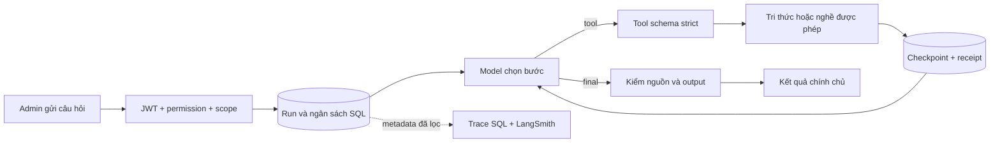
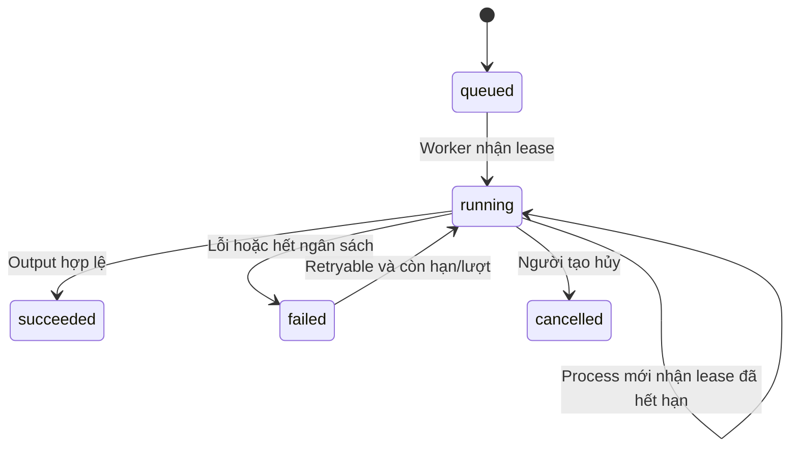

# Hiểu và vận hành Agent G1

G1 đưa **một Agent trợ lý tri thức chỉ đọc** vào Backend. Agent chọn công cụ, đọc kết quả, quyết định bước tiếp theo và trả lời kèm nguồn. Trạng thái nằm trong SQL Server để tiến trình API có thể khởi động lại mà vẫn giữ lượt đang làm.

Các AI phỏng vấn, chấm code, lập kế hoạch và tư vấn cũ vẫn giữ service/quy tắc hiện tại. Chúng được chuyển lần lượt ở G2; thêm SDK không tự biến mọi AI thành Agent. [Báo cáo G1](reports/agent-foundation-20261024.md) ghi rõ từng loại bằng chứng và giới hạn.

## 1. Theo dõi một ví dụ từ đầu đến cuối

Admin đã xuất bản hướng dẫn Git dành cho sinh viên. Admin hỏi: “Trước commit nên kiểm tra gì?”. Server kiểm JWT, permission `knowledge.read`, trạng thái tài khoản và nghề đã chọn. Model có thể chọn `knowledge_search`, đọc hướng dẫn được phép rồi trả lời với nguồn `k:ma-tai-lieu@version`.

Nếu không có tài liệu phù hợp, câu trả lời phải nói rõ thiếu bằng chứng. Nếu model chọn shell/email/GitHub hoặc bịa nguồn, Backend từ chối quyết định đó. Nội dung câu hỏi/tài liệu không thể cấp thêm quyền.



## 2. Agent được đọc những gì?

| Tool | Model truyền gì? | Server quyết định gì? |
|---|---|---|
| `knowledge_search` | Query tối đa 1.000 ký tự | Actor đăng nhập, consumer, purpose, nghề đã chọn và quyền hiện tại |
| `career_role` | Không có tham số | Chỉ nghề đã chọn lúc tạo run, chỉ bản published |

Agent G1 dùng consumer `knowledge-assistant`, purpose `mentoring`, tài liệu `student_safe` thuộc loại guide/exercise. Nó không đọc Q&A chấm thi, solution, rubric ẩn hoặc dữ liệu riêng của sinh viên khác. Scope cho các consumer khác nằm ở [KNOWLEDGE-RETRIEVAL](KNOWLEDGE-RETRIEVAL.md).

Kết quả tool có mã/version/SHA-256/tiêu đề và reference hoặc URL nguồn. ID trong nội dung tool và manifest cùng dùng một dạng canonical để model không nhầm UUID DB với ID trích dẫn. URL chỉ là thông tin nguồn; Agent không tự tải URL. Tài liệu được xem là dữ liệu tham khảo, không phải system instruction, kể cả khi đã publish.

## 3. Thử qua HTTP

Các đường dẫn sau nằm dưới `/api/v1`. Dùng access token của **Admin**; G1 chưa thêm màn hình Agent cho sinh viên/giảng viên.

| Thao tác | Endpoint | Kết quả |
|---|---|---|
| Tạo run | `POST /admin/agents/knowledge-runs` | 202: run đã lưu; xử lý nền |
| Theo dõi | `GET /admin/agents/knowledge-runs/:id` | 200: trạng thái và output chính chủ |
| Hủy | `POST /admin/agents/knowledge-runs/:id/cancel` | 200: ngăn các bước tiếp theo |
| Chạy tiếp lỗi tạm thời | `POST /admin/agents/knowledge-runs/:id/resume` | 202 nếu retryable/còn hạn/còn lượt; ngược lại 409 |

Body tạo run:

```json
{
  "requestId": "436a9711-58cf-4fbf-bd86-4e816ecdd87f",
  "question": "Trước khi commit, git status và git diff dùng làm gì?",
  "roleCode": "frontend"
}
```

Client tạo `requestId` là UUID. Khi retry cùng yêu cầu, dùng lại ID và giữ nguyên nội dung để nhận đúng run cũ. Cùng ID nhưng đổi nội dung trả `AGENT_REQUEST_CONFLICT`. Câu hỏi mới cần UUID mới. `roleCode` có thể bỏ trống; thêm nghề published không cần mở rộng enum trong Agent.

Body không được chứa `actorId`, tool list hoặc permission. Đọc run của Admin khác trả 404. API không trả input gốc, system prompt, receipt nội bộ hoặc lease owner. Kết quả có `status`, `steps`, `attempts`, usage, `errorCode`, `retryable` và `output`.

Output thành công gồm `answer`, `insufficientEvidence` và `citations`. Nếu chưa có tri thức phù hợp, `insufficientEvidence=true` là kết quả hợp lệ. `succeeded` nghĩa là workflow đã hoàn thành hợp lệ, không có nghĩa mọi câu hỏi đều được giải đáp đầy đủ. HTTP 202 chỉ xác nhận tiếp nhận, chưa chứng minh hoàn thành.

## 4. Trạng thái và phục hồi



| Giới hạn | Giá trị và cách hiểu |
|---|---|
| Thời hạn run | 2 phút từ lúc tạo; không gia hạn khi restart/resume |
| Bước model/tool | Tối đa 8 |
| Tool calls | Tối đa 3 |
| Token reservation | Tối đa 64.000; tính bảo thủ theo UTF-8 byte, gồm phần dành cho retry |
| Output mỗi lần gọi model | Tối đa 768 token |
| Retry provider | Tối đa 1 lần thêm; cấu hình hiện hành có thể giới hạn thấp hơn |
| Worker claims | Tối đa 3 cho cùng run |
| Lease | 60 giây, gia hạn mỗi 10 giây |
| Recovery scan | Mỗi 15 giây ở runtime; tắt trong test để kiểm chủ động |

Reservation khác usage thật. `inputTokens`/`outputTokens` cộng usage provider báo; thiếu số liệu vẫn giữ null. Không suy ra chi phí chính xác từ reservation.

Checkpoint giữ quyết định/observations đã hoàn tất. Receipt giữ kết quả theo run/callKey; worker cũ mất lease không được ghi tiếp. Sau restart, scanner nhận queued run hoặc run có lease hết hạn. Nếu run đã hết thời hạn, hệ thống đánh dấu lỗi thay vì tiếp tục vô hạn.

Hủy không thu hồi được request đã gửi tới provider và provider có thể vẫn tính phí. Kết quả đến muộn không được tiếp tục tool hay ghi thành công vào run đã hủy. Model có thể bị gọi lại nếu process chết trước khi ghi checkpoint. Không tuyên bố exactly-once cho model hoặc HTTP bên ngoài. G1 chỉ cấp tool đọc; SQL effect và receipt có thể cùng transaction cho tool tương lai phù hợp.

## 5. Đọc lỗi để xử lý đúng

| Mã/nhóm mã | Ý nghĩa và hướng xử lý |
|---|---|
| `AGENT_INPUT_INVALID` | Kiểm UUID, độ dài, nghề và trường thừa |
| `AGENT_REQUEST_CONFLICT` | UUID đã dùng cho nội dung khác; dùng ID mới nếu là câu hỏi mới |
| `AGENT_RUN_BUSY` | Worker khác đang giữ lease; theo dõi run hiện tại |
| `AGENT_RUN_EXPIRED` / `AGENT_TIMEOUT` | Hết thời hạn; kiểm latency/provider trước khi tạo yêu cầu mới |
| `AGENT_STEP_BUDGET` / `AGENT_TOKEN_BUDGET` / `AGENT_TOOL_BUDGET` | Vượt giới hạn; không tăng budget để che vòng lặp |
| `AGENT_TOOL_FORBIDDEN` / `AGENT_DECISION_INVALID` | Tool hoặc schema model không hợp lệ; không thực thi |
| `AGENT_NO_EVIDENCE` / `AGENT_CITATION_REQUIRED` / `AGENT_CITATION_INVALID` | Chưa có tool result/nguồn hợp lệ; không trình bày như đã chứng minh |
| `AGENT_SCOPE_DENIED` | Quyền/scope không còn hợp lệ trong lúc chạy |
| `AI_PROVIDER_RATE_LIMITED` | Chỉ resume khi run ghi retryable và còn hạn/lượt |
| `AI_PROVIDER_UNAVAILABLE` | Provider thiếu cấu hình, từ chối hoặc không khả dụng; không dùng câu trả lời giả |

Schema, nguồn bịa, quyền và ngân sách không được tự retry. Bản ghi lỗi chỉ có mã an toàn; không đưa lỗi thô của provider cho client/cloud.

## 6. Cấu hình LangSmith và bảo vệ dữ liệu

Nhập key bằng script tương tác; không đưa key vào source/screenshot/chat:

```powershell
.\scripts\configure-langsmith.ps1 -Region US -WorkspaceId '<workspace-uuid>' -Project vintern-local-g1
```

Script lưu `.env` local đã được Git ignore. `LANGSMITH_TRACING=false` giữ SDK auto tracing tắt; `AGENT_LANGSMITH_ENABLED=true` bật adapter allowlist. Graph còn tắt auto tracing trong AsyncLocalStorage của lượt chạy.

Cloud chỉ nhận correlation/version, status, model ID hợp lệ, số lượng, usage/latency, mã lỗi và hash tri thức. Không gửi câu hỏi, answer, nội dung tool, raw CV, actor/email, password, API key hoặc token GitHub. Nếu cloud lỗi, trace SQL vẫn còn; delivery event ghi accepted/error code an toàn.

Region/workspace phải khớp key. HTTP 403 chưa đủ kết luận key hỏng khi thiếu Workspace ID. Adapter chuẩn hóa UUID chữ thường và dotted order/parent hierarchy để LangSmith nhận trace từ SQL Server. Khi đọc bằng SDK API v2, truyền project ID và `selects`; mặc định chỉ trả ID.

**Checkpoint, input/output và receipt local có nội dung công việc để resume.** Chúng cần quyền SQL và chính sách lưu trữ phù hợp; redaction cloud không có nghĩa mọi bảng local chỉ chứa metadata.

## 7. Tìm đúng file để sửa hoặc kiểm lại

| Phần | File/thư mục |
|---|---|
| Prompt/schema/allowlist/budget | `src/agents/definitions/knowledge-assistant.definition.ts` |
| Graph và phục hồi | `src/agents/runtime/agent-runtime.service.ts` |
| Tools/citation IDs | `src/agents/runtime/knowledge-agent.tools.ts` |
| Run/lease/receipt/budget | `src/agents/runtime/agent-state.store.ts` |
| SQL checkpointer | `src/agents/runtime/sql-agent-checkpointer.ts` |
| Trace/LangSmith | `src/agents/runtime/agent-telemetry.service.ts` |
| HTTP/DTO/module | `src/agents/agents.controller.ts`, `agents.module.ts` |
| DB schema | Migration `CreateAgentRuntime1762982400000` |
| Eval guards | `src/agents/eval/knowledge-agent.holdout.spec.ts` |
| SQL/HTTP/process restart | `test/agent-*.e2e-spec.ts`, `test/fixtures/agent-process.cjs` |

Trước package manager/test/build, chạy script storage trong cùng PowerShell theo [LOCAL-DEVELOPMENT](LOCAL-DEVELOPMENT.md). E2E chỉ dùng database disposable; không reset/seed hai DB đang dùng. Sau migration kiểm lại count, identity và readiness.

Eval guard không thay đánh giá chất lượng model trên nhiều nội dung. 11 ca live là mốc nghiệm thu ban đầu; xem rubric, nguồn và các lần thử thất bại trong [báo cáo](reports/agent-foundation-20261024.md).
