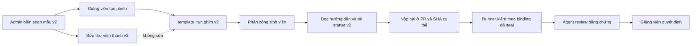

# Bàn giao G2 — thư viện bài nhỏ và Agent nghiệp vụ

Đọc chương này nếu bạn cần hiểu **một tài liệu được dùng thế nào trong một lượt Agent**, hoặc muốn thêm bài tập mà không đổi đề sinh viên đang làm. G2 hoàn thiện mẫu nhỏ, tài liệu công khai/riêng và chuyển bảy chức năng AI hiện hữu qua runtime Agent. Tiếp nhận CV, lịch tuyển dụng, email và xử lý vi phạm thuộc các giai đoạn tiếp theo; G2 không tự cung cấp những luồng đó.

## 1. Một ví dụ xuyên suốt

Giảng viên chọn **Sổ ghi chú học tập**. Sinh viên nhận module Node.js nhỏ, dữ liệu giả và test công khai. Starter cố ý còn `TODO`: nhiệm vụ của sinh viên là hoàn thành hàm, giữ input bất biến và kiểm chứng quy tắc. Không cần đăng ký cloud, cài database hoặc dựng một ứng dụng lớn.

Admin có thể sửa mẫu sau khi phiên đã bắt đầu. Phiên cũ vẫn giữ phiên bản ban đầu. Sinh viên tải gói theo **phân công của mình**, không theo phiên bản mới nhất của thư viện. Lời giải và hidden checks được lưu ở đường riêng dành cho người chấm.



## 2. Ba thư viện khác nhau

| Thư viện | Lưu gì? | Dùng vào việc gì? |
|---|---|---|
| Nghề nghiệp | Mã nghề, tên, kỹ năng, trạng thái tuyển | Chọn nghề và kiểm tính hợp lệ; không cấp quyền RBAC |
| Tri thức Agent | Q&A nhiều hướng trả lời đúng, hướng dẫn, bài tập, rubric, nguồn, audience/purpose | Retrieval có quyền trước khi xếp hạng; bản nháp không được dùng |
| Dự án mẫu | Blueprint, Sprint/task/dependency, starter và assessment riêng | Khởi tạo phiên học; snapshot giữ đề đã giao |

“Nuôi Agent” là cung cấp tài liệu đã duyệt và công cụ đọc có giới hạn. Đây **không phải fine-tune trọng số model**. Nội dung CV, câu trả lời, README hay code sinh viên là dữ liệu tham khảo, không được biến thành lệnh cấp quyền hoặc tự xuất bản.

## 3. Bộ bài nhỏ có sẵn

| Mã | Bài tập | Hành vi đáng kiểm |
|---|---|---|
| MINI-NOTES-V1 | Sổ ghi chú học tập | Chuẩn hóa title, ID duy nhất, tìm kiếm và không sửa input |
| MINI-TASKS-V1 | Bảng việc cá nhân | Chuyển trạng thái đúng bước, lặp trạng thái và validation |
| MINI-CART-V1 | Giỏ hàng mô phỏng | Giá lấy từ catalog; quantity/stock; tổng nguyên an toàn |
| MINI-ROSTER-V1 | Danh sách lớp nhỏ | Chuẩn hóa mã, chống trùng khác hoa/thường, email theo hợp đồng |
| MINI-BOOKING-V1 | Lịch đặt chỗ nhỏ | Giới hạn chỗ, trùng lịch và các cạnh thời gian |
| MINI-BLOG-V1 | Bài viết nhỏ | Nháp/xuất bản, nội dung hợp lệ và chuyển trạng thái |

Mỗi bài có phạm vi 1–2 Sprint, 3–6 task, khoảng 3–7 ngày. Thực thi chính xác đọc trong `src/templates/mini-project-domains.ts`; tiêu chí runner đọc ở `grading-runner/`. Tên mã giữ `V1` để nhận diện họ bài; **version trong database** mới là phiên bản nội dung cần ghim.

Trong gói starter:

```text
README.md                 Hợp đồng hàm, phạm vi và cách bàn giao
package.json              Lệnh chạy; không kéo dependency ngoài
src/model.cjs             Các hàm còn TODO
demo.cjs                  Xem đề / chạy dữ liệu minh họa
test/acceptance.test.cjs   Kiểm thử công khai
data/sample.json          Dữ liệu giả
```

```powershell
node demo.cjs
node demo.cjs --run
node --test test/acceptance.test.cjs
```

Lệnh đầu giới thiệu hợp đồng. Hai lệnh sau có thể đỏ hoặc exit 2 khi starter chưa hoàn thành. Sau khi làm bài chúng phải thành công; test công khai xanh chưa tự động chứng minh hidden runner đã chạy hay giảng viên đã duyệt.

## 4. Public và private được tách ở đâu?

| Thành phần | Public | Chấm riêng |
|---|---|---|
| Schema | `learningPackage` | `assessment` |
| Nội dung | prerequisites/setup/run/starterFiles/sampleData | solutionFiles/hiddenTestFiles/rubric/taskSuites |
| Lưu trữ | definition và public revision/snapshot | `project_template_assessments` theo template + version |
| Quyền | Staff xem thư viện; sinh viên chỉ gói của phân công chính chủ | Vai trò staff **và** `templates.assessment.read/manage` |
| Download | ZIP chỉ gồm file public | Không gộp vào starter |

File chỉ được preview như văn bản. Các đường dẫn tuyệt đối, `..`, `.git`, `.env`, tên thiết bị Windows, trùng tên không phân biệt hoa/thường và xung đột file/thư mục bị chặn. Giới hạn số file/kích thước nằm ở `template-package.ts`. API không thực thi code từ nội dung authoring.

`taskSuites.digest` là metadata tác giả cung cấp. Nó **không tự cấp trusted binding**. Operator vẫn phải seal bộ kiểm thử với repository, task, spec hash và image digest theo [hướng dẫn runner](architecture/grading-runner.md).

## 5. Một lượt Agent thực sự diễn ra thế nào?

```mermaid
sequenceDiagram
  participant D as Domain service
  participant A as BusinessAgentEngine
  participant M as Gemini
  participant T as context_bundle
  participant S as SQL state
  D->>A: input đã xác thực, actor/resource, validator
  A->>S: request hash, lease và checkpoint
  A->>M: Chọn truy vấn bằng schema quyết định
  M-->>A: tool + query
  A->>T: Kiểm quyền actor/resource lại
  T-->>A: Tài liệu published đúng purpose/audience/version/hash
  A->>S: Receipt công cụ
  A->>M: Tạo kết quả nghiệp vụ cùng nguồn được phép
  M-->>A: Structured output
  A->>A: Validator cũ; không nới quy tắc
  A->>S: Kết quả, model, usage và trạng thái thật
  A-->>D: Kết quả đã kiểm; domain quyết định ghi nghiệp vụ
```

Model phải chọn công cụ ít nhất một lần. Chỉ có `context_bundle`, với một đối số `query`; model không được chọn actor, tài nguyên, audience hoặc quyền. Tối đa hai lượt đọc, tám bước dự trù và deadline SQL có fencing. Kết quả dùng `sourceManifest` để liệt kê mã/version/hash đã thật sự đọc. Tài liệu vẫn là dữ liệu không đáng tin, kể cả khi được đưa vào context.

| Agent | Feature giữ tương thích | Phạm vi đọc |
|---|---|---|
| interview-conversation | interview_conversation / interview_clarification | Buổi phỏng vấn chính chủ; tài liệu student_safe |
| interview-evaluator | recruitment-evaluation | Đúng buổi; rubric được phép cho chấm |
| project-planner | sprint-plan | Dự án/phiên staff quản lý; xuất draft |
| code-reviewer | code_review | Bài nộp thuộc dự án/phiên được review |
| learning-mentor | ai-mentor | Hội thoại active chính chủ; không private answers |
| performance-advisor | recommendation | Sinh viên chính chủ hoặc Admin được cấp quyền |
| instructor-assistant | evaluation-assistance | Đánh giá thuộc người chấm/phạm vi được quản lý |

Luật điểm dưới 50 / 50–70 / trên 70, tổng ba lượt phỏng vấn, validation kế hoạch và quyết định giảng viên giữ ở domain. Agent không tự sửa KPI, publish Sprint, finalize điểm, gửi email hay mời GitHub.

## 6. State, retry và quan sát lỗi

`agent_runs` chứa định danh và trạng thái. Checkpoint LangGraph, pending writes và `agent_tool_receipts` nằm trong SQL. Hash phát hiện payload bị sửa; lease/fencing ngăn hai worker cùng chốt kết quả. Cùng intent và context có thể đọc lại kết quả đã hoàn tất. Nếu provider lỗi tạm thời, thử lại cùng intent khôi phục checkpoint và receipt thay vì tự tạo tác vụ mới. Input/prompt/schema thay đổi là context khác.

Business Agent chạy cùng lời gọi nghiệp vụ; nó không có endpoint công khai để tùy chọn scope. Worker phục hồi nền của G1 chỉ nhận `knowledge-assistant`. Endpoint knowledge-runs cũng chỉ đọc/hủy/resume đúng loại đó. Không dùng endpoint G1 để lấy output private của Agent khác.

Trace cloud chỉ gửi metadata cho phép: agent/version, model, latency, token, hash nguồn, trạng thái và mã lỗi. Không gửi prompt, câu trả lời, CV, code, thông tin đăng nhập hoặc exception thô. Bản ghi local có receipt chuyển trace; cloud lỗi không được ghi là thành công giả. Chưa có outbox tự gửi lại trace bị mất hoặc retention/purge tự động.

Admin mở **Cấu hình AI → Agent & lượt chạy** để xem bảy định nghĩa, prompt version, run ID, model thực, token, bước, tool calls và lỗi. Có lọc Agent/trạng thái, phân trang và làm mới. `GET /admin/agents/business-runs` yêu cầu `settings.read` cùng vai trò Admin hiệu lực; response không chứa input/output hoặc tool body. Bảng không tự gọi model và không tự tạo dữ liệu mẫu khi chưa có lượt chạy.

## 7. Cài nội dung vào local mà giữ dữ liệu đang có

Trước npm/build/test bằng PowerShell trên workspace hiện tại:

```powershell
& E:\Projects\V-INTERN\manual-runtime\Use-ProjectStorage.ps1
cd 'E:\Projects\V-INTERN\V-INTERN-BE'
npm run seed:g2-content
npm run seed:g2-content -- --apply
```

Không có `--apply` thì chỉ preview. Lệnh apply thêm sáu mẫu nếu chưa có, nâng assessment của bản bundled v1 **chưa bị sửa**, và publish 18 tài liệu curated đi kèm source. Đây là thao tác operator cho nội dung đã kiểm trong repo, không xuất bản tự động nội dung do model mới sinh. Code đã tồn tại thuộc tác giả: seed giữ nguyên, kể cả draft/archived. Chạy lần hai không thêm revision. Nếu một lần lỗi giữa draft và publish, kiểm bản nháp trong Admin; seed không tự ghi đè bản đó.

Không reset database để cài thư viện. Không tự thay bài của template_run đã khởi tạo. Không đưa `.env`, credential hoặc file vận hành riêng vào Git.

## 8. Tìm code và kiểm chứng

| Muốn thay đổi | Bắt đầu đọc |
|---|---|
| Thêm/sửa một bài | `templates/mini-project-domains.ts`, catalog, assessments và faulty variants |
| Quy tắc package/private/version | `templates/template-package.ts`, `template-revisions.store.ts` |
| Phạm vi sinh viên tải gói | `TemplatesService.ownLearningPackage` |
| Map feature → Agent | `agents/definitions/business-agents.ts` |
| Quyền tài nguyên | `agents/runtime/business-agent-scope.service.ts` |
| Workflow/checkpoint | `business-agent-engine.ts`, `sql-agent-checkpointer.ts` |
| Đọc tri thức | `knowledge-retrieval.service.ts`, `knowledge-retrieval.policy.ts` |
| Test nghiệp vụ Agent | `test/business-agent.e2e-spec.ts`, holdouts/resources trong fixtures |
| Nghiệm thu provider thật | `test/business-agent-live.cjs` — opt-in, tạo SQL test mới, có chi phí API |

Test nhanh `npm test`; SQL theo hướng dẫn [kiểm thử](TESTING.md). CI tách database của business Agent và retrieval khỏi suite kiểm kho ban đầu rỗng. Không chạy chúng cùng DB rồi sửa assertion để né dữ liệu giao nhau.

[Báo cáo G2](reports/g2-completion-20261024.md) ghi số liệu, giờ, source, CI và giới hạn. Phân biệt unit, SQL/provider fixture, Docker chạy thật và Gemini/LangSmith thật; không cộng các loại bằng chứng thành một con số “tổng test”.
