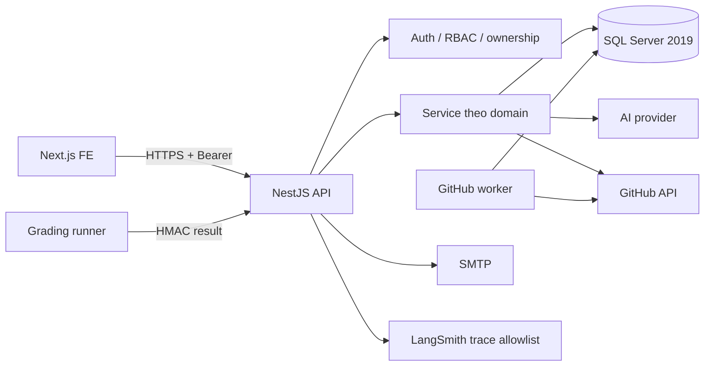
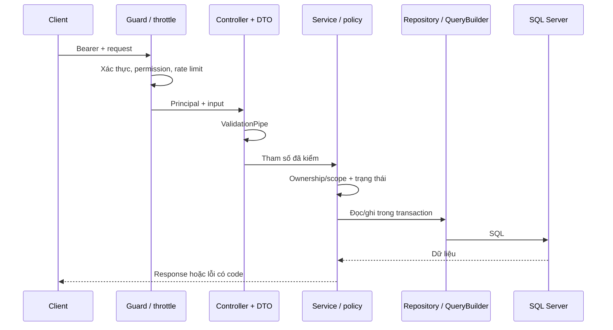
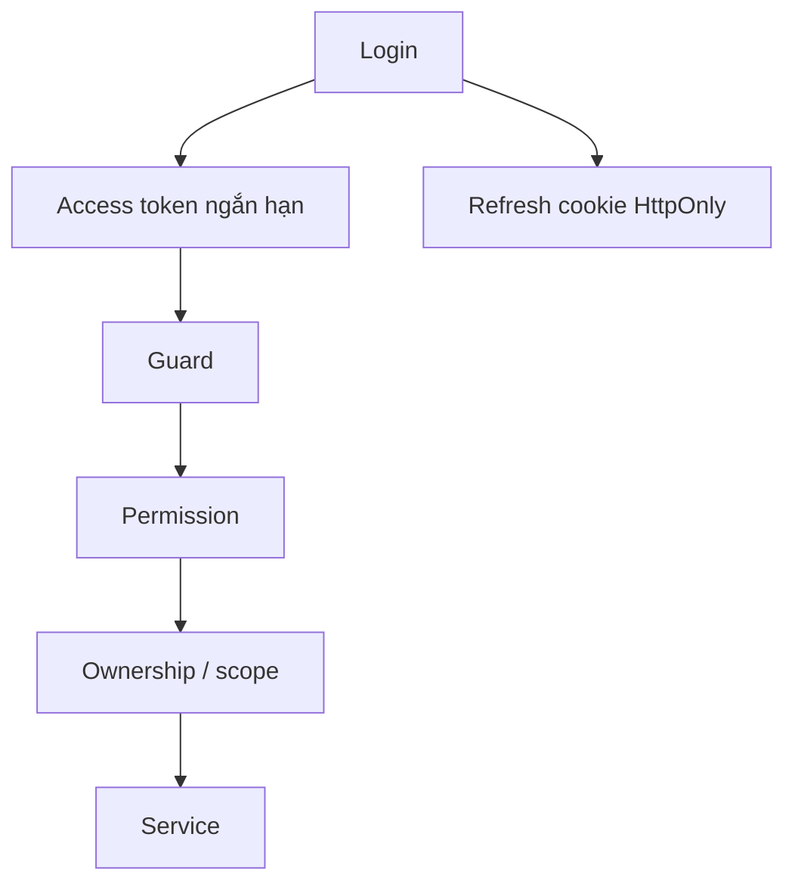

# Kiến trúc Backend

Tài liệu này mô tả **cách hệ thống được lắp ghép**. Quan hệ dữ liệu chi tiết nằm ở [domain-model](architecture/domain-model.md); từng nghiệp vụ nằm trong `docs/architecture/`.

## 1. Bối cảnh



| Thành phần | Vai trò |
|---|---|
| NestJS API | HTTP, xác thực, policy, transaction, read model |
| SQL Server | Nguồn dữ liệu chuẩn, migration có version |
| Worker | Tạo repo, lời mời, đồng bộ GitHub; chạy nền, có lease |
| Grading runner | Chạy test trong container cách ly, ký kết quả |
| AI provider | Sinh nội dung/đề xuất; không có quyền chốt |
| SMTP | Email hồ sơ/lịch hẹn; không phải kênh quyết định |

## 2. Process và cấu hình khởi động

`src/main.ts` cấu hình:

- Global prefix `api`, URI versioning mặc định `1` → route nghiệp vụ `/api/v1/...`.
- `ValidationPipe` với whitelist + forbid unknown fields.
- CORS allowlist có credentials; không wildcard.
- JSON body limit; cookie parser; helmet.
- Swagger tại `/api/docs`.

`AppModule` gom các module domain, cấu hình TypeORM, guard toàn cục và bootstrap. Không thêm logic nghiệp vụ vào `main.ts`.

## 3. Một request đi qua đâu?



| Lớp | Trách nhiệm | Không nên chứa |
|---|---|---|
| Guard | Authentication, permission thô, throttle | Điều kiện nghiệp vụ theo bản ghi |
| Controller | Route, DTO, mapping response | Transaction, policy phức tạp |
| Service/policy | Ownership, trạng thái, công thức, transaction | HTTP status chi tiết |
| Repository/entity | Truy vấn, quan hệ, kiểu dữ liệu | Quyết định quyền |
| Migration | Schema/constraint/index | Logic runtime |

**Kiểm tra tối thiểu cho endpoint mới:** DTO → authentication → permission → quyền trên bản ghi → trạng thái → transaction → response → test.

## 4. Module map

| Nhóm | Module | Trách nhiệm |
|---|---|---|
| Danh tính | `auth`, `users`, `rbac`, `groups` | Đăng nhập, token, vai trò, permission, nhóm |
| Nền | `common`, `config`, `database`, `health` | Guard, decorator, lỗi, config, entity, migration |
| Tuyển dụng | `recruitment`, `applications`, `career-roles`, `catalogs` | Bài thi, câu hỏi, CV, lịch, nghề nghiệp |
| Dự án | `templates`, `projects`, `sessions`, `assignments` | Mẫu, phiên bản, phiên, đội hình, phân công |
| Công việc | `sprints`, `tasks`, `submissions`, `participation` | Kế hoạch, Kanban, bài nộp, thời hạn |
| AI | `ai`, `ai-generation`, `agents` | Provider, structured output, Mentor, agent runtime |
| GitHub | `github`, `code-review` | OAuth, repo, lời mời, webhook, snapshot, review |
| Kết quả | `evaluation`, `performance`, `kpi`, `salary`, `certificates`, `reports` | Điểm, chỉ số, KPI, ledger, chứng nhận, snapshot |
| Vận hành | `notifications`, `audit`, `admin`, `dashboard`, `communications`, `settings` | Thông báo, audit, quản trị, read model |
| Tích hợp | `knowledge`, `intern`, `scripts` | Kho tri thức, workspace own, seed/audit |

Chi tiết file: [CODE-MAP](CODE-MAP.md).

## 5. Xác thực và phân quyền



- Access token chứa principal; không chứa toàn bộ quyền nghiệp vụ.
- Permission lấy theo role/principal; có thể đổi mà không cần đăng nhập lại.
- **Ownership/scope** là lớp thứ hai: giảng viên có `tasks.view` vẫn chỉ đọc task trong project/session được giao.
- API `own` lấy user từ token; client không gửi `internId` để đọc bài người khác.
- Refresh token rotation/revocation; cookie invalid thì fail closed.
- Webhook dùng HMAC; runner dùng signing key riêng.

Chi tiết: [SECURITY](SECURITY.md).

## 6. Dữ liệu và transaction

- Entity mô tả mô hình; migration mô tả chuyển đổi schema. Không sửa migration đã chạy.
- Transaction gom thay đổi phải cùng thành công (assignment + membership, publish plan + task).
- Optimistic version (`expectedVersion`) phát hiện ghi đè.
- Idempotency (`requestId`, ledger key) chặn tạo trùng khi retry.
- Lease/fencing cho worker; không giữ khóa SQL trong lúc chờ HTTP provider.
- Snapshot cho đề bài, SHA bài nộp, báo cáo, chứng nhận.

Ba loại dữ liệu phải phân biệt:

1. **Live** — trạng thái hiện tại, thay đổi theo quy tắc.
2. **Append-only history** — chuyển trạng thái, ledger, audit.
3. **Snapshot** — nội dung tại thời điểm ghi.

Chi tiết: [domain-model](architecture/domain-model.md), [MIGRATION_POLICY](database/MIGRATION_POLICY.md).

## 7. Tác vụ nền và tích hợp

| Luồng | Cơ chế | Bất biến |
|---|---|---|
| Tạo repo/lời mời GitHub | Worker + lease, batch giới hạn | Không tạo trùng; không đổi owner cũ |
| Refresh GitHub token | Single-flight/khóa | Không dùng refresh token cũ sau rotate |
| AI generation | Job + status + retry hữu hạn | Không tự áp điểm/chuyển Done |
| Grading | Runner riêng + HMAC | Chỉ nhận evidence đúng task/suite/SHA |
| Notifications | Sự kiện + dispatch | Retry không nhân đôi tác dụng |
| Reports | Snapshot + scope | Sửa dữ liệu hiện tại không đổi report cũ |

Nguyên tắc: **HTTP/provider ra ngoài, transaction ngắn trong DB**. Lỗi provider không được biến thành kết quả nghiệp vụ giả.

## 8. Lỗi và response

```json
{
  "statusCode": 409,
  "code": "TASK_DEPENDENCIES_PENDING",
  "message": "Thông điệp mô tả điều kiện chưa đạt",
  "traceId": "tham-chiếu-tra-log",
  "details": { "blockedBy": [] }
}
```

- Dùng HTTP status đúng nghĩa; không trả 200 cho thao tác chưa hoàn tất.
- `code` ổn định để FE xử lý; `message` cho người dùng; `details` có cấu trúc.
- Không trả stack trace, SQL, token hoặc PII.
- Validation lỗi trả field-level; conflict trả trạng thái hiện tại nếu contract cho phép.

## 9. Cấu hình và secret

- `.env` là cấu hình máy; `.env.example` là danh sách mẫu.
- Secret không commit, không log, không trả API.
- AI key, GitHub secret, webhook secret, runner signing key là các secret **riêng**.
- Đổi JWT secret ảnh hưởng phiên; đổi encryption key ảnh hưởng dữ liệu đã mã hóa.
- Cấu hình có thể khác giữa API chính/QA; không suy DB từ `.env` khi dùng launcher.

Chi tiết: [CONFIGURATION](CONFIGURATION.md).

## 10. Kiểm thử theo tầng

| Tầng | Kiểm gì | Không kiểm gì |
|---|---|---|
| Unit | Policy, calculator, parser, guard | SQL/HTTP/provider thật |
| SQL/HTTP E2E | DTO/guard/service/transaction | Provider thật nếu bị override |
| Runner | Container, policy, HMAC | Mọi framework/pipeline |
| Live | OAuth/provider/PR/Docker thật | Toàn bộ mọi nhánh |

Không cộng các tầng thành một con số. Chi tiết: [TESTING](TESTING.md).

## 11. Bất biến kiến trúc

1. AI không cấp quyền, không chốt điểm, không tự Done.
2. Client không quyết định scope; service luôn kiểm tra lại.
3. Không chạy code không tin cậy trong process API.
4. Không sửa migration đã chạy; không sửa snapshot lịch sử.
5. Không fallback dữ liệu giả khi provider lỗi.
6. Không log/trả secret hoặc PII.
7. Không dùng DB chính để test phá hủy.

## 12. Đọc tiếp

- [CODE-MAP](CODE-MAP.md) — tìm file/module.
- [api/README](api/README.md) — gọi API.
- [domain-model](architecture/domain-model.md) — quan hệ dữ liệu.
- [SECURITY](SECURITY.md) — ranh giới tin cậy.
- [TESTING](TESTING.md) — chọn bằng chứng.
