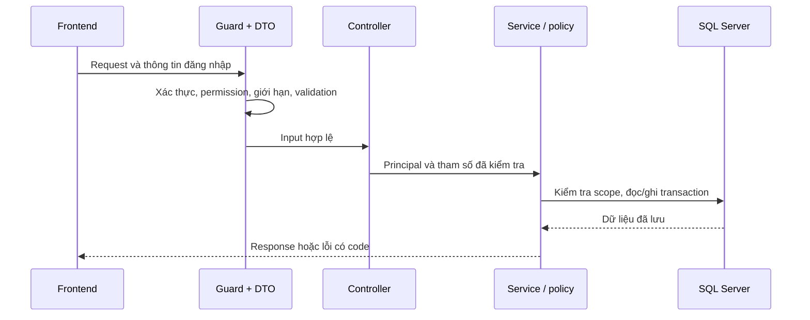

# Tìm đường trong source backend

## Một request đi qua những đâu?

Controller xác định endpoint, DTO và permission. Service xử lý nghiệp vụ và scope. Policy/calculator chứa quy tắc có thể kiểm thử độc lập. Entity/migration xác định cách dữ liệu được lưu. Đọc đủ bốn lớp trước khi sửa một luồng.

## Bản đồ module

| Thư mục | Khi nào mở? |
|---|---|
| `auth`, `users`, `rbac`, `groups` | Đăng nhập, token, danh tính và quyền |
| `common` | Guard, decorator, error contract và helper dùng chung |
| `recruitment` | Bắt đầu bài, câu hỏi, đáp án, số lượt, kết quả tuyển dụng |
| `templates` | Thư viện blueprint và tạo run từ mẫu |
| `sessions`, `projects`, `assignments`, `classes` | Phiên, ownership, roster và phân công |
| `sprints`, `tasks`, `submissions` | Trạng thái công việc, bài nộp, rubric và phê duyệt |
| `ai`, `ai-generation` | Provider, structured output, Mentor, gợi ý, draft/confirm |
| `github`, `code-review` | OAuth, repo, webhook, source snapshot, review job/evidence |
| `sharing` | Xin và cấp quyền xem snapshot theo thời hạn |
| `evaluation`, `performance`, `kpi`, `salary` | Đánh giá chính thức, chỉ số, KPI và ledger |
| `certificates`, `reports` | Chứng nhận và các bản báo cáo đã lưu |
| `notifications`, `audit`, `admin`, `dashboard` | Sự kiện, cảnh báo, giám sát và read model |
| `database` | Entity registry, data source và lịch sử migrations |

## Cách đọc một lỗi cụ thể

Ví dụ kéo task bị chặn bởi phụ thuộc:

1. Tìm error code `TASK_DEPENDENCIES_PENDING` bằng `rg`.
2. Đọc policy/service đưa ra điều kiện chặn.
3. Đọc DTO và controller của endpoint đang gọi để hiểu quyền và input.
4. Đọc test tương ứng để biết cả trường hợp đúng và trường hợp bị từ chối.
5. Đối chiếu task/spec/assignment thực tế, không xóa phụ thuộc chỉ để thao tác đi qua.

## Cách thay đổi an toàn

Thay công thức: sửa calculator/policy và test biên. Thay API: sửa DTO/controller, response mapping, FE adapter và tài liệu cùng lúc. Thay schema: thêm migration mới, không sửa migration đã chạy. Thay prompt: tăng prompt version và kiểm tra schema output; giữ provenance của kết quả cũ.

Mỗi thay đổi nên có một ví dụ trước/sau, một ca bị chặn vẫn phải bị chặn và một kiểm thử chứng minh hành vi mong muốn. [TESTING](TESTING.md) giải thích khi nào cần unit, SQL E2E hoặc thử tích hợp thật.

## Nhánh Git trong workspace

FE và BE là hai repository, có lịch sử nhánh riêng. Kiểm tra từng repository bằng `git status --short`, `git branch -vv` và `git log --graph --oneline --all`. Tên nhánh không chứng minh một thay đổi đã được merge; dùng ancestry/commit thực tế.

Khi working tree đang có việc chưa commit, không reset, clean hoặc checkout để thử làm gọn. Nhánh `archive/*` giữ lịch sử phục hồi, không phải bản chạy chính. Không xóa nhánh chỉ vì remote đã mất. Tài liệu nghiệm thu ghi rõ branch, HEAD và dirty state để người tiếp nhận biết code được kiểm tra là bản nào.
