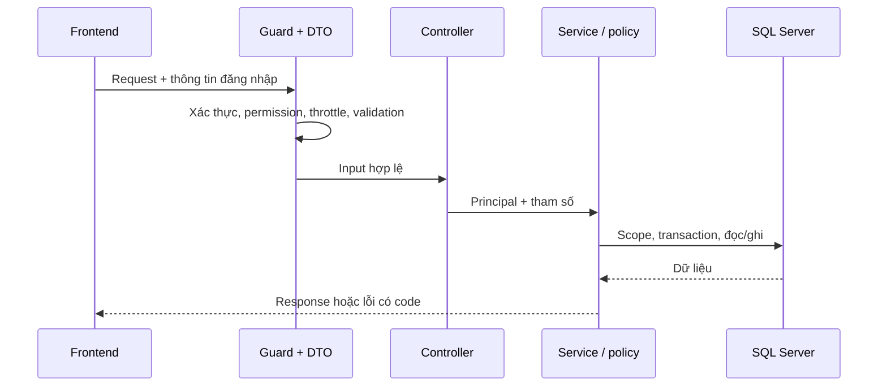

# Bản đồ code Backend

Mục tiêu: từ một triệu chứng hoặc yêu cầu, tìm đúng **controller → DTO → service/policy → entity/migration → test** mà không đoán.

## 1. Một request đi qua những đâu?



Đọc đủ bốn lớp trước khi sửa một luồng: **controller** (endpoint/DTO/permission), **service** (nghiệp vụ/scope), **policy/calculator** (quy tắc thuần), **entity/migration** (lưu trữ).

## 2. Bản đồ module

| Thư mục | Khi nào mở? |
|---|---|
| `src/auth`, `users`, `rbac`, `groups` | Đăng nhập, token, danh tính, vai trò, permission |
| `src/common` | Guard, decorator, error contract, helper dùng chung |
| `src/config` | Đọc/validate biến môi trường |
| `src/database` | Entity registry, data source, migration |
| `src/recruitment` | Bắt đầu bài, câu hỏi, đáp án, lượt, kết quả tuyển dụng |
| `src/applications`, `career-roles`, `catalogs` | CV, lịch hẹn, nghề nghiệp, danh mục |
| `src/templates` | Blueprint, revision, tạo run từ mẫu |
| `src/projects`, `sessions`, `assignments` | Phiên, ownership, roster, phân công |
| `src/sprints`, `tasks`, `submissions` | Trạng thái công việc, bài nộp, rubric, phê duyệt |
| `src/ai`, `ai-generation`, `agents` | Provider, structured output, Mentor, gợi ý, draft/confirm |
| `src/github`, `code-review` | OAuth, repo, webhook, snapshot, review job/evidence |
| `src/evaluation`, `performance`, `kpi`, `salary` | Đánh giá chính thức, chỉ số, KPI, ledger |
| `src/certificates`, `reports` | Chứng nhận, báo cáo snapshot |
| `src/notifications`, `audit`, `admin`, `dashboard` | Sự kiện, cảnh báo, giám sát, read model |
| `src/knowledge` | Kho tri thức, retrieval, import/export |
| `src/intern` | API `own` cho sinh viên |
| `src/health` | Health check |
| `src/scripts` | Bootstrap/seed/audit — không phải runtime API |
| `test/` | E2E, SQL spec, fixture, harness |
| `grading-runner/` | Worker chấm code tách biệt |

## 3. Tìm theo loại thay đổi

| Muốn đổi | Mở ở đâu | Kiểm gì |
|---|---|---|
| Endpoint/DTO | `*.controller.ts`, `dto/` | Guard, permission, validation, response |
| Công thức điểm/KPI | `*.calculator.ts`, `*policy*.ts` | Test biên, null/0, snapshot cũ |
| Quyền/scope | Guard + service | own/managed/foreign, user bị khóa |
| Trạng thái task/sprint | Service + policy | Transition hợp lệ, phụ thuộc, version |
| Schema | `src/database/entities`, `migrations/` | Migration mới, rollback, schema audit |
| Prompt/AI schema | `src/ai`, `ai-generation` | Prompt version, validator, provenance |
| GitHub | `src/github`, `code-review` | OAuth/state, token, SHA, webhook HMAC |
| Runner | `grading-runner/`, `code-review` | Suite đúng task, HMAC, cleanup |
| Notification | `src/notifications` | Retry idempotent, scope người nhận |
| Báo cáo | `src/reports` | Snapshot, scope, PDF/XLSX |
| Cấu hình | `src/config/configuration.ts`, `.env.example` | Default, validation, secret |

## 4. Đọc một lỗi cụ thể

Ví dụ kéo task bị chặn bởi phụ thuộc:

1. Tìm error code `TASK_DEPENDENCIES_PENDING` bằng `rg`.
2. Đọc policy/service đưa ra điều kiện chặn.
3. Đọc DTO/controller của endpoint đang gọi để hiểu quyền và input.
4. Đọc test tương ứng để biết cả trường hợp đúng và bị từ chối.
5. Đối chiếu task/spec/assignment thực tế; không xóa phụ thuộc để thao tác đi qua.

Lệnh tìm nhanh:

```powershell
rg "TASK_DEPENDENCIES_PENDING" src test
rg "expectedVersion" src
rg "class .*Controller" src
rg "CREATE TABLE|ALTER TABLE" src/database/migrations
```

Với tìm theo cấu trúc cú pháp, dùng `ast-grep` thay vì regex chuỗi.

## 5. Thay đổi an toàn

| Loại | Quy tắc |
|---|---|
| Công thức | Sửa calculator/policy + test biên; giữ kết quả lịch sử |
| API | Sửa DTO/controller, response mapping, FE adapter và tài liệu cùng lúc |
| Schema | Thêm migration mới; không sửa migration đã chạy |
| Prompt | Tăng prompt version; kiểm schema output; giữ provenance |
| Quyền | Thêm test own/managed/foreign và user bị khóa |
| Runner | Giữ HMAC bind đúng request + suite; không nới validation |

Mỗi thay đổi nên có: một ví dụ trước/sau, một ca bị chặn vẫn bị chặn, một test chứng minh hành vi mong muốn.

## 6. Test ở đâu?

| Loại | Vị trí | Chạy |
|---|---|---|
| Unit | `src/**/*.spec.ts` | `npm test` |
| E2E HTTP/SQL | `test/*.e2e-spec.ts` | `npm run test:e2e` |
| SQL/migration | `test/*.sql-spec.ts` | Cấu hình riêng trong `test/jest-e2e.json` |
| Runner | `grading-runner/*.test.*` | `cd grading-runner && npm test` |

Đọc [TESTING](TESTING.md) trước khi thêm suite; E2E cần DB riêng và có thể yêu cầu baseline.

## 7. Nhánh Git trong workspace

FE và BE là hai repository, lịch sử riêng. Kiểm tra từng repo:

```powershell
git status --short
git branch -vv
git log --graph --oneline --all
```

Tên nhánh không chứng minh đã merge; dùng ancestry/commit thực tế. Khi working tree có việc chưa commit, không reset/clean/checkout để thử làm gọn. Nhánh `archive/*` giữ lịch sử phục hồi, không phải bản chạy chính.

## 8. Đọc tiếp

- [ARCHITECTURE](ARCHITECTURE.md) — bức tranh tổng thể.
- [domain-model](architecture/domain-model.md) — quan hệ dữ liệu.
- [api/README](api/README.md) — hợp đồng HTTP.
- [TESTING](TESTING.md) — chọn bằng chứng.
