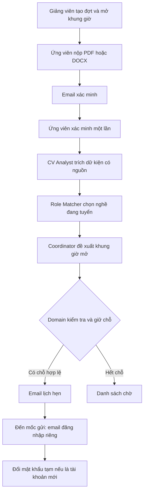
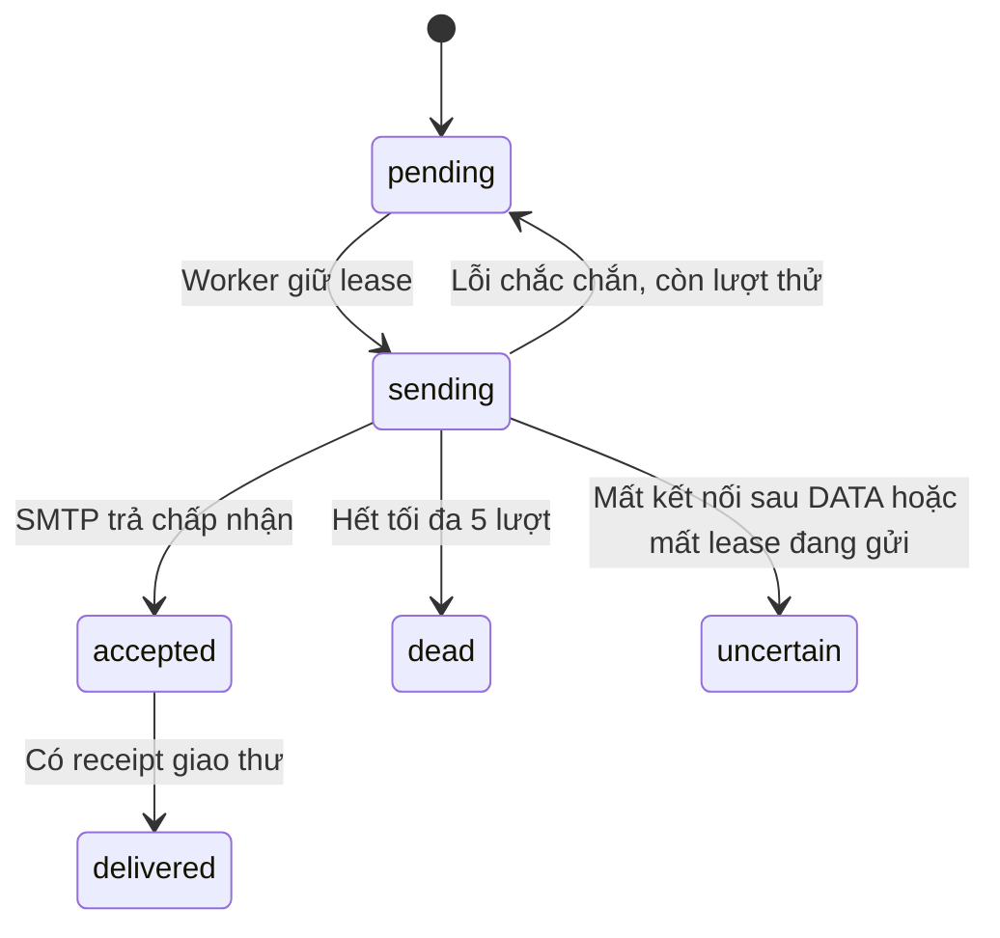

# Nhận CV, chọn nghề và xếp lịch phỏng vấn

Tài liệu này giúp người tiếp nhận hiểu G3 từ thao tác trên giao diện đến cách hệ thống xử lý bên trong. G3 bổ sung cổng nhận CV và lịch hẹn; các quy tắc bắt đầu đúng lịch, vắng quá 15 phút thuộc G4. Không dùng trạng thái G3 để suy ra G4 đã hoàn tất.

## Đọc theo nhu cầu

| Bạn muốn làm gì? | Đọc phần nào? |
|---|---|
| Mở một đợt nhận CV | Chuẩn bị một đợt tuyển |
| Nộp và theo dõi hồ sơ | Hành trình của ứng viên |
| Hiểu vì sao Agent chọn nghề | Ba Agent phối hợp thế nào |
| Chạy thử email trên máy | Vận hành local |
| Sửa lỗi hồ sơ hoặc email | Xử lý các tình huống thường gặp |
| Bảo trì, viết tính năng tiếp | Cấu trúc code và hợp đồng API |

## Toàn bộ hành trình



Ví dụ: giảng viên mở lịch Frontend lúc 09:00 ngày mai, sức chứa hai người. CV có đoạn nêu dự án React/TypeScript. Analyst giữ nguyên câu trích và số trang; Matcher đối chiếu nghề đang tuyển; Coordinator chọn trong các lịch đã mở. Backend kiểm tra lại sức chứa trong transaction. Nếu người khác vừa giữ chỗ cuối, ứng viên được đưa vào danh sách chờ. Agent không tự tạo thêm lịch.

## Chuẩn bị một đợt tuyển

1. Admin hoặc giảng viên vào **Tuyển dụng & hồ sơ CV** (`/admin/recruitment-rounds` hoặc `/instructor/recruitment-rounds`).
2. Tạo đợt, ghi tên dễ nhận biết và thời gian nhận hồ sơ.
3. Thêm khung giờ theo nghề, giờ bắt đầu/kết thúc, múi giờ và sức chứa.
4. Kiểm tra nghề đã xuất bản, đang nhận ứng viên và đủ câu hỏi để phỏng vấn: sáu chuyên môn, hai giới thiệu, hai tiếng Anh.
5. Mở đợt rồi gửi đường dẫn `/apply` cho ứng viên.

Thời gian chuẩn bị mặc định là 60 phút; email đăng nhập mặc định được xếp trước lịch 30 phút. Có thể cấu hình khi mở khung giờ. Giờ gửi credential phải nằm trong khoảng chuẩn bị; API từ chối lịch quá khứ hoặc cấu hình không hợp lệ. Dữ liệu được lưu theo UTC và có múi giờ để diễn giải lịch.

Giảng viên quản lý hồ sơ thuộc đợt của mình. Admin có thể quản lý toàn hệ thống. Quyền `applications.manage` phải đi kèm vai trò staff hợp lệ; chỉ có tên quyền không đủ để truy cập hồ sơ.

## Hành trình của ứng viên

Ứng viên chưa cần tài khoản. Tại `/apply`, chọn đợt đang mở, nhập họ tên/email, tải CV và đồng ý cho xử lý hồ sơ. Mỗi email chỉ có một hồ sơ trong cùng đợt. Hãy kiểm tra email trước khi nộp.

CV nhận PDF/DOCX tối đa 5 MB. Đổi đuôi một file khác thành PDF không làm file hợp lệ. Hệ thống kiểm tra định dạng thật và đọc trong tiến trình có giới hạn bộ nhớ, thời gian, dung lượng giải nén và văn bản. Hai tiến trình đọc được chạy đồng thời; nếu đang bận, giao diện báo để người dùng thử lại. PDF scan chưa có lớp chữ sẽ được yêu cầu bổ sung; tính năng hiện tại không tuyên bố hỗ trợ OCR.

Email xác minh chứa liên kết dùng một lần, hạn 24 giờ. Khi xác minh thành công, trình duyệt giữ một cookie HttpOnly để theo dõi đúng hồ sơ trong bảy ngày. Token được xóa khỏi thanh địa chỉ sau khi xử lý. Nếu đổi trình duyệt hoặc hết phiên theo dõi, dùng chức năng yêu cầu lại liên kết bằng đúng đợt/email; phản hồi không tiết lộ email có tồn tại hay không.

Trang theo dõi hiển thị các mốc: đã nhận, đã xác minh, đang phân tích, cần bổ sung, đang chờ lịch hoặc đã có lịch. Khi được yêu cầu bổ sung, ứng viên nộp lại CV tại chính hồ sơ; hệ thống giữ phiên bản xử lý mới, không tạo một ứng viên thứ hai.

## Ba Agent phối hợp thế nào?

| Agent | Nhận thông tin gì? | Được đề xuất gì? | Điều Backend kiểm tra lại |
|---|---|---|---|
| `cv-analyst` | Văn bản CV theo trang/đoạn, tri thức được phép | Kỹ năng, thông tin còn thiếu, confidence | Mỗi câu trích phải tồn tại nguyên văn ở nguồn đã nêu |
| `role-matcher` | Dữ kiện đã kiểm, nghề đang tuyển | Một nghề hoặc chưa đủ cơ sở | Nghề phải nằm trong danh sách cho phép; dẫn chứng phải trỏ tới facts thật |
| `interview-coordinator` | Nghề phù hợp và khung giờ mở | Một khung giờ hoặc chờ | Lịch còn mở, đủ chuẩn bị, còn chỗ và đúng nghề |

Đây là các graph chạy qua runtime Agent chung: quyết định → công cụ `context_bundle` → quyết định → kết quả có schema. Checkpoint SQL hỗ trợ phục hồi và giới hạn bước/token; nguồn tri thức được lọc theo audience/purpose/role. Trích dẫn CV là dữ liệu, không phải lệnh cho Agent.

Giảng viên mở chi tiết hồ sơ để xem confidence, lý do chọn nghề và câu trích theo trang/đoạn. Confidence là mức tự tin của đề xuất, không phải điểm phỏng vấn hoặc bảo đảm ứng viên sẽ đậu. Dữ kiện ít thì hệ thống yêu cầu bổ sung; không bịa kỹ năng còn thiếu.

## Hai email và tài khoản

Email thứ nhất thông báo lịch hẹn, nghề và thời gian. Email thứ hai chỉ đến mốc đã cấu hình mới gửi thông tin đăng nhập. Việc tách mail giúp ứng viên biết lịch sớm nhưng hạn chế thời gian lưu hành mật khẩu tạm.

Với email chưa có tài khoản, Backend sinh mật khẩu ngẫu nhiên, chỉ lưu hash trong `users`; phần cần gửi được mã hóa AES-GCM trong hàng đợi. Lần đăng nhập đầu buộc đổi mật khẩu. Mật khẩu tạm hết hạn sau khi khung phỏng vấn kết thúc 24 giờ. Đổi mật khẩu tăng `authVersion` và thu hồi refresh token; access token cũ cũng mất hiệu lực.

Với tài khoản sinh viên đã tồn tại, hệ thống dùng lại đúng danh tính, không đổi mật khẩu, không đặt lại lượt phỏng vấn. Mail hướng dẫn dùng tài khoản hiện có. Tài khoản không phù hợp, đã đậu, đang có phiên phỏng vấn hoặc hết lượt không được tự tạo lịch mới để lách chính sách.

Khi đổi/hủy lịch, các mail cũ chưa gửi bị vô hiệu hóa. Nếu mail đang gửi, thao tác thay lịch bị chặn để tránh hai thông báo mâu thuẫn. Chức năng **Gửi lại thông tin đăng nhập** chỉ thử lại payload còn hợp lệ của booking hiện tại; không âm thầm sinh mật khẩu khác. Sau khi mail đã được chấp nhận, payload nhạy cảm được xóa, nên không thể đọc lại mật khẩu qua Admin.

## Vận hành local

Chạy trong thư mục BE, sau khi đã áp dụng migration bổ sung và chuẩn bị `.env` riêng:

```powershell
& ..\manual-runtime\Use-ProjectStorage.ps1
& .\scripts\configure-local-mail.ps1 -EnableWorkers
node .\scripts\local-smtp-sink.cjs
```

Lệnh Node chạy SMTP sink ở foreground; để cửa sổ đó hoạt động trong khi thử. Khởi động lại API để đọc cấu hình. SMTP nghe tại loopback cổng 2525; xem mail tại `http://localhost:8025`. Sink không chuyển mail ra Gmail/Outlook, giữ tối đa 100 thư trong bộ nhớ và xóa sau 24 giờ; dừng tiến trình sẽ mất inbox thử. Không dùng CV thật hoặc credential thật làm minh chứng công khai.

| Cấu hình | Ý nghĩa |
|---|---|
| `PUBLIC_WEB_ORIGIN` | Origin FE dùng để tạo CTA; không lấy từ nội dung CV |
| `MAIL_ENCRYPTION_KEY` | Khóa base64 32 byte riêng cho mail, không dùng lại JWT/GitHub key |
| `MAIL_WORKER_ENABLED` | Bật worker gửi mail; mặc định tắt |
| `APPLICATION_WORKER_ENABLED` | Bật xử lý CV đã xác minh; mặc định tắt |
| `SMTP_*` | Kết nối máy chủ mail; plain chỉ được dùng loopback ở non-production |
| `MAIL_DELIVERY_MODE=local` | Cho UI biết đang thử mail local |
| `CV_STORAGE_DIR` | Kho CV riêng; để trống dùng `.runtime/cv` trong BE |

Không đổi khóa mã hóa khi còn mail chờ mà chưa có kế hoạch xử lý. Không commit `.env`, file CV, inbox hoặc mật khẩu vào Git. Workspace hiện tại yêu cầu mọi file runtime/cache nằm trong folder dự án; xem [chạy local](LOCAL-DEVELOPMENT.md).

## Hiểu đúng trạng thái email



`accepted` chỉ có nghĩa máy chủ SMTP đã nhận. Nó không chứng minh hộp thư người nhận đã nhận thư. Nhánh `delivered` cần tích hợp receipt có bằng chứng; G3 hiện chưa tạo receipt giao thư bên ngoài. Local sink không tạo bằng chứng email thật bên ngoài. Với `uncertain`, hệ thống không tự gửi lại vì có thể thư đã đi; người quản trị phải xem bằng chứng và xác nhận nguy cơ trùng khi thử lại. Các payload nhạy cảm hết TTL vẫn được dọn ngay cả khi chưa cấu hình SMTP.

## Xử lý các tình huống thường gặp

| Dấu hiệu | Cách kiểm tra và xử lý |
|---|---|
| Nộp CV xong nhưng chưa chạy Agent | Kiểm tra đã xác minh, worker bật và API đã restart; xem timeline trước khi bấm thử lại |
| Hồ sơ nằm danh sách chờ | Xem nghề sẵn sàng, lịch còn mở/đủ chuẩn bị/sức chứa; thêm lịch rồi thử xử lý lại |
| Cần bổ sung dù đã tải PDF | PDF có thể chỉ là ảnh scan; nộp PDF có lớp chữ hoặc DOCX hợp lệ |
| Không tạo được khung giờ | Kiểm tra giờ tương lai, múi giờ, khoảng chuẩn bị và đủ câu hỏi của nghề |
| Không thấy email trong Gmail | Chế độ local chỉ có inbox 8025; không chuyển thư ra ngoài |
| Mail `uncertain` | Đối chiếu sink/provider; Admin quyết định gửi lại và xác nhận khả năng thư trùng |
| Không gửi lại được credential | Payload đã bị xóa/hết hạn, booking đổi hoặc mail đang gửi; không reset mật khẩu để né lỗi |
| Trình duyệt không còn thấy hồ sơ | Yêu cầu liên kết mới theo đợt/email; không dùng ID hồ sơ người khác |

## Cấu trúc code và hợp đồng API

| Nơi đọc code | Trách nhiệm |
|---|---|
| `src/applications/applications.service.ts` | Nhận/xác minh/theo dõi/bổ sung và quyền truy cập CV |
| `cv-storage.ts`, `scripts/extract-cv.cjs` | Kho file riêng và parser subprocess có giới hạn |
| `recruitment-rounds.service.ts` | Đợt tuyển, slot, ownership và readiness |
| `intake-agents.service.ts` | Ba Agent và kiểm schema/nguồn |
| `application-workflow.service.ts` | Claim hồ sơ, lease, retry và phục hồi |
| `interview-bookings.service.ts` | Giữ chỗ, identity, hai mail, đổi/hủy lịch |
| `src/communications/` | Template, outbox, SMTP, preview và resend |
| `src/auth/temporary-password.policy.ts` | Hạn mật khẩu tạm và giới hạn phiên cần đổi mật khẩu |

API dùng prefix `/api/v1`. Các thao tác công khai gồm `GET /applications/rounds`, `POST /applications` (multipart field `cv`), `POST /applications/verify`, `POST /applications/request-access`, `GET /applications/me`, `GET/POST /applications/me/cv`. Chỉ cookie ứng viên hợp lệ mới xem/tải/bổ sung được hồ sơ của chính mình.

Nhóm `/recruitment-rounds` dành cho staff: tạo/xem đợt, thêm/đóng slot, danh sách/chi tiết/download CV, retry/cancel/reschedule và `resend-credentials`. Các endpoint đều xác minh phạm vi đợt. `/admin/communications` cung cấp trạng thái/preview/resend mail với quyền quản trị riêng. `/auth/change-password` yêu cầu mật khẩu hiện tại và mật khẩu mới, không phải endpoint reset tùy ý.

## Kiểm chứng và phần nối tiếp

Các kiểm thử nằm ở `test/applications.sql-spec.ts`, `test/communications.sql-spec.ts`, `test/applications-migration.sql-spec.ts` và các unit spec cùng thư mục source. Browser harness nằm ở `scripts/g3-acceptance-harness.cjs` (BE) và `scripts/g3-applications-live.mjs` (FE). Chúng chỉ dùng dữ liệu QA trên DB dùng một lần.

Kết quả nghiệm thu và giới hạn cập nhật trong [báo cáo G3](reports/g3-completion-20261024.md). Khi đọc bằng chứng, phân biệt model deterministic với provider thật, SMTP local với hộp thư ngoài, migration đã áp dụng với runtime đang chạy. G4 tiếp tục dùng booking này để khóa role, mở phòng đúng giờ và xử lý vắng mặt.
