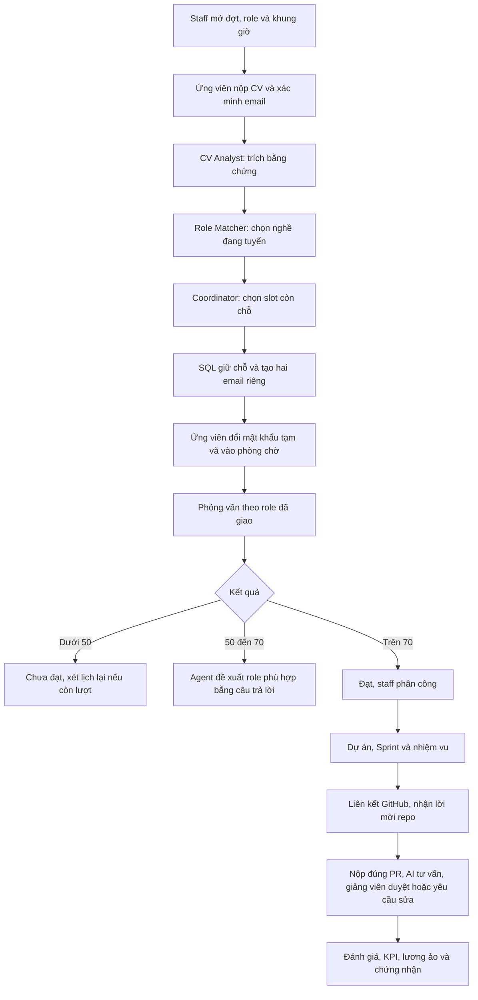

# Bàn giao G0–G7: đọc từ đầu, dùng đúng luồng

**Cập nhật tiếp: 26/10/2026.** Đọc [checkpoint mới](ACCEPTANCE-CHECKPOINT-20261026.md) để biết số liệu, CI, dịch vụ thật và việc còn mở. Phần dưới là hướng dẫn bàn giao nền tảng và bằng chứng lịch sử ngày 25/10: khi đó G7 đạt local nhưng CI còn bị billing chặn. Các repo nay đã public và có receipt CI xanh; bộ PR vẫn đang nghiệm thu/review, chưa merge. [Báo cáo cũ có nguồn](reports/g7-local-acceptance-20261025.json) giữ nguyên phạm vi thời điểm cũ.

## 1. Bạn nên bắt đầu ở đâu?

| Người đọc | Đọc theo thứ tự |
|---|---|
| Người demo | Chương 2 dưới đây → [DEMO-GUIDE](DEMO-GUIDE.md) → các lưu ý mail/GitHub ở chương 3 |
| Giảng viên | [CV và lịch tuyển](CV-AND-INTERVIEW-SCHEDULING.md) → [phỏng vấn theo lịch](SCHEDULED-INTERVIEWS.md) → [thời hạn](PARTICIPATION.md) → [thay thành viên](REPLACEMENT.md) |
| Sinh viên | [hành trình sử dụng](USER-JOURNEYS.md) → lịch trong email → phòng chờ/phỏng vấn → công việc/Sprint → GitHub → nộp bài → kết quả |
| Người quản trị | [cấu hình](CONFIGURATION.md) → [lời mời GitHub](GITHUB-INVITATIONS.md) → [phục hồi quyền](REPOSITORY-ACCESS-RECOVERY.md) → [khôi phục credential](TEMPORARY-CREDENTIAL-RECOVERY.md) |
| Lập trình viên | [HANDOVER](HANDOVER.md) → [CODE-MAP](CODE-MAP.md) → [Agent runtime](AGENT-RUNTIME.md) → chương nghiệp vụ cần sửa → [API](api/README.md) |
| Người kiểm thử | [TESTING](TESTING.md) → ma trận dưới đây → JSON evidence → [VERIFICATION](VERIFICATION.md) |

README của mỗi repo là cửa vào. Tài liệu domain giải thích cách dùng và nguyên tắc; code map chỉ nơi triển khai; báo cáo kiểm chứng ghi bằng chứng tại một mốc cụ thể. Báo cáo cũ giữ giá trị lịch sử, không thay cho kết quả hiện tại.

## 2. Đi qua một kỳ thực tập

**Giảng viên chuẩn bị:** mở đợt, kiểm role đã publish và bộ câu hỏi đủ giai đoạn; mở slot với timezone, capacity và thời gian chuẩn bị. Agent chỉ được chọn từ những slot còn hợp lệ, không tự đặt một lịch ngoài inventory. Một role mới phải có tri thức/câu hỏi đủ điều kiện trước khi nhận hồ sơ.

**Ứng viên nộp CV:** dùng cổng `/apply`, chọn đợt, nhập email thuộc quyền kiểm soát và xác nhận đồng ý xử lý hồ sơ. PDF/DOCX phải đọc được; ảnh scan thiếu văn bản vào trạng thái cần bổ sung. Xác minh email trước khi Agent chạy. Hồ sơ thiếu bằng chứng không được gán năng lực hoặc nghề một cách giả định.

**Hai email:** thư lịch chứa nghề, giờ và hướng dẫn; thư đăng nhập riêng chứa credential tạm cho tài khoản mới. Tài khoản đã có mật khẩu chính thức không bị reset bởi đặt lịch hoặc resend. Password không đi qua Agent. Thư nghiệm thu SMTP được ghi rõ là kiểm thử, không phải một lịch đặt thật.

**Vào phỏng vấn:** role thuộc booking phía server, không chọn lại qua URL. Chỉ bắt đầu trong khoảng `T ≤ now < T+15 phút`; tại T+15:00 nếu chưa bắt đầu thì chuyển chờ đợt sau, giữ CV. Phiên đã bắt đầu ở T+14:59 tiếp tục được sau mốc 15 phút. Tối đa ba lượt tổng cộng; cấu hình có thể giảm xuống một hoặc hai. Đổi role, gửi lại email, cấp lại mật khẩu và hẹn lại đều không reset số lượt.

**Phân công và Sprint:** staff phân công người đã đạt vào đúng phiên/dự án. Sinh viên xem Sprint đang chạy, được lập kế hoạch hoặc lịch sử theo dữ liệu được phép. Có nhiệm vụ trong Sprint planned không đồng nghĩa Sprint đã active; giao diện hiện đúng trạng thái. Sinh viên chỉ sửa/nộp nhiệm vụ của mình và vẫn chịu thứ tự trạng thái/phụ thuộc phía server.

**Nộp và chấm:** sinh viên dùng PR đúng repository và danh tính GitHub đã liên kết. Dữ liệu code là đầu vào không tin cậy; mọi bước snapshot/đánh giá vẫn kiểm nguồn và quyền. Agent đưa tư vấn có bằng chứng, không tự thay điểm chính thức. Giảng viên xem bài, rubric, điểm dự kiến và phần phạt trễ rồi xác nhận hoặc yêu cầu sửa. Bài đã chốt giữ lịch sử.

## 3. Những tình huống dễ hiểu nhầm

| Bạn thấy | Hiểu đúng và cách xử lý |
|---|---|
| Đã gửi lời mời repo | Sinh viên còn phải nhận lời mời trên GitHub; đây chưa phải quyền đã xác nhận |
| Webhook hoạt động | Webhook nhận sự kiện, không tự cấp collaborator và không thay OAuth |
| Đã thay người trong phiên | Quyền GitHub đang được worker đối chiếu riêng; đọc mục quyền sau bàn giao |
| Admin cần đối chiếu quyền | Quyền đã nhận hoặc không rõ nguồn được giữ, Admin xử lý rồi staff yêu cầu đối chiếu lại |
| Credential tạm hết hạn | Dùng [khôi phục riêng](TEMPORARY-CREDENTIAL-RECOVERY.md), cần lý do và proof email trong 24 giờ; resend không đổi mật khẩu |
| Nộp đúng giờ nhưng chấm muộn | Không tính là sinh viên nộp trễ; dùng timestamp bài nộp hợp lệ đầu tiên |
| Bị cảnh báo lần ba | Đây là căn cứ xem xét; Agent tư vấn, giảng viên quyết định. Không tự kick |
| SMTP accepted | Máy chủ mail chấp nhận chuyển tiếp; chưa đủ bằng chứng thư đã nằm trong Inbox |
| CI failure không có step/log | Kiểm annotation của GitHub. Lượt G7 hiện bị billing chặn trước khi chạy |

Policy nộp trễ có version và cấu hình: mặc định cảnh báo lần 1, xét trừ từ lần 2, đề xuất thay từ lần 3. Chưa cấu hình số điểm thì không bịa mức trừ. Một nhiệm vụ chỉ có một incident; cron lặp, nộp sau hạn và giảng viên chấm lại không được phạt kép. Gia hạn/miễn trừ/hoàn tác có lý do và lịch sử.

Thay người phải qua tư vấn → xem trước ảnh hưởng → lý do → phê duyệt. Bài đã chốt, điểm, tác giả và tài khoản được giữ. Task mở chuyển đúng phạm vi; người mới có hạn bàn giao được hiển thị trước quyết định. Preview cũ, bài đang review, người không đủ role/capacity hoặc hai thao tác cạnh tranh bị chặn.

## 4. Hệ thống được chia như thế nào?

| Lớp | Trách nhiệm | Không được làm thay lớp khác |
|---|---|---|
| FE: route và component | Hiển thị trạng thái, thu input, xác nhận tác động, kiểm contract response | Không tự kết luận eligibility/điểm/quyền GitHub |
| Controller/DTO/guard | Kiểm định dạng, xác thực, permission | Biết UUID không tạo quyền với bản ghi |
| Domain service và policy | Quy tắc nghiệp vụ, scope, state machine, transaction | Không gọi model/GitHub trong transaction thay người |
| Agent runtime | Tool allowlist, retrieval theo scope/version, checkpoint, trace và output có schema | Không tự kick, reset password, cấp quyền hoặc ghi điểm chính thức |
| SQL/outbox/ledger | Dữ liệu bền vững, idempotency, lease, audit và lịch sử | Không biến API remote thành giao dịch exactly-once giả |
| Adapter ngoài | SMTP, GitHub, provider AI, runner | Lỗi cần thành trạng thái/khả năng retry rõ ràng |

Thư viện nghề, Q&A và dự án mẫu nhỏ là nguồn tri thức có version cho toàn bộ Agent có scope tương ứng. **Không phải cứ thêm tài liệu là fine-tune model.** Nội dung publish được retrieval sử dụng; run cũ giữ snapshot. Tài liệu rubric/chấm riêng không được đưa cho sinh viên qua retrieval.

Khi thêm một Agent/role: đọc [runtime](AGENT-RUNTIME.md), [tri thức](KNOWLEDGE-LIBRARY.md) và [mẫu nhỏ](AGENTS-AND-MINI-PROJECTS.md). Bắt đầu bằng schema, quyền/tool và các ca thiếu dữ liệu/đối kháng; không tạo đường gọi LLM bỏ qua checkpoint hoặc tự thực hiện hành động đặc quyền.

## 5. Chạy local và giữ dữ liệu

Web chính ở `http://localhost:3001`, API chính 8080; API kiểm thử native riêng 8081. Không cần triển khai production. Ba tài khoản trắng gốc được bàn giao riêng và vẫn đăng nhập được; nghiệm thu dùng danh tính QA riêng, không tiêu hao lượt của các tài khoản đó.

Trên workspace Windows, trước package manager/build/test phải nạp `manual-runtime/Use-ProjectStorage.ps1`. Dependencies, cache, evidence, CV và dữ liệu runtime nằm trong folder dự án. Hai file DB ứng dụng đã được kiểm đường dẫn thật. SQL Server/Windows là hạ tầng dùng chung, không di chuyển master DB hoặc gỡ ứng dụng để dọn ổ.

Migration G6 là bổ sung: trước/sau so sánh mọi cột cũ của 96 bảng ở từng DB. Dữ liệu cũ được giữ nguyên; các cột điểm phạt mới không được coi là thay đổi dữ liệu cũ. G7 Q05 dùng event xác minh lại hiện có, không thêm migration.

Gmail SMTP đã có cấu hình local qua App Password. Đã gửi đúng một thư nghiệm thu qua outbox/transport thật; chưa xác nhận Inbox. Worker chỉ được bật lại sau khi kiểm cả hai DB không có mail pending chưa hết hạn từ hàng đợi cũ. Secret nằm trong cấu hình riêng tại máy; public README chỉ mô tả biến và cách sử dụng.

Nếu local không kết nối SQL: xem health và ERRORLOG trước. Lượt kích hoạt này gặp thiếu bộ nhớ native SQL khi chạy nhiều môi trường; đã đóng QA hoàn tất, dừng container SQL2019 QA, khởi động lại đúng named instance và kiểm lại dữ liệu. Không hạ timeout/assertion của CI để che lỗi. Bật lại môi trường QA riêng khi cần kiểm SQL2019; không chạy các suite reset trên DB chính.

## 6. Kiểm chứng tại mốc bàn giao

| Nhóm | Kết quả local | Phạm vi |
|---|---|---|
| BE unit | 111 suite / 840 test | Source G7, không thay thế SQL/browser |
| FE unit | 105 file / 638 test | Có ba ca khôi phục credential mới |
| Tuyển dụng/mail/lịch/khôi phục | 48 ca SQL2019 | 15 ca recovery; có email đang gửi, scope, replay, rollback, login/đổi mật khẩu |
| G6 quyền GitHub | 21 ca queue/worker/HTTP; 17 ledger/invitation; ba migration | Các nhóm riêng, không cộng lặp thành tổng release |
| Full-stack | 17/17 bước | Cùng assertion của gate GitHub, chỉ đổi port/config QA local; provider/GitHub fixture được khai báo |
| Chrome CV/lịch/recovery | Đạt | Multipart PDF, graph Agent thật với provider fixture, SMTP local thật, biên T+15, UI năm độ rộng |
| Chrome quyền sau thay | 30 lượt độ rộng | Staff và sinh viên cũ/mới; retry/revision, Escape/trả focus |
| Native | Hai health API; ba blank login; 10 lượt độ rộng | G6/G7 đã active; alias `/admin/logs` trả 307 |
| Dependency audit | 0 vulnerability trong phạm vi gate đã chạy | BE production dependencies; FE audit theo lockfile |
| GitHub thật | Invitation 201 → provenance → hủy đúng pending | Repo QA được archive; không coi đây là bằng chứng nhận collaborator mới |
| Gmail thật | Một receipt `SMTP_ACCEPTED` | Chưa xác nhận Inbox, không gửi hàng loạt lịch cũ |
| CI GitHub cuối G7 | **BLOCKED: billing** | Job chưa bắt đầu; G6 trước đó đã xanh |

Bằng chứng local, fixture và live được tách trong JSON; mỗi phần có mốc UTC. Không lấy số test/ngày cũ để trình bày thành kiểm tra của commit mới.

## 7. Tiếp nhận source trên GitHub

G4 → G5 → sửa Sprint → G6 → G7 đang là chuỗi PR. G7 Backend **#11**, Frontend **#21** có code và tài liệu đã push; FE pin một SHA BE cụ thể cho full-stack. [Quy trình Git](GIT-WORKFLOW.md) giải thích đọc diff theo base và không merge khi gate chưa đạt.

Khi billing được xử lý: chạy lại BE, FE quality và full-stack của cặp commit cuối; đọc job/annotation, xác nhận đã thực thi đủ step rồi mới tích cổng cloud. Bộ local xanh không đổi failure của GitHub thành success. Chưa có production deployment hay merge tự động trong mốc này.

Chức năng và nghiệm thu local đã có; các phần chưa có bằng chứng cần giữ rõ: CI cloud G7, xác nhận Inbox Gmail, chất lượng model live cho mọi tình huống CV và một hành trình mới liên tục tới PR/chấm với toàn bộ dịch vụ ngoài thật. Không gộp các fixture thành bằng chứng live cho những mục đó.
