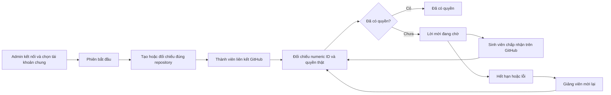

# GitHub — từ liên kết tài khoản đến quyền cộng tác

V-Intern tạo repository public bằng **tài khoản chung do Admin chọn**. Giảng viên và sinh viên chỉ liên kết GitHub để xác minh đúng người nhận và danh tính bài nộp. Không nhập mật khẩu GitHub vào V-Intern.

## Đường đi của một lời mời

Tên repo: `vintern-dự-án-tên-phiên-ngày-bắt-đầu-mã-phiên`. Không đưa email hoặc tên sinh viên vào tên repo public. Repo cũ giữ chủ sở hữu đã được ghi nhận; thay tài khoản chung không chuyển repo cũ sang tài khoản mới.

## Sinh viên cần làm gì?

1. Mở **GitHub của bạn** trong không gian sinh viên và liên kết đúng tài khoản cá nhân.
2. Khi được thêm vào phiên, chờ hệ thống đồng bộ. Mỗi vòng xử lý có giới hạn; lớp đông có thể cần nhiều vòng.
3. Nếu thấy **Chờ chấp nhận**, chọn **Mở lời mời GitHub**, kiểm tra đúng tài khoản đang đăng nhập và chấp nhận lời mời.
4. Quay lại V-Intern, chọn **Kiểm tra quyền GitHub của tôi**. Chỉ khi GitHub xác nhận collaborator, V-Intern mới ghi **Đã có quyền**.
5. Tạo nhánh theo mã nhiệm vụ, mở PR và nộp liên kết tại nhiệm vụ như trước.

Lời mời có hạn khoảng bảy ngày kể từ lúc tạo. Nút tải lại trang chỉ đọc trạng thái đã lưu; nút kiểm tra quyền mới yêu cầu đối chiếu với GitHub. Nếu vừa kiểm tra, đợi một phút. Sinh viên chỉ kiểm tra quyền của chính mình, không mời người khác.

## Giảng viên xử lý cả lớp

Mở chi tiết phiên → **Repository của phiên** → **Thành viên & lời mời**. Giảng viên chủ trì hoặc Admin có thể:

| Trạng thái | Ý nghĩa | Hành động phù hợp |
|---|---|---|
| Chưa liên kết | Thành viên chưa có danh tính GitHub liên kết | Nhắc người đó liên kết tài khoản |
| Chờ chấp nhận | GitHub có một lời mời còn hạn | Nhắc người đó mở lời mời; không tạo thêm lời mời |
| Đã có quyền | GitHub đã xác nhận quyền cộng tác | Tiếp tục làm và nộp bài |
| Lời mời hết hạn | Đã quá hạn hoặc GitHub đánh dấu expired | Chọn **Mời lại** cho người đó |
| Cần kiểm tra | Kết nối, quyền hoặc danh tính chưa đối chiếu được | Kiểm tra kết nối; mời lại sau khi sửa nguyên nhân |

Nút **Đối chiếu & mời thành viên cần xử lý** xử lý tối đa năm người mỗi lần. Bấm lặp hoặc hai process cùng xử lý một người không tạo hai lệnh cấp quyền: SQL giữ lease năm phút và cooldown một phút. Người đã có quyền hoặc có lời mời còn hạn không được gửi lại chỉ vì bấm nút batch.

Nếu người dùng đổi GitHub numeric ID, hệ thống báo `GITHUB_IDENTITY_CHANGED` và giữ dấu vết quyền cũ. Admin cần đối chiếu trước; không tự chuyển quyền từ người cũ sang người mới. Đổi username nhưng numeric ID giữ nguyên vẫn hoạt động.

## Thông báo và email

V-Intern tạo thông báo trong ứng dụng và một email riêng gồm tên phiên, repo, hạn lời mời và nút mở đúng trang V-Intern. Trang đó yêu cầu đăng nhập và vẫn kiểm quyền phiên. Tùy chọn tắt thông báo nhóm `session` được tôn trọng.

Email native của GitHub do GitHub quyết định nội dung và gửi riêng. V-Intern không sửa được format đó. Email V-Intern được mã hóa trong outbox; event ID chống enqueue trùng. Khi SMTP chưa cấu hình, thông báo trong app vẫn hoạt động và email đợi cấu hình. Khi queue lỗi, trạng thái GitHub đã xác minh không bị mất; worker thử lại thông báo từ event đã lưu. Thư đã hết hạn không được gửi muộn.

Phạm vi nghiệm thu email hiện tại là **SMTP local**. `SMTP_ACCEPTED` nghĩa server SMTP local nhận DATA, không phải bằng chứng thư tới hộp thư bên ngoài.

## API và cấu trúc code

| API | Quyền và tác dụng |
|---|---|
| `GET /sessions/:id/github` | Người được đọc phiên; SV chỉ nhận bản ghi quyền của mình |
| `POST /sessions/:id/github/invite` | Chủ trì/Admin; đối chiếu/mời batch tối đa năm |
| `POST /sessions/:id/github/members/:userId/invite` | Chủ trì/Admin; đối chiếu/mời lại một thành viên hiện hành |
| `POST /sessions/:id/github/reconcile` | Thành viên; chỉ kiểm tra quyền của chính caller, không cấp quyền |
| `POST /sessions/:id/github/webhook` | Chủ trì/Admin; đăng ký lại webhook cho đúng repo |

Các route API nằm dưới `/api/v1`. `github-invitation-policy.ts` xử lý hợp đồng remote; `github-invitations.service.ts` chịu trách nhiệm lease, snapshot, audit và thông báo; `github-repositories.service.ts` giữ kiểm quyền phiên/chủ repo. Không dùng output Agent hoặc username do browser gửi để quyết định quyền.

Migration `TrackGithubInvitations1763414400000` là bổ sung. Bản ghi cũ `invited` chuyển thành `pending` chưa có ID/hạn, rồi được worker đối chiếu; không đoán là đã chấp nhận. `github_invitation_events` giữ actor, nguồn lệnh, trạng thái trước/sau, numeric ID và mã lỗi. Không rollback xóa audit đã có dữ liệu.

## Đối chiếu và webhook

Worker vẫn chạy theo vòng, kể cả khi webhook bị mất hoặc chưa cấu hình. Trạng thái accepted luôn cần đối chiếu GitHub; giao diện không tự suy luận từ việc đã gửi email.

Webhook có đường HTTPS riêng `/api/v1/github/webhook`, xác minh HMAC, delivery ID, payload hash, repo ID và owner ID. Ping/sự kiện ký tay chỉ là kiểm hợp đồng; phải có GitHub delivery thật mới gọi là nghiệm thu live. Không mở toàn bộ API ra internet để kiểm webhook.

## Tra lỗi nhanh

| Mã | Cách xử lý |
|---|---|
| `GITHUB_RECONNECT_REQUIRED` | Admin kết nối lại đúng tài khoản chung tại Cài đặt |
| `GITHUB_INVITATION_COOLDOWN` | Đợi một phút rồi kiểm tra lại |
| `GITHUB_RATE_OR_PERMISSION` | Kiểm tra quyền token/repo và giới hạn API; không bấm liên tục |
| `GITHUB_IDENTITY_CHANGED` | Admin đối chiếu quyền của numeric ID cũ và mới |
| `GITHUB_INVITATION_UNAVAILABLE` | Chưa tìm được lời mời hoặc quyền hợp lệ; giảng viên có thể đối chiếu/mời lại |
| `GITHUB_INVITATION_SCAN_LIMIT` | Repo có quá nhiều lời mời để quét trong một lệnh giới hạn; Admin cần xử lý danh sách GitHub |

Đọc [báo cáo G5](reports/g5-completion-20261025.md) để phân biệt phần đã kiểm local, kết quả CI và phụ thuộc GitHub đang chờ. Không gửi token, secret hoặc mật khẩu vào log/issue/chat.
