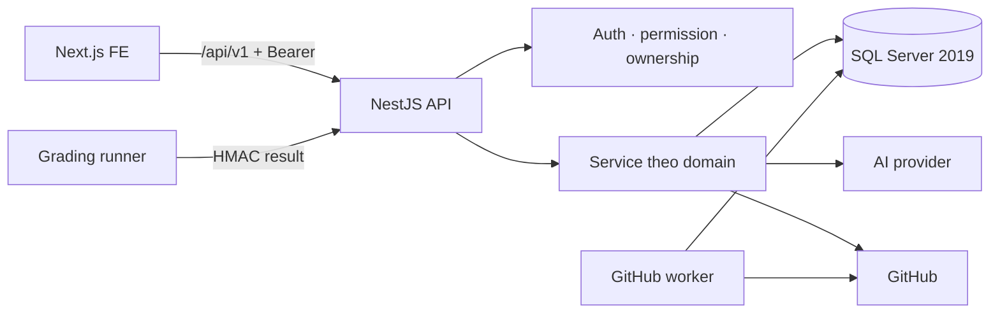
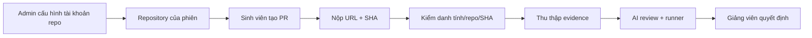

# Bàn giao Backend

Tài liệu này là điểm bắt đầu cho người tiếp nhận. Nó không thay thế các chương kỹ thuật; nó cho biết **đọc gì, kiểm gì và phần nào chưa được chứng minh**.

> **Mốc bàn giao:** 02/11/2026 · nhánh `main` · commit `ca60e16`
> **Trạng thái:** 113 suite / 849 unit test · 34 suite / 316 SQL/HTTP E2E · lint và build đạt
> **Thay đổi gần nhất:** gỡ classes/session-sharing; API còn 302 operation trong 48 nhóm.

## 1. Đọc theo nhu cầu

| Bạn cần | Đọc |
|---|---|
| Hiểu sản phẩm | [START-HERE](START-HERE.md) → [USER-JOURNEYS](USER-JOURNEYS.md) → [WORKFLOW-MATRIX](WORKFLOW-MATRIX.md) |
| Chạy local | [LOCAL-DEVELOPMENT](LOCAL-DEVELOPMENT.md) → [CONFIGURATION](CONFIGURATION.md) → [TROUBLESHOOTING](TROUBLESHOOTING.md) |
| Sửa code | Tài liệu này → [CODE-MAP](CODE-MAP.md) → [ARCHITECTURE](ARCHITECTURE.md) → chương domain |
| Gọi API | [api/README](api/README.md) → [api/ROUTES](api/ROUTES.md) → [api/SCHEMAS](api/SCHEMAS.md) |
| Kiểm thử | [TESTING](TESTING.md) → [VERIFICATION](VERIFICATION.md) → [MIGRATION_POLICY](database/MIGRATION_POLICY.md) |
| Vận hành DB | [SQL Server 2019 setup](database/SQLSERVER2019_SETUP.md) → [MIGRATION_POLICY](database/MIGRATION_POLICY.md) |
| Đóng góp | [CONTRIBUTING](CONTRIBUTING.md) → [SECURITY](SECURITY.md) |
| Demo | [DEMO](DEMO.md) |

Giao diện nằm ở repository `V-Intern FE`; hai repo phối hợp qua HTTP và **không dùng chung lịch sử Git**.

## 2. Backend chịu trách nhiệm gì?

**Có:**

- Danh tính, đăng nhập, refresh, phân quyền và ownership.
- Trạng thái nghiệp vụ, công thức điểm/KPI, điều kiện chuyển bước.
- Transaction, migration, audit và snapshot lịch sử.
- Tích hợp AI/GitHub/SMTP/runner qua adapter có kiểm soát.
- Worker nền, health, Swagger và read model.

**Không:**

- Không dựng giao diện hoặc quyết định hiển thị thay FE.
- Không để AI cấp quyền, chốt điểm hoặc tự chuyển task Done.
- Không chạy code không tin cậy trong process API.
- Không tự tạo SQL Server, cấp quyền login hoặc seed DB bàn giao.



## 3. Chạy nhanh

```powershell
& .\scripts\Use-ProjectStorage.ps1
npm ci
Copy-Item .env.example .env   # chỉ khi chưa có
npm run migration:show        # xem migration đang chờ
npm run start:dev
```

Kiểm tra:

1. `http://localhost:8080/api/v1/health` → `database: ok`.
2. `http://localhost:8080/api/docs` → đúng route/DTO.
3. Đăng nhập một tài khoản local và mở dữ liệu thật.

Trên máy bàn giao, dùng launcher thay vì tự đoán DB:

```powershell
& .\scripts\Use-ProjectStorage.ps1
& ..\manual-runtime\start-owned-services.ps1 -Backend -Frontend
```

| Process | Cổng | Database theo launcher |
|---|---|---|
| API chính | 8080 | `VIntern_M2_BROWSER` |
| API QA | 8081 | `VIntern_Test_Learning_20261014` |
| SQL TCP | 1435 | Kiểm kết nối đúng instance |

> `.env` và launcher có thể chọn database khác nhau. Không suy DB đang phục vụ UI chỉ từ `DB_NAME`.

## 4. Kiến trúc trong một trang

```text
Request → Guard (auth/permission/throttle)
        → Controller + DTO (ValidationPipe)
        → Service/policy (ownership, trạng thái, công thức)
        → Repository/entity (transaction, version)
        → SQL Server
```

| Lớp | Trách nhiệm | Không nên chứa |
|---|---|---|
| Guard | Authentication, permission thô, rate limit | Điều kiện theo bản ghi |
| Controller | Route, DTO, mapping response | Transaction, policy phức tạp |
| Service/policy | Ownership, trạng thái, công thức, transaction | HTTP status chi tiết |
| Repository/entity | Truy vấn, quan hệ | Quyết định quyền |
| Migration | Schema/constraint/index | Logic runtime |

Bất biến:

1. AI không cấp quyền, không chốt điểm, không tự Done.
2. Client không quyết định scope; service kiểm tra lại.
3. Không chạy code không tin cậy trong process API.
4. Không sửa migration đã chạy; không sửa snapshot lịch sử.
5. Không fallback dữ liệu giả khi provider lỗi.
6. Không log/trả secret hoặc PII.
7. Không dùng DB chính để test phá hủy.

Chi tiết: [ARCHITECTURE](ARCHITECTURE.md).

## 5. Bản đồ domain

| Nhóm | Chương |
|---|---|
| Nền tảng | [domain-model](architecture/domain-model.md) · [registration](architecture/registration.md) · [admin](architecture/admin.md) |
| Tuyển dụng | [recruitment-chat](architecture/recruitment-chat.md) |
| Dự án & phiên | [project-blueprints](architecture/project-blueprints.md) · [academic-core](architecture/academic-core.md) · [learning-plans](architecture/learning-plans.md) |
| Công việc | [sprint-task-core](architecture/sprint-task-core.md) · [github-code-review](architecture/github-code-review.md) · [grading-runner](architecture/grading-runner.md) |
| AI | [ai-mentor](architecture/ai-mentor.md) · [ai-evaluation-assistance](architecture/ai-evaluation-assistance.md) · [ai-recommendations](architecture/ai-recommendations.md) |
| Kết quả | [evaluation-performance-kpi](architecture/evaluation-performance-kpi.md) · [student-performance](architecture/student-performance.md) · [virtual-salary](architecture/virtual-salary.md) · [certificates](architecture/certificates.md) · [reports](architecture/reports.md) |
| Vận hành | [notifications](architecture/notifications.md) |

## 6. Tuyển dụng: quy tắc không được phá

| Điểm của lượt mới | Kết quả | Việc tiếp theo |
|---|---|---|
| Nhỏ hơn 50 | Không đạt | Xem phản hồi; thử lại nếu còn lượt |
| Từ 50 đến 70 (gồm hai đầu) | Đề xuất chuyên môn khác | Đọc lý do/reference rồi tự chọn |
| Lớn hơn 70 | Đạt | Chờ phân công |

- Tối đa **3 lượt tổng cộng**, không phải 1 + 3.
- Đổi role không cấp thêm lượt.
- Kết quả lịch sử giữ decision/model/version đã dùng.
- Lỗi provider không trừ lượt và không tự ghi `failed`.

Chi tiết: [recruitment-chat](architecture/recruitment-chat.md), [ADR score bands](decisions/0003-recruitment-score-bands.md).

## 7. Dự án, phân công và kế hoạch

| Khái niệm | Hiểu đơn giản | Điều dễ nhầm |
|---|---|---|
| Template/blueprint | Bản mô tả mẫu, có version | Sửa mẫu không sửa run cũ |
| Phiên thực tập | Đợt tổ chức có thời gian/người phụ trách | Tạo phiên chưa giao task |
| Assignment | Phân công vào vị trí | Đậu tuyển dụng không tự tạo assignment |
| Learning plan | Kế hoạch Sprint/task | Bản nháp AI cần giảng viên xác nhận |
| Sprint | Giai đoạn triển khai | `planned` chưa phải đang chạy |
| Task | Việc có người nhận, trạng thái, phụ thuộc | Không chuyển trạng thái tùy ý |

Nếu sinh viên báo chưa có Sprint, đi theo chuỗi: đúng phiên → assignment active → đúng dự án → kế hoạch đã publish → Sprint active. Không sửa UI để hiện dữ liệu ngoài scope.

## 8. GitHub, bài nộp và runner



- URL GitHub tồn tại **chưa đủ** để chấp nhận.
- PR đổi commit sau khi nộp → `409 SUBMISSION_SHA_CHANGED`; phải nộp lại.
- Runner chạy cách ly, ký HMAC; API chỉ nhận evidence đúng request/task/suite/SHA.
- AI review source **không** chứng minh code đã chạy test.
- Thiếu suite đúng task → không có trusted PASS; có thể manual review theo policy.

Chi tiết: [github-code-review](architecture/github-code-review.md), [grading-runner](architecture/grading-runner.md).

## 9. Kết quả cuối

| Module | Người dùng cần thấy | Khi sửa phải giữ |
|---|---|---|
| Evaluation | Kỳ, tiêu chí, draft/submitted/finalized | Quyền chốt, validation, lịch sử |
| Performance | Số liệu và phạm vi đo | Mẫu số, null/0, nguồn, thời điểm |
| KPI/lương ảo | Kết quả và biến động đối chiếu được | Công thức, snapshot, ledger idempotent |
| Certificate | Bản phát hành và trạng thái kiểm tra | Điều kiện, thu hồi, snapshot |
| Report | Bản chụp và file xuất | Scope, thời điểm, tính nhất quán |

`0`, `null` và `insufficient_data` là ba trạng thái khác nhau. Báo cáo cũ không tự tính lại.

## 10. Kiểm thử trước khi nhận bàn giao

```powershell
& .\scripts\Use-ProjectStorage.ps1
npm run lint
npm test
npm run build
git diff --check
```

Kỳ vọng hiện tại: lint 0 lỗi, **113 suite / 849 unit test**, build thành công. E2E chạy trên DB riêng theo [TESTING](TESTING.md).

## 11. Việc cần kiểm lại khi tiếp nhận

- [ ] Health trả `database: ok`; Swagger đúng bản.
- [ ] Đăng nhập/refresh/logout; refresh rotation và replay detection.
- [ ] Ba vai trò vào đúng scope; user bị khóa bị chặn.
- [ ] Tuyển dụng: ngưỡng điểm, ba lượt, role khác có reason/reference.
- [ ] Tạo phiên → phân công → publish plan → active Sprint → task hiện cho sinh viên.
- [ ] Nộp PR + SHA; runner/HMAC; PR đổi SHA bị từ chối.
- [ ] Evaluation → KPI → lương ảo → chứng nhận; report snapshot.
- [ ] GitHub connect/invitation/repo; webhook HMAC (E2E).
- [ ] AI lỗi/timeout không tạo kết quả giả.
- [ ] Migration show/run/audit trên DB mới; revert/reapply trong CI.
- [ ] Không có secret/PII trong log/ảnh.

## 12. Giới hạn đã biết

| Giới hạn | Ảnh hưởng | Cách xử lý |
|---|---|---|
| Webhook chưa live | Chưa chứng minh delivery thật | Dùng GitHub API cho PR/SHA; E2E kiểm hợp đồng |
| Rate limit theo process | Multi-instance có thể vượt giới hạn | Cần store chia sẻ/gateway nếu scale |
| Timeout SQL từng gặp | Chưa rõ nguyên nhân gốc | Ghi nhận, theo dõi; không tăng timeout mù |
| Live provider chỉ theo fixture | Không phủ mọi repo/framework | Kiểm lại trước demo |
| Chưa production | Không tuyên bố sẵn sàng production | Giữ phạm vi local/CI |
| Audit dependency theo thời điểm | Có thể có advisory mới | Chạy lại `npm audit` trước release |

## 13. Bàn giao kèm gì?

- Commit/branch và tình trạng working tree.
- Danh sách module/route/migration đã đổi.
- Lệnh đã chạy + kết quả + số test.
- Database/môi trường đã dùng và phần chưa kiểm.
- Liên kết PR FE/BE, issue, báo cáo.
- Secret, `.env`, token và `manual-runtime/private` bàn giao qua **kênh riêng**, không qua repo/chat công khai.
