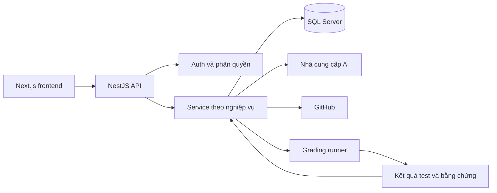
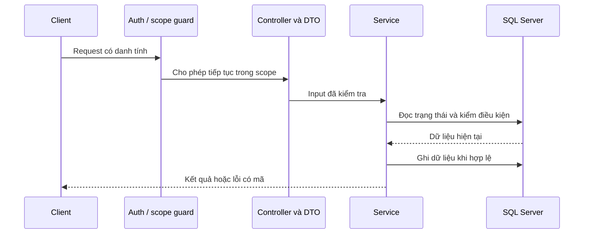
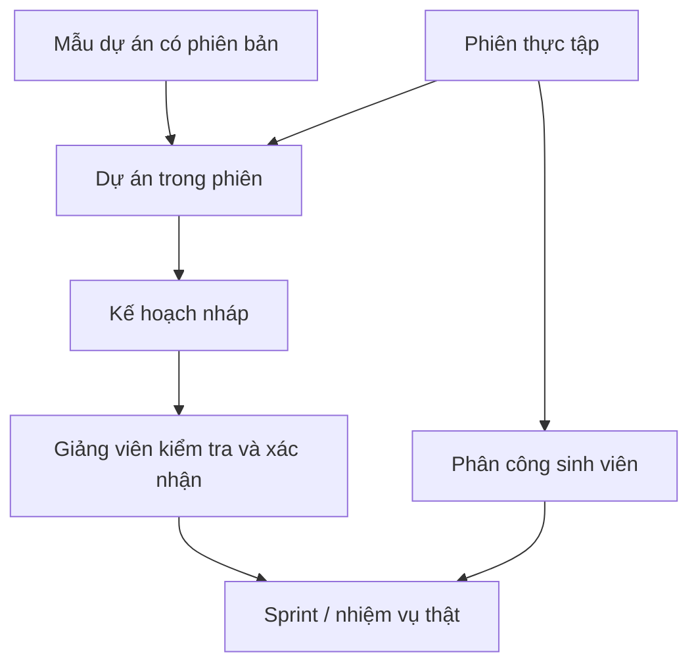
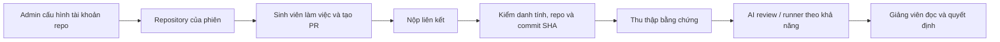

# Bàn giao Backend V-Intern

> **Checkpoint 26/10/2026:** [đọc số liệu, CI theo SHA, luồng dịch vụ thật và phần còn mở](ACCEPTANCE-CHECKPOINT-20261026.md). BE 859 / FE 644 unit tests hiện hành; dữ liệu 840/638 và local G7 bên dưới thuộc mốc cũ. Repo đã public và cặp CI có receipt xanh; không còn mô tả billing là blocker hiện tại. Chưa kết luận nghiệm thu toàn bộ ba vai hoặc UI mới.

> Mục tiêu của tài liệu này là giúp người mới hiểu vì sao hệ thống hoạt động như vậy, chạy đúng môi trường, tìm đúng code và thay đổi mà không làm mất dữ liệu. Các chương chuyên sâu được liên kết ngay tại chủ đề tương ứng.

## 1. Đọc theo nhu cầu của bạn

| Người đọc | Lộ trình |
|---|---|
| Chủ sản phẩm / người nghiệm thu | [Hiểu sản phẩm](START-HERE.md) → [Hành trình sử dụng](USER-JOURNEYS.md) → [Nhánh nghiệp vụ](WORKFLOW-MATRIX.md) |
| Người vận hành local | [Chạy local](LOCAL-DEVELOPMENT.md) → [Cấu hình](CONFIGURATION.md) → [Tìm lỗi](TROUBLESHOOTING.md) |
| Lập trình viên mới | Tài liệu này → [Bản đồ code](CODE-MAP.md) → [API](api/README.md) → chương domain cần sửa |
| Người kiểm thử | [Testing](TESTING.md) → [Verification](VERIFICATION.md) → [Quy tắc migration](database/MIGRATION_POLICY.md) |
| Người tiếp nhận Git | [Git workflow](GIT-WORKFLOW.md), phân biệt nhánh source với nhánh điều kiện nghiệp vụ |
| Quản trị nghề nghiệp và tiếp nối Agent roadmap | [Đặc tả catalog](../SPEC-career-roles.md) → [bằng chứng theo lát cắt](reports/career-roles-20261023.md) → [checklist còn lại](../tasks/todo.md) |
| Tiếp nhận runtime Agent G1 | [Cách chạy và phục hồi](AGENT-RUNTIME.md) → [nghiệm thu/giới hạn](reports/agent-foundation-20261024.md) → [các Agent còn lại ở G2](../tasks/todo.md) |

Để hiểu giao diện, đọc [bàn giao FE](https://github.com/vanhoi04082006-pixel/V-Intern-FE/blob/feat/ui-ux-overhaul/docs/HANDOVER.md). Hai repo phối hợp qua HTTP; chúng không dùng chung một lịch sử Git.

## 2. Backend chịu trách nhiệm gì?

V-Intern mô phỏng một kỳ thực tập có dự án, người hướng dẫn và bằng chứng công việc. Backend giữ quyền quyết định về danh tính, phạm vi truy cập, trạng thái dữ liệu, điểm và các điều kiện chuyển bước. AI hỗ trợ tạo nội dung hoặc đề xuất; quyền chốt nghiệp vụ phải đi qua các quy tắc của hệ thống.



| Công nghệ | Vai trò |
|---|---|
| NestJS 11 / TypeScript | Module, controller, service và dependency injection |
| TypeORM / SQL Server | Entity, truy vấn, transaction và migration |
| JWT / refresh cookie | Xác thực phiên và làm mới access token |
| DTO / ValidationPipe | Kiểm tra đầu vào và từ chối field không hợp lệ |
| Swagger | Tra cứu route/schema của bản đang chạy |
| Jest / HTTP E2E | Kiểm quy tắc và luồng request thực tế |

## 3. Bắt đầu an toàn trên máy bàn giao

Mọi dependency, cache, log, bằng chứng và dữ liệu runtime của dự án phải nằm trong workspace. Mỗi PowerShell chạy package manager/build/test cần gọi script lưu trữ trước:

```powershell
& .\scripts\Use-ProjectStorage.ps1
# Chạy tại thư mục gốc repository Backend
```

| Process | Cổng | Database theo launcher |
|---|---|---|
| API chính: `manual-runtime/start-backend.cjs` | 8080 | `VIntern_M2_BROWSER` |
| API QA: `manual-runtime/validation-runtime.cjs` | 8081 | `VIntern_Test_Learning_20261014` |
| SQL TCP trên máy hiện tại | 1435 | Cần kiểm kết nối đúng instance |

**Điểm cần nhớ:** `.env` và launcher có thể chọn database khác nhau. Trên máy này không suy ra database đang phục vụ UI chỉ từ `DB_NAME` trong `.env`. Không khởi chạy BE bằng lệnh mặc định rồi cho rằng nó tương đương launcher chính.

```powershell
# Dùng khi cần restart API đã thuộc workspace
& ..\manual-runtime\restart-owned-apps.ps1 -Backend
```

Để mở máy mới, làm theo [LOCAL-DEVELOPMENT](LOCAL-DEVELOPMENT.md): cấu hình SQL/login, copy mẫu môi trường khi chưa có file, cài dependency từ lockfile, đọc migration pending rồi mới áp dụng lên database được chỉ định. Không chạy `seed:dev` trên database bàn giao để “làm sạch”. Ba tài khoản gốc và dữ liệu đang có phải được giữ.

### Kiểm tra đúng tầng

Runner local cần được khởi động riêng bằng `manual-runtime/start-grader.ps1` của workspace. Script giữ phiên WSL riêng để worker không tự tắt khi không còn client; xem [hướng dẫn local](LOCAL-DEVELOPMENT.md). Môi trường QA phải có callback, frontend origin và URL xác minh chứng nhận riêng, không dùng cổng API chính cho các liên kết QA.

1. Process API đang listen không đồng nghĩa SQL truy vấn được.
2. `/api/v1/health` giúp kiểm trạng thái dịch vụ; cần đọc nội dung phản hồi, không chỉ status 200.
3. `/api/docs` cho biết route/DTO của đúng bản đang chạy.
4. Một request có xác thực, trong đúng scope và có dữ liệu thật mới chứng minh luồng đọc tương ứng hoạt động.
5. Cấu hình AI/GitHub/runner hiện diện không chứng minh một lượt gọi thực tế đã thành công.

Vị trí MDF/LDF phải kiểm từ SQL trước khi khẳng định dữ liệu nằm trong project. WSL/Docker lưu dưới project không tự chứng minh file database cũng ở đó.

## 4. Từ HTTP request đến quy tắc nghiệp vụ



`main.ts` cấu hình prefix `api`, URI versioning mặc định `1`, CORS có allowlist, JSON body limit và ValidationPipe. Vì vậy URL nghiệp vụ thường bắt đầu `/api/v1`. DTO whitelist và forbid unknown giúp loại request sai contract sớm.

Controller là cửa vào HTTP, không nên chứa cả luồng nghiệp vụ. Service kiểm điều kiện dựa trên trạng thái hiện tại và danh tính. Repository/entity biểu diễn dữ liệu lưu. Với thay đổi nhiều bản ghi, đọc service hiện có để giữ transaction và điều kiện cạnh tranh.

Khi thêm một endpoint, kiểm đủ: DTO → authentication → permission → quyền trên **bản ghi cụ thể** → trạng thái → transaction → response → test. Chỉ có role `instructor` chưa chứng minh người đó được sửa mọi phiên.

## 5. Tuyển dụng: điểm và lượt phỏng vấn

| Điểm của lượt mới | Kết quả | Việc người dùng làm tiếp |
|---|---|---|
| Nhỏ hơn 50 | Không đạt | Có thể thử lại nếu còn lượt |
| Từ 50 đến 70, gồm hai đầu mút | Đề xuất chuyên môn khác | Đọc gợi ý dựa trên câu trả lời rồi chọn hướng phù hợp |
| Lớn hơn 70 | Đạt | Chờ phân công vào phiên/dự án |

Giới hạn là **3 lượt tổng cộng**, không phải 1 lượt đầu cộng 3 lần làm lại. Kết quả lịch sử không được đổi âm thầm theo chính sách mới. Gợi ý role phải có căn cứ trong câu trả lời; không bịa năng lực hoặc chỉ đổi tên role để trông như đã phân tích.

Hội thoại có trạng thái server, thời gian và các nhánh lỗi AI. Nếu AI chưa trả kết quả, giữ bài làm và thông báo đúng để retry theo quy tắc. Không coi lỗi nhà cung cấp là sinh viên được 0 điểm.

Nguồn đọc sâu: [recruitment-chat](architecture/recruitment-chat.md), [ADR chính sách điểm](decisions/0003-recruitment-score-bands.md), các file `attempt-policy`, `scoring`, `recommendation-policy` và test trong `src/recruitment`.

## 6. Dự án, phiên, phân công và kế hoạch

Các từ này có quan hệ nhưng không thay thế nhau:

| Khái niệm | Hiểu đơn giản | Điều dễ nhầm |
|---|---|---|
| Project blueprint/template | Bản mô tả mẫu để tái sử dụng | Sửa mẫu không có nghĩa được sửa mọi bản đang chạy |
| Phiên thực tập | Một đợt tổ chức có thời gian và người phụ trách | Tạo phiên chưa tự giao task cho sinh viên |
| Assignment | Phân công người vào vị trí/dự án | Đậu tuyển dụng không tự tạo assignment |
| Learning plan | Kế hoạch giai đoạn và nhiệm vụ | Bản nháp AI cần được xem và xác nhận |
| Sprint | Một giai đoạn triển khai | Có Sprint trong quản lý chưa chắc đang active cho sinh viên |
| Task | Việc cụ thể được giao, có trạng thái và điều kiện | Không được chuyển mọi trạng thái tùy ý |



Nếu giảng viên thấy nội dung nhưng sinh viên báo chưa có Sprint, đi theo chuỗi: đúng phiên → đúng assignment → đúng dự án → kế hoạch đã xác nhận → Sprint đúng trạng thái. Đừng sửa UI để hiện dữ liệu ngoài scope nhằm che thiếu bước.

Đọc sâu: [blueprints](architecture/project-blueprints.md), [academic core](architecture/academic-core.md), [learning plans](architecture/learning-plans.md), [sprint/task](architecture/sprint-task-core.md).

## 7. GitHub, bài nộp và chấm code

Admin cung cấp tài khoản GitHub dùng tạo repository chung. Việc này khác với danh tính GitHub của người nộp bài. Repository cấp cho phiên không làm mất yêu cầu đối chiếu người nộp, URL, quyền truy cập và commit.



Một URL GitHub tồn tại chưa đủ để chấp nhận. Luồng cần đối chiếu repository, chủ thể và commit theo service. SHA xác định nội dung đã xét; PR tiếp tục có commit mới không nên làm bằng chứng cũ tự đổi nghĩa.

Runner chạy code không tin cậy phải tách khỏi process API và tài nguyên máy chủ. AI review đọc bằng chứng không có nghĩa code đã chạy test. Kết quả cần phân biệt source evidence, test evidence, trạng thái lỗi runner và nhận xét AI. Không ghi “đã pass” khi runner không khả dụng.

Tài khoản, OAuth secret, token, webhook secret và cấu hình runner được bàn giao riêng tại máy. Không dùng password GitHub trong code hoặc README; không mở rộng quyền chỉ để vượt lỗi cấu hình.

Đọc sâu: [GitHub/code review](architecture/github-code-review.md), [runner](architecture/grading-runner.md), [runner README](../grading-runner/README.md), [ADR repo Admin](decisions/0002-admin-repository-account.md), [bằng chứng GitHub lịch sử](LIVE-GITHUB.md).

## 8. Đánh giá, hiệu suất, KPI và đầu ra

Đánh giá là quá trình theo tiêu chí. Hiệu suất là góc nhìn từ dữ liệu công việc. KPI/lương ảo là kết quả tính theo quy tắc. Chứng nhận là bản được phát hành khi đủ điều kiện. Không lấy một con số AI rồi thay cho tất cả các loại kết quả này.

| Module | Người dùng cần thấy | Khi sửa code phải giữ |
|---|---|---|
| Evaluation | Kỳ, tiêu chí, trạng thái nháp/nộp/chốt | Quyền chốt, validation, trạng thái lịch sử |
| Performance | Số liệu và phạm vi đo | Mẫu số, null/0, nguồn và thời điểm |
| KPI / lương ảo | Kết quả và biến động có thể đối chiếu | Công thức, snapshot và ledger theo nghiệp vụ |
| Certificate | Bản phát hành và trạng thái kiểm tra | Điều kiện, thu hồi/hiệu lực và tra cứu |
| Reports | Bản chụp và nội dung xuất | Scope, thời điểm tạo, dữ liệu nhất quán |
| Sharing | Ai chia sẻ cho ai, phạm vi và đồng ý | Consent và quyền của cả hai phía |

Đọc sâu trong [mục lục domain](README.md): có chương riêng cho từng module trên, AI Mentor, recommendations, notifications và quản trị.

## 9. Database và migration

Entity mô tả mô hình ở source. Migration mô tả cách đưa schema từ trạng thái cũ sang mới. Hai việc không tự thay thế nhau. Trước khi chạy migration cần biết database đích, migration pending và tác động lên dữ liệu đang có.

```powershell
& .\scripts\Use-ProjectStorage.ps1
# Lệnh kiểm tra, phải xác nhận env/DB đích trước
npm run migration:show
```

Không đưa `migration:run`, `migration:revert`, seed hoặc reset vào hướng dẫn “thử cho nhanh” cho người đọc mới. Những lệnh đó thay dữ liệu/schema và cần được dùng trong kế hoạch cụ thể. Xem [MIGRATION_POLICY](database/MIGRATION_POLICY.md) và [SQL setup](database/SQLSERVER2019_SETUP.md).

## 10. Kiểm thử, bằng chứng và chất lượng

```powershell
& .\scripts\Use-ProjectStorage.ps1
npm run lint
npm test
npm run build
```

Unit test kiểm quy tắc ở mức service/policy. HTTP E2E kiểm request, auth, validation và lưu trữ trên database test đã định rõ. Trước E2E phải đọc cấu hình suite; không trỏ suite có reset/seed vào database chính.

Mỗi bản bàn giao ghi: thời điểm, branch/commit, trạng thái dirty nếu có, lệnh đã chạy, exit code, test count, môi trường và hạn chế. [VERIFICATION](VERIFICATION.md) là chỉ mục nguồn; không sửa ngày của log cũ để tạo cảm giác đó là bằng chứng mới.

## 11. Chẩn đoán có trình tự

| Hiện tượng | Đọc bằng chứng nào? | Không nên làm |
|---|---|---|
| Query 15 giây rồi timeout | API log, SQL session/wait, pool, kết nối trực tiếp | Kết luận DNS hoặc tăng timeout khi chưa có bằng chứng |
| 401 liên tiếp | Access token, refresh cookie, origin và rotation | Retry vô hạn |
| 403 trên một bản ghi | Scope, owner, permission, consent | Chỉ nới role hoặc bỏ guard |
| 409 khi chuyển task | Version và điều kiện trạng thái/phụ thuộc | Cập nhật DB thủ công để ép qua |
| AI lỗi | Provider, timeout, response parser, trạng thái job | Gán điểm hoặc nội dung giả |
| Repo/PR không đọc được | Danh tính liên kết, repo scope, URL/SHA | Dùng token quyền rộng tùy tiện |
| FE khác BE | API base URL, database theo launcher, version build | Reset cả hệ thống |

Đã có lần timeout SQL được ghi nhận trong kiểm chứng local trước đó; restart API phục hồi nhưng **chưa xác định nguyên nhân gốc**. Đây là giới hạn cần giữ trong bàn giao, không mô tả thành lỗi đã sửa dứt điểm.

## 12. Tiếp nhận và phát triển tiếp

Trước khi sửa, đọc chương domain và test gần service. Khi đổi policy, thêm test đúng biên (ví dụ 49.99/50/70/70.01 theo kiểu điểm hỗ trợ), giữ kết quả lịch sử và cập nhật ADR nếu quyết định thay đổi. Khi đổi DTO/API, đối chiếu parser FE trong cùng đợt.

Không xóa nhánh archive chỉ vì đã cũ. Xem bảng quan hệ commit trong [GIT-WORKFLOW](GIT-WORKFLOW.md), phân biệt nhánh đã tích hợp với nhánh còn commit riêng. Công việc chưa commit phải được xem trước khi merge hoặc chuyển nhánh.

Tài liệu sâu có thể tra cứu độc lập: [code map](CODE-MAP.md), [config](CONFIGURATION.md), [API schema](api/SCHEMAS.md), [API routes](api/ROUTES.md), [security](SECURITY.md), [dependencies](DEPENDENCIES.md). Đây là các chương của cùng bộ bàn giao, không phải những checklist thay thế cho việc hiểu luồng.
