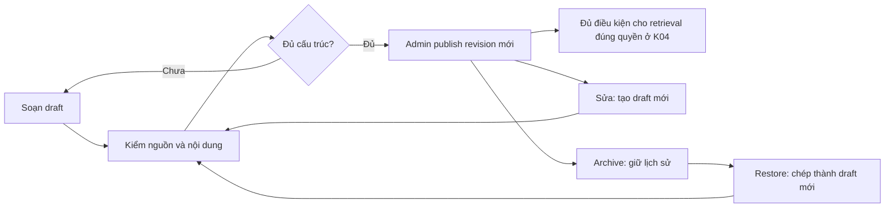

# Kho tri thức: soạn nội dung, duyệt phiên bản và giữ nguồn

**Dành cho:** người quản trị nội dung và lập trình viên tiếp nhận Backend. Kho dùng chung cho các Agent đang được xây theo [lộ trình](../tasks/plan.md). Hiện K01/K02 cung cấp lưu trữ và API; giao diện K03 và retrieval K04 được nghiệm thu riêng. Một mục đã published chưa chứng minh các Agent hiện tại đã đọc mục đó.

## 1. Hiểu bằng một ví dụ

Bạn muốn Mentor hướng dẫn sinh viên đọc lỗi Git. Hãy soạn một **guide an toàn cho sinh viên**, gắn mục đích `mentoring`, nghề liên quan và nguồn tài liệu Git.

Bạn muốn Evaluator chấm cách xử lý Promise. Hãy soạn một **Q&A dành cho chấm bài**, trong đó có nhiều hướng trả lời đúng và rubric. Không đưa toàn bộ Q&A vào guide Mentor: câu trả lời, lời giải và tiêu chí chấm có phạm vi khác nhau.



Đây là cách cung cấp context và nguồn có kiểm soát, không phải tự huấn luyện lại model. CV, câu trả lời của sinh viên, log và trace không tự trở thành kiến thức đã duyệt.

## 2. Một tài liệu gồm những gì?

| Trường | Cách hiểu và sử dụng |
|---|---|
| `code` | Mã ổn định, ví dụ `git-read-errors`. Dùng để tra cứu và giữ lịch sử; không đổi khi sửa tiêu đề |
| `kind` | `guide`, `qa`, `exercise`, `solution`, `rubric`, `plan_template`, `communication` |
| `title`, `summary` | Tên dễ tìm và mô tả ngắn giúp người duyệt hiểu mục tiêu trước khi mở nội dung |
| `language`, `difficulty` | vi/en; easy/medium/hard hoặc null nếu không cần phân độ khó |
| `roleCodes` | Mã nghề lấy từ catalog M01; rỗng nghĩa là kiến thức dùng chung, không phải tự cấp mọi quyền |
| `purposes` | Các công việc được dùng nội dung này: mentoring, planning, code_review, interview, interview_evaluation, evaluation_assistance, recommendation, cv_screening, communication |
| `audience` | Phân loại nội dung an toàn cho sinh viên, nội bộ hoặc riêng cho chấm |
| `sources` | Tên nguồn kèm URL HTTPS hoặc tham chiếu tài liệu; hệ thống lưu trích dẫn, không tự tải URL |
| `body` | Nội dung theo loại; Q&A/rubric có cấu trúc, các loại còn lại dùng markdown |

Chọn audience theo **nội dung**, không theo người đang đăng nhập:

| Audience | Dùng khi |
|---|---|
| `student_safe` | Có thể đưa nội dung vào hỗ trợ học tập sau khi đúng scope và được duyệt |
| `staff_only` | Nội dung vận hành nội bộ dành cho công việc của người quản lý |
| `grading_only` | Có đáp án, lời giải hoặc rubric; bắt buộc với qa/solution/rubric |

Phân loại này chưa tự cấp quyền gọi một Agent hoặc một tool. K04 sẽ xác định scope từ server, rồi lọc trạng thái/quyền trước khi tìm và xếp hạng nội dung.

## 3. Thử API qua Swagger

Trên môi trường đã áp migration và chạy bản M02, mở `/api/docs` của API cần dùng. Đăng nhập bằng tài khoản Admin qua `auth/login`, dùng accessToken cho nút **Authorize**, rồi tìm nhóm `knowledge`.

Thực hiện theo thứ tự:

1. Tạo draft bằng `POST /api/v1/admin/knowledge` với payload dưới đây.
2. Đọc lại bằng `GET /api/v1/admin/knowledge/git-read-errors`. Version đầu là 1, status draft.
3. Đọc `GET /api/v1/admin/knowledge/git-read-errors/publication-check`. Kết quả có `currentVersion`, `status`, `sha256`, `publishable` và `issues`. Đây là kiểm tra chỉ đọc trên bản đã lưu; không tạo revision hoặc audit ghi dữ liệu.
4. Sau khi duyệt chuyên môn, gọi `POST /api/v1/admin/knowledge/git-read-errors/publish` với `{"version":1}`. Nhận version 2, status published. Server vẫn kiểm quyền, version và cấu trúc lần nữa.
5. Đọc `.../git-read-errors/revisions` để thấy cả draft 1 và published 2, người tạo, thời điểm và hash.

```json
{
  "code": "git-read-errors",
  "draft": {
    "kind": "guide",
    "title": "Đọc lỗi Git trước khi sửa",
    "summary": "Hướng dẫn kiểm tra working tree và hiểu thông báo lỗi trước khi thay đổi mã.",
    "language": "vi",
    "difficulty": "easy",
    "audience": "student_safe",
    "purposes": ["mentoring"],
    "roleCodes": ["frontend"],
    "tags": ["Git"],
    "sources": [{"title": "Git documentation", "url": "https://git-scm.com/docs"}],
    "body": {
      "markdown": "Đọc đầy đủ thông báo lỗi. Chạy git status để biết working tree đang có thay đổi nào. Đối chiếu lệnh với tài liệu trước khi quyết định cách xử lý."
    }
  }
}
```

Ví dụ chỉ minh họa cấu trúc và thao tác; bộ nội dung chuyên môn dùng cho nghiệm thu sẽ được biên soạn/duyệt riêng ở P02. Không chạy các ví dụ tạo dữ liệu trên database muốn giữ trắng.

## 4. Soạn Q&A có nhiều hướng trả lời đúng

Q&A không phải một câu mẫu để model so khớp nguyên văn. Người duyệt cần mô tả năng lực mong đợi và những cách giải thích tương đương.

| Trường trong `body` | Yêu cầu trước publish |
|---|---|
| `question` | Câu hỏi rõ, ít nhất 10 ký tự |
| `expectedConcepts` | 1–20 ý chính, có thể nhận diện trong cách diễn đạt khác nhau |
| `validAnswers` | 2–8 cách trả lời đúng, khác nhau; không nhân bản một câu chỉ bằng đổi hoa/thường |
| `exampleAnswer` | Một câu trả lời minh họa đủ rõ, không phải đáp án bắt học thuộc |
| `commonMistakes` | 1–20 hiểu lầm/lỗi thường gặp |
| `followUps` | 1–8 câu hỏi đào sâu |
| `weakAnswerExamples` | 1–8 ví dụ chưa đạt để phân biệt thiếu bằng chứng với diễn đạt khác |
| `rubric` | 1–12 tiêu chí riêng biệt; mỗi tiêu chí có criterion, description, weight; trọng số nguyên dương tổng 100 |

Với câu hỏi “Bạn xử lý lỗi Promise thế nào?”, hai hướng đúng có thể là async/await với try/catch hoặc Promise.catch/finally, nếu cả hai xử lý lỗi và phản hồi thật. Rubric nên chấm khả năng kiểm soát lỗi và trải nghiệm người dùng, không bắt mọi người viết cùng một chuỗi ký tự.

Rubric độc lập dùng `body.guidance` và `body.rubric`. Guide, exercise, solution, plan_template và communication dùng `body.markdown`. Nội dung ngoài schema publish bị từ chối, không âm thầm biến thành chỉ thị thêm cho model.

Draft cho phép chưa có nguồn hoặc chưa đủ Q&A để soạn tiếp. Publish bắt buộc title tối thiểu 5 ký tự, summary tối thiểu 20, nguồn và cấu trúc đủ. Đây là gate cấu trúc; Admin vẫn phải kiểm độ đúng chuyên môn, tính phù hợp và chất lượng nguồn.

## 5. Sửa, lưu trữ và khôi phục

| Bạn muốn | API và kết quả |
|---|---|
| Sửa nội dung | PUT `/:code` với `{version,draft}`. Tạo version tiếp theo ở draft, kể cả trước đó published |
| Dừng dùng | POST `/:code/archive` với `{version}`. Thêm revision archived, giữ mọi bản cũ |
| Lấy lại nội dung cũ | POST `/:code/restore` với `{version,sourceVersion}`. Chép nội dung cũ vào draft mới; không quay ngược số version |
| Xuất bản lại bản archive | Restore thành draft, kiểm nội dung, rồi publish với version mới |

Ví dụ: published 2 → sửa thành draft 3 → archive 4 → restore từ 2 thành draft 5 → publish 6. Revision 2 vẫn giữ nội dung và hash ban đầu. Khi K04 kết nối retrieval, run mới chỉ lấy current published; run đã chụp snapshot vẫn giữ nguồn của lần chạy trước.

Nếu nhận **409 KNOWLEDGE_VERSION_CONFLICT**, người khác vừa sửa hoặc bạn đang giữ version cũ. Tải current, đối chiếu thay đổi rồi gửi lại version mới. Không tự ghi đè hoặc đổi version để bỏ qua nội dung người khác.

## 6. Tìm, xem lịch sử và kiểm lô import

GET danh sách hỗ trợ page/pageSize (tối đa 50), search theo mã/tiêu đề, status, kind, audience, purpose và roleCode. Danh sách chỉ trả metadata; mở detail/history để đọc nội dung. Search là chuỗi literal, dấu `%` không biến thành wildcard.

POST `/import/dry-run` nhận `{"entries":[{"code":"...","draft":{...}}]}` với 1–50 hàng. Mỗi hàng có:

- `validDraft`: đủ điều kiện lưu draft; khác với đủ điều kiện publish.
- `publishable`, `publicationIssues`: kết quả gate cấu trúc xuất bản.
- `exists`, `currentVersion`: mã đã có, giúp người quản trị nhận ra cập nhật cần xử lý version.
- `issues`: lỗi theo hàng, gồm mã trùng trong lô, schema sai hoặc nghề không tồn tại.

`mutationsPerformed` luôn bằng 0. Dry-run không nhập, sửa hoặc publish tài liệu. Dữ liệu hợp lệ phải được tạo/sửa bằng API thông thường; mỗi thao tác vẫn kiểm quyền/version lại. Không có endpoint import hàng loạt âm thầm ghi đè.

## 7. Quyền và bảo toàn dữ liệu

Tất cả endpoint yêu cầu Admin hiệu lực và `knowledge.read`; thao tác biên soạn thêm `knowledge.manage`, publish thêm `knowledge.publish`. Giảng viên/sinh viên không được đọc kho biên soạn kể cả khi một role tùy chỉnh được cấp các permission này. Thu hồi quyền có hiệu lực ngay ở request sau; JWT chỉ giữ danh tính.

Người chỉ được duyệt xuất bản vẫn có thể đọc `publication-check` khi có quyền đọc, không cần quyền biên soạn. Quyền này không cho phép kiểm file import: `/import/dry-run` tiếp tục yêu cầu `knowledge.manage`. Kiểm xuất bản không phải giữ chỗ hoặc khóa tài liệu; nếu một người khác sửa sau lúc kiểm, thao tác publish trả conflict và người duyệt phải đối chiếu lại.

Mỗi lần ghi lưu current, revision và audit trong cùng transaction. Audit chỉ ghi mã/version/hash và bản nguồn khi restore; không chép toàn bộ đáp án. SQL trigger chặn UPDATE/DELETE revision. Down migration kho sẽ dừng nếu đã có nội dung; migration permission không tự thu hồi quyền đang được sử dụng.

Đường dẫn code: `src/knowledge/` (contracts, policy, publication policy, store, DTO, controller, import). Kiểm thử: unit policy và `test/knowledge-storage.e2e-spec.ts`. [Báo cáo có nguồn](reports/knowledge-library-20261023.md) phân biệt local, CI, runtime và các phần chưa triển khai.
