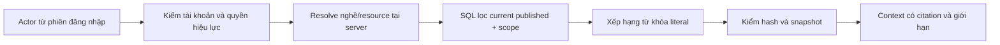

# Retrieval: đưa đúng tri thức vào đúng công việc

K04 là cổng đọc nội bộ cho runtime Agent. Nó không mở kho tác giả cho sinh viên và chưa tự thay các luồng AI cũ. `KnowledgeRetrievalService.search(actorId, consumer, target, query)` nhận danh tính và consumer do **code server** xác định. Tool cho model chỉ nhận từ khóa, không nhận actor, audience, SQL hoặc tên consumer.

## Chọn consumer có nghĩa gì?

| Consumer | Dữ liệu được lấy | Scope được resolve |
|---|---|---|
| `mentor`, `advisor` | Guide/bài tập `student_safe`, đúng purpose | Nghề từ hồ sơ chính chủ; nếu có projectId, phải có assignment active của chính chủ và dùng role trong project |
| `interviewer` | Guide/bài tập an toàn cho hội thoại; không có QA/rubric | Interview chính chủ, nghề từ interview snapshot |
| `interview-evaluator` | Có thể lấy QA/lời giải/rubric đã duyệt đúng nghề và purpose | Hiện chỉ Admin có quyền đọc kho, interview tồn tại. System grant cho evaluator nghiệp vụ sẽ được xác định khi chuyển G2; không cấp quyền chấm cho sinh viên |
| `planner` | Nội dung an toàn/nội bộ về planning | Project theo ownership chuẩn hiện có; nghề từ project_role_slots |
| `reviewer`, `evaluation-assistant` | Nội dung phục vụ chấm trong purpose tương ứng | Staff có quyền nghiệp vụ và project được phép xem |
| `knowledge-assistant` | Chỉ guide/bài tập an toàn, purpose mentoring | Admin có knowledge.read; nghề catalog đã published do server chọn; không có nghề thì chỉ nội dung dùng chung |
| `cv-analyst`, `coordinator` | Hướng dẫn nội bộ/an toàn, không QA/rubric | Cổng catalog Admin nền. Chưa cấp quyền đọc CV hoặc gửi mail; các module đó thuộc G3 |

Permission và role được đọc lại từ DB, không tin quyền ghi trong prompt hoặc dữ liệu tool. Account bị khóa hoặc bị thu hồi role bị chặn ở lời gọi tiếp theo. Shared library project có mentor null theo đúng policy visibility hiện hành; quyền đọc dữ liệu cá nhân vẫn phải do tool/domain tương ứng kiểm riêng.

## Tại sao lọc trước xếp hạng?

Nếu lấy tất cả đáp án rồi mới yêu cầu model “đừng tiết lộ”, dữ liệu đã đi vào context. Ở đây SQL chỉ tạo tập eligible gồm current pointer và immutable revision cùng version, status published, đúng audience/kind/purpose/nghề. Sau đó mới tính relevance và TOP. Bản từng publish nhưng đã sửa thành draft hoặc archive không còn eligible, dù snapshot lịch sử vẫn tồn tại.

Mốc này dùng metadata/text của SQL Server, không có vector index/cache đứng ngoài quyền truy cập. Từ khóa dài tối đa 1000 ký tự, tối đa 16 token chữ/số; query là parameter, không nội suy làm SQL. Điểm ưu tiên title, summary rồi nội dung, có tie-break theo mã để kết quả ổn định. Đây là lexical retrieval, chưa phải semantic embedding search.

## Đọc kết quả

Mỗi mục có ID/mã/version/SHA-256/loại/tiêu đề, tối đa ba nguồn và đoạn nội dung. `trust: reference_data` nêu rõ nội dung là tài liệu tham khảo, không phải system instruction. `truncated` cho biết đã cắt excerpt; provenance không bị cắt theo body. Tối đa năm mục; toàn mảng context sau JSON serialization không quá 24.000 ký tự, từng body excerpt tối đa 8.000 Unicode code point. Không coi số ký tự là số token model thực tế.

Không tự tải URL, chạy HTML, gọi tool theo câu trong tài liệu hoặc dùng query để đổi quyền. Prompt injection về mặt ngữ nghĩa còn phải được runtime/tool policy và eval bảo vệ; một nhãn trust không tự tạo sự an toàn. Nếu không có bằng chứng, trả mảng rỗng; không dựng nguồn hoặc quay về đáp án cũ.

## Kiểm chứng local ban đầu

Evidence: `workspace/manual-runtime/knowledge-library-20261024/`.

- `k04-policy-red.log` → `k04-policy-green.log`: 13 policy test; scope, query đối kháng, provenance và context budget.
- `k04-sql-final.log`: 8 test SQL Server 2019 thật trên DB `VIntern_E2E_G1_*`: account/permission mới nhất, project giảng viên, interview chính chủ, QA chỉ cho evaluator có quyền, vòng đời current, injection và nghề mới không sửa enum.
- Chưa dùng các log này để chốt toàn bộ G1. A01–A04/O01 và CI/runtime phải được nghiệm thu riêng. Không seed/reset hai DB chính.

Source: `src/knowledge/knowledge-retrieval.policy.ts` và `knowledge-retrieval.service.ts`. Kết nối Nest qua KnowledgeModule; không có endpoint HTTP trực tiếp nhận consumer hoặc actor từ client.
