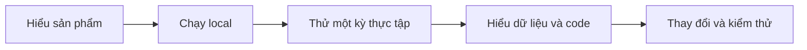

# Tài liệu V-Intern Backend

Demo trước giảng viên: [checklist ngắn](DEMO-CHECKLIST.md) → [hướng dẫn chi tiết](DEMO-GUIDE.md). Bản GitHub không chứa mật khẩu tài khoản bảo vệ.

> Bộ bàn giao theo lộ trình đọc: [HANDOVER](HANDOVER.md). Trang này là chương tra cứu chuyên sâu; kết quả chạy thực tế xem [VERIFICATION](VERIFICATION.md).

Bộ tài liệu này dành cho người sử dụng, người vận hành local và lập trình viên tiếp nhận dự án. Bạn không cần đọc từ đầu đến cuối trong một lần. Chọn lộ trình phù hợp rồi quay lại các chương chuyên sâu khi cần.

## Lộ trình đọc

1. [Bắt đầu từ đây](START-HERE.md): sản phẩm giải quyết việc gì, ai làm gì, thuật ngữ và ví dụ xuyên suốt.
2. [Chạy local](LOCAL-DEVELOPMENT.md): điều kiện, cấu hình, khởi động, dừng và kiểm tra đúng dịch vụ.
3. [Hướng dẫn sử dụng](USER-JOURNEYS.md): thao tác của Admin, giảng viên và sinh viên; cách nhận biết từng bước đã xong.
4. [Bản đồ code](CODE-MAP.md) và [mô hình dữ liệu](architecture/domain-model.md): tìm nơi xử lý một chức năng.
5. [API](api/README.md), [kiểm thử](TESTING.md), [tìm lỗi](TROUBLESHOOTING.md): tích hợp và bảo trì.
6. [Bảng nhánh xử lý](WORKFLOW-MATRIX.md): đối chiếu các điều kiện đúng/sai; [nhánh Git](GIT-WORKFLOW.md): tiếp nhận working tree và lịch sử hiện tại.

## Các chương theo nghiệp vụ

| Nhóm | Nội dung |
|---|---|
| Tài khoản | [Đăng ký, đăng nhập và quyền](architecture/registration.md) · [Quản trị](architecture/admin.md) |
| Tuyển dụng | [Hội thoại, chấm điểm và đề xuất vai trò](architecture/recruitment-chat.md) |
| Tri thức Agent | [Cách biên soạn và duyệt phiên bản](KNOWLEDGE-LIBRARY.md) · [Đặc tả M02](../SPEC-knowledge-library.md) · [Kiểm chứng K01/K02](reports/knowledge-library-20261023.md) |
| Chuẩn bị thực tập | [Dự án mẫu](architecture/project-blueprints.md) · [Phiên và đội hình](architecture/academic-core.md) · [Kế hoạch AI](architecture/learning-plans.md) |
| Làm việc | [Sprint, task và bài nộp](architecture/sprint-task-core.md) · [AI Mentor](architecture/ai-mentor.md) |
| Mã nguồn | [GitHub và review](architecture/github-code-review.md) · [Runner tin cậy](architecture/grading-runner.md) |
| Theo dõi | [Hiệu suất sinh viên](architecture/student-performance.md) · [Thông báo](architecture/notifications.md) · [Chia sẻ theo đồng ý](architecture/session-sharing.md) |
| Kết quả | [Đánh giá và KPI](architecture/evaluation-performance-kpi.md) · [Lương ảo](architecture/virtual-salary.md) · [Chứng nhận](architecture/certificates.md) · [Báo cáo](architecture/reports.md) |
| AI tư vấn | [Gợi ý chấm đánh giá](architecture/ai-evaluation-assistance.md) · [Khuyến nghị phát triển](architecture/ai-recommendations.md) |

## Vận hành và căn cứ kỹ thuật

- [Cấu hình](CONFIGURATION.md), [SQL Server](database/SQLSERVER2019_SETUP.md), [migration](database/MIGRATION_POLICY.md).
- [API routes](api/ROUTES.md), [bảo mật](SECURITY.md), [dependencies](DEPENDENCIES.md).
- [Kiểm chứng](VERIFICATION.md), [nghiệm thu GitHub lịch sử](LIVE-GITHUB.md).
- Các quyết định: [AI và GitHub](decisions/0001-ai-github-authority.md), [tài khoản repository chung](decisions/0002-admin-repository-account.md), [ba mức điểm phỏng vấn](decisions/0003-recruitment-score-bands.md).

## Cách đọc ví dụ

Tên người, email và ID trong ví dụ là minh họa, không phải tài khoản đăng nhập. Chỉ số mẫu dùng để giải thích công thức, không phải kết quả của database hiện tại. Một ví dụ request phải được thay bằng ID có thật và thuộc phạm vi tài khoản đang dùng.

Các file dưới `archive/` là lịch sử dự án. Chúng có thể mô tả chính sách cũ; không dùng chúng thay hướng dẫn hiện hành. ADR cũ được giữ để giải thích vì sao thiết kế đã thay đổi. Khi code, DTO hoặc migration thay đổi, cập nhật chương tương ứng và ghi lại lần kiểm chứng mới; không sửa kết quả lịch sử để làm tài liệu trông đồng bộ.
