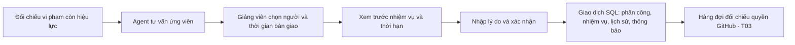
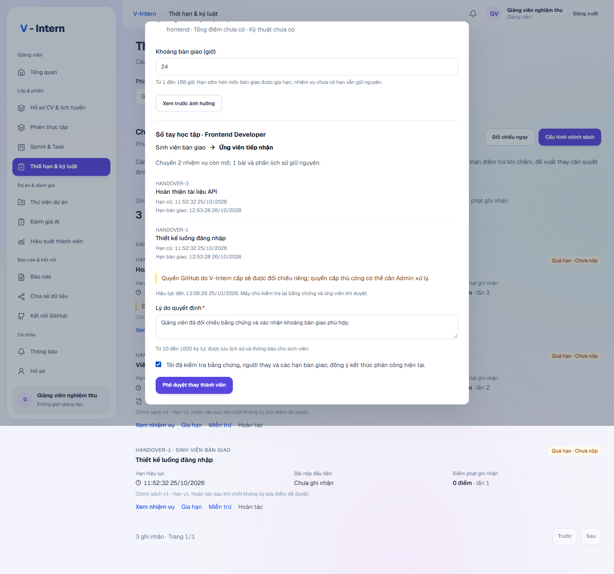
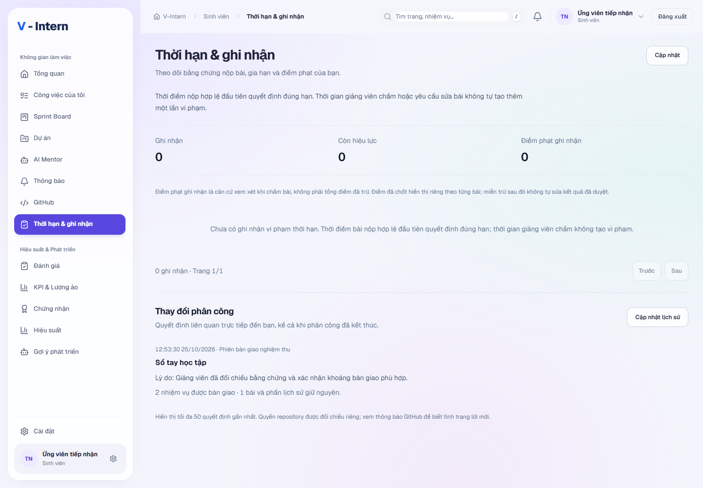

# Thay thành viên: từ bằng chứng đến quyết định

**Trạng thái ngày 25/10/2026:** T01–T03 đã được kiểm trên SQL2019 và Chrome QA riêng. Hai database local chính chưa bật G6. [Đối chiếu quyền GitHub và cách phục hồi](REPOSITORY-ACCESS-RECOVERY.md) đã có worker, trạng thái hai vai và retry có lý do. Không coi việc duyệt trong hệ thống là bằng chứng GitHub đã cấp hoặc thu hồi quyền.

## Một ví dụ để hiểu toàn bộ luồng

An đang làm dự án Sổ tay học tập. Phiên dùng quy tắc cảnh báo từ lần 1, trừ điểm từ lần 2 và xem xét thay từ lần 3. An có ba ghi nhận vi phạm còn hiệu lực. Giảng viên muốn tìm người tiếp nhận hai nhiệm vụ còn mở, trong khi một bài đã được chấm 85 điểm.

Agent có thể đề xuất Bình vì Bình đã đạt phỏng vấn đúng vai trò và chưa có phân công/công việc đang mở. Đề xuất chưa thay An. Giảng viên vẫn có thể chọn người khác trong danh sách đủ điều kiện mà server đã cung cấp, hoặc dừng lại.

## Giảng viên thao tác thế nào?

1. Vào **Thời hạn & kỷ luật**, chọn phiên mình chủ trì. Chỉ ghi nhận đang đủ ngưỡng mới có **Xem xét thay thành viên**.
2. Chọn **Yêu cầu Agent đối chiếu**. Hệ thống không tự gọi model chỉ vì bạn mở hộp thoại. Xem nhận định, căn cứ kỹ năng và giới hạn của lượt tìm kiếm.
3. Chọn một ứng viên và khoảng bàn giao từ **1 đến 168 giờ**, mặc định 24 giờ.
4. Chọn **Xem trước ảnh hưởng**. Kiểm tra đúng dự án, vai trò, người cũ/người mới, từng nhiệm vụ chuyển, hạn cũ và hạn bàn giao. Bản xem trước chỉ có hiệu lực trong tối đa 15 phút, và không vượt hạn 30 phút của tư vấn.
5. Nhập lý do từ 10 đến 1000 ký tự, đọc lại ảnh hưởng rồi đánh dấu xác nhận. Chỉ sau đó nút **Phê duyệt thay thành viên** mới được mở.
6. Đọc kết quả. Thông báo “đang chờ đối chiếu GitHub” có nghĩa quyền trên GitHub chưa được xác nhận.

Nếu mạng mất sau khi bấm duyệt, thử lại cùng bản xem trước sẽ nhận kết quả đã lưu, không tạo thêm phân công hoặc thông báo trùng. Nếu máy chủ báo bằng chứng thay đổi, giao diện bỏ bản xem trước cũ; hãy yêu cầu đối chiếu hoặc xem trước lại theo thông báo.

## Dữ liệu nào đổi, dữ liệu nào được giữ?

| Phần | Kết quả sau khi duyệt |
|---|---|
| Phân công cũ | Chuyển sang `cancelled`; không ghi nhận hoàn thành khóa thực tập |
| Phân công mới | Tạo một assignment đang hoạt động, đúng phiên/dự án/vai trò và còn đủ chỗ |
| Danh sách thành viên phiên | Gỡ người cũ, thêm người mới |
| Thành viên dự án | Giữ người cũ làm lịch sử, thêm/cập nhật vai trò người mới |
| Nhiệm vụ còn mở, đúng phạm vi | Chuyển người phụ trách, tăng version và lưu audit |
| Nhiệm vụ đã xong hoặc thuộc Sprint đã kết thúc/hủy | Giữ tác giả và lịch sử |
| Bài đang review hoặc có bài nộp chờ duyệt | Chặn thay người; giảng viên xử lý bài trước |
| Bài đã chấm, đánh giá, KPI đã chốt | Giữ nguyên; ví dụ bài 85 điểm vẫn là của An và vẫn 85 điểm |
| Tài khoản, mật khẩu, vai trò tuyển dụng | Không đổi |
| Quyền GitHub | Ghi hai công việc đối chiếu để xử lý sau giao dịch SQL |

Hạn có sẵn sớm hơn mốc bàn giao sẽ được nâng tới mốc đó; hạn muộn hơn giữ nguyên. Nhiệm vụ chưa có hạn vẫn chưa có hạn. Giảng viên thấy cảnh báo nếu hạn bàn giao vượt lịch kết thúc phiên.

## Tính công bằng và giới hạn của Agent

- Ngưỡng thay người được đọc từ **snapshot chính sách của ghi nhận**, vì sửa chính sách mới chỉ áp dụng cho tương lai. Server đếm lại các vi phạm còn hiệu lực. Nếu hai vi phạm trước đã được miễn, “lần 3” trong lịch sử không đủ để tiếp tục thay người.
- Agent chỉ nhận ứng viên đã được server kiểm: tài khoản sinh viên đang hoạt động, đã đạt đúng vai trò đã phát hành, không có assignment đang hoạt động và không có nhiệm vụ mở thuộc dự án còn hoạt động.
- Mỗi lượt tìm đối chiếu tối đa 60 hồ sơ và đưa tối đa 20 ứng viên vào model. Khi chưa phủ hết hồ sơ, giao diện nói rõ giới hạn đó.
- Email ứng viên không được đưa vào input model. Model không được tự tạo người, tự kick, tự sửa điểm hoặc cấp quyền repository.
- Output phải dùng đúng ID và bằng chứng đã được cung cấp. Thay đổi bằng chứng trong lúc model chạy, sau tư vấn hoặc sau preview đều có kiểm tra lại ở server.

## Sinh viên thấy gì?

Ở **Thời hạn & ghi nhận**, mỗi người chỉ thấy bằng chứng và lịch sử thay đổi liên quan đến mình. Người cũ vẫn đọc được quyết định sau khi không còn assignment hiện hành. Người mới thấy nhiệm vụ đã nhận cùng hạn cụ thể trong **Công việc**. Lịch sử hiển thị tối đa 50 quyết định gần nhất, có thời gian và lý do.

## API và cấu trúc code

Các đường dẫn dưới đây có tiền tố `/api/v1`. Tất cả đều cần đăng nhập. Luồng staff yêu cầu `sessions.manage` + `recruitment.view`; preview/đọc quyết định/phê duyệt cần thêm `assignments.manage`. Chỉ giảng viên chủ trì hoặc Admin được xử lý phiên.

| API | Mục đích |
|---|---|
| `POST /sessions/:id/participation/incidents/:incidentId/replacement-advice` | Tạo tư vấn mới, có ID và bằng chứng bất biến |
| `POST /sessions/:id/participation/incidents/:incidentId/replacement-preview` | Nhận `adviceId`, `candidateId`, `handoverHours`; chỉ lưu preview |
| `GET /sessions/:id/participation/replacements/:commandId` | Đọc preview, thời hạn, kết quả đã duyệt và trạng thái hàng đợi |
| `POST /sessions/:id/participation/replacements/:commandId/approve` | Nhận `expectedPreviewHash`, `reason`; server kiểm lại và lưu một lần |
| `GET /participation/me/replacements` | Tối đa 50 quyết định liên quan trực tiếp đến caller |

BE đặt toàn bộ nghiệp vụ trong `src/participation`: `replacement-scope.ts` kiểm quyền/phạm vi/ngưỡng; `replacement-advice.service.ts` gọi Agent; `replacement-plan.ts` lập kế hoạch nhiệm vụ thuần; `replacement-preview.service.ts` kiểm tư vấn/TTL/fingerprint; `replacement-commands.service.ts` thực hiện giao dịch. DTO/controller và schema của dữ liệu lưu được tách riêng.

FE dùng `src/lib/api/replacements.ts` để kiểm contract; `replacement-dialog.tsx` điều khiển tư vấn → preview → xác nhận; `replacement-history.tsx` hiển thị lịch sử sinh viên. Giao diện không tự quyết định điểm, eligibility hay quyền GitHub.

Giao dịch phê duyệt dùng `SERIALIZABLE`, khóa phiên trước, rồi command → assignment cũ → user theo thứ tự → project → nhiệm vụ. Kiểm hash/fingerprint/TTL và điều kiện lại trong transaction. Không gọi model hoặc GitHub bên trong giao dịch. Nếu không lưu được hàng đợi, toàn bộ thay đổi được rollback.

Migration `1763587200000-CreateReplacementWorkflow.ts` bổ sung ba bảng command, quyết định và access job. Rollback bị chặn khi đã có lịch sử; không xóa quyết định để hạ phiên bản. **Chưa chạy migration G6 trên hai DB native.**

## Bằng chứng và phần còn lại

Nghiệm thu dùng SQL2019 disposable và model fixture được nêu rõ; không thay thế bằng chứng model hoặc GitHub thật. Xem [báo cáo kiểm chứng](reports/g6-replacement-evidence-20261025.json) để biết commit, số test, mốc kiểm tra và giới hạn.

T03 đã kiểm nguồn gốc lời mời, lease/retry, numeric identity và phạm vi dùng chung. GitHub thật đã tạo/hủy đúng pending invitation; collaborator đã nhận hoặc quyền chưa rõ nguồn được giữ để Admin đối chiếu. G7 còn nghiệm thu toàn bộ luồng và kích hoạt native có kiểm tra dữ liệu được bảo vệ.
