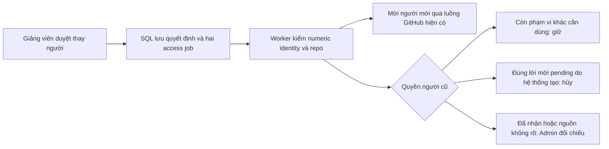

# Quyền GitHub sau khi thay sinh viên

Ngày kiểm: **25/10/2026**. Chức năng T03 đã được kiểm trên SQL2019 và Chrome QA riêng. Hai database native chưa được kích hoạt G6. Việc thay người thành công trong V-Intern không có nghĩa quyền GitHub đã thay đổi ngay.

## Hiểu qua một tình huống

Giảng viên duyệt Bình tiếp nhận nhiệm vụ của An. Giao dịch lưu quyết định, chuyển nhiệm vụ mở và tạo hai việc đối chiếu quyền. Worker xử lý tối đa ba việc mỗi phút; nếu API GitHub gián đoạn, quyết định học tập vẫn được giữ và việc đối chiếu sẽ thử lại.

**Tạo lời mời** và **đã có quyền** là hai kết quả khác nhau. Sinh viên phải chấp nhận lời mời trên GitHub. Kết nối OAuth chỉ xác nhận danh tính, không tự cấp quyền repository.

## Cách sử dụng

1. Giảng viên mở **Thời hạn & kỷ luật**, chọn phiên và xem mục **Quyền GitHub sau bàn giao**.
2. Bấm **Cập nhật quyền** để đọc kết quả mới nhất. Đây là thao tác đọc, không chạy GitHub đồng bộ ngay trong request.
3. Nếu sinh viên mới chưa kết nối, hướng dẫn mở **Kết nối GitHub** bằng đúng tài khoản. Sinh viên thấy đường dẫn này trong trạng thái của chính mình.
4. Nếu hiện **Admin cần đối chiếu**, người quản lý repo mở GitHub và kiểm tra quyền hiện tại. Quyền chưa chứng minh được nguồn gốc được giữ nguyên. Chỉ gỡ sau khi đã xác nhận không còn phiên nào cần dùng.
5. Sau khi sửa kết nối hoặc quyền, giảng viên bấm **Đối chiếu lại**, nhập lý do 10–1000 ký tự rồi **Đưa vào hàng đợi**. Kết quả cần chờ lượt worker và tải lại.
6. Nếu trạng thái thay đổi trong lúc mở hộp thoại, đóng và tải lại. Không gửi lại quyết định cũ một cách âm thầm.

Sinh viên chỉ đọc các lượt liên quan đến mình. Sinh viên đã kết thúc phân công vẫn được xem lịch sử; không được đọc hồ sơ người tiếp nhận hoặc yêu cầu staff retry.

## Đọc trạng thái

| Hiển thị | Ý nghĩa và việc cần làm |
|---|---|
| Chờ xử lý | Đã lưu việc; chưa có kết quả GitHub |
| Đang đối chiếu | Worker đang giữ lease có thời hạn |
| Sẽ thử lại | Lỗi tạm thời; backoff, tối đa sáu lượt mạng cho mỗi đợt xử lý |
| Cần bổ sung kết nối | Kiểm tra kết nối sinh viên, tài khoản chung, repo hoặc trạng thái phiên; chờ này không tiêu hao lượt mạng |
| Admin cần đối chiếu | Giữ quyền chưa xác minh; xử lý thủ công rồi yêu cầu đối chiếu lại |
| Cần xử lý | Hết lượt thử hoặc lỗi cần người phụ trách can thiệp |
| Đã đối chiếu | Đã lưu kết quả kiểm tra; đọc thêm dòng **lời mời đang chờ** hoặc **đã xác nhận quyền** |

Retry có lý do là một đợt xử lý mới: reset bộ đếm mạng, lưu trạng thái/số lần cũ vào audit. Không cho retry việc đang chạy, pending hoặc done. Danh sách trả tối đa 50 lượt mới nhất; tổng hợp trạng thái tính trên toàn bộ phạm vi được phép.

## Quy tắc không được bỏ qua

- So khớp numeric ID của owner, repo và người nhận. Đổi username không thay danh tính. Kết nối sang numeric ID mới cần kiểm tra, không cấp quyền mù.
- Chủ repo và danh tính còn được phiên/phân công khác dùng luôn được giữ. Lịch sử numeric ID vẫn được xét khi đã ngắt kết nối.
- Chỉ phản hồi **201 tạo lời mời mới** gắn với invitation event bất biến mới là bằng chứng hệ thống đã cấp lời mời. Phản hồi 204, lời mời có sẵn hoặc quyền có sẵn không được nhận thành quyền do V-Intern tạo. Không backfill quyền lịch sử.
- Chỉ tự hủy **đúng invitation ID đang pending có bằng chứng**. Quyền collaborator đã được nhận có thể đã được Admin sửa thủ công; GitHub không cung cấp chuỗi nguồn gốc đủ chắc để tự xóa. Trường hợp đó chuyển kiểm tra thủ công.
- Lease SQL năm phút, khóa phiên trước, kiểm lại lease trước hủy từ xa và lưu kết quả có điều kiện. Worker cũ không hoàn tất hoặc giải phóng lease của worker mới.
- Không gọi model/GitHub trong giao dịch SQL. Mất phản hồi DELETE được phục hồi bằng đối chiếu lại, không xóa quyền mới quan sát được.

## API và nơi sửa code

Tiền tố `/api/v1`, cần đăng nhập:

| API | Quyền |
|---|---|
| `GET /sessions/:id/participation/repository-access-jobs` | Admin hoặc giảng viên chủ trì; đủ quyền session/recruitment/assignment |
| `POST /sessions/:id/participation/repository-access-jobs/:jobId/retry` | Cùng phạm vi; body có `expectedRevision` và `reason`; revision cũ trả 409 |
| `GET /github/me/repository-access` | Chỉ dữ liệu caller |

BE: `github-grant-ledger.ts` lưu provenance; `repository-access.policy.ts` quyết định thuần; `repository-access.queue.ts` lease/kết quả/audit; `repository-access.worker.ts` điều phối GitHub; service/controller kiểm scope và retry. Migration `1763673600000-TrackRepositoryGrants.ts` không backfill; rollback bị chặn nếu đã có bằng chứng.

FE: `src/lib/api/repository-access.ts` kiểm contract; `src/components/participation/repository-access.tsx` dùng chung cho hai vai. Không có quyền staff retry ở giao diện sinh viên.

## Bằng chứng và giới hạn

- 21 ca SQL queue/worker/HTTP đạt, gồm SERIALIZABLE pool, concurrency, lease hết hạn, 403/429, giữ quyền dùng chung, giữ quyền không rõ nguồn, numeric ID đổi, RBAC và revision 409.
- 17 ca ledger/invitation và ba ca migration đạt; 32 ca worker/queue/approval hồi quy đạt trước bổ sung test isolation, không dùng số đó cộng vào tổng mới.
- Chrome production QA: 30 lượt ở 390/768/1024/1280/1440; preview, modal retry, Escape/trả focus, giảng viên và sinh viên cũ/mới; không tràn ngang hoặc lỗi JavaScript. Model và GitHub trong luồng này là fixture được khai báo.
- GitHub thật: tạo repo public QA, tạo invitation 201 qua service chính, lưu provenance, hủy đúng invitation qua worker, xác nhận remote không còn. Repo đã archive. [JSON bằng chứng](reports/g6-access-live-20261025.json).
- Không coi fixture nhận collaborator là bằng chứng sinh viên đã chấp nhận lời mời thật. SMTP ngoài, OAuth mới và AI live không nằm trong lượt nghiệm thu này.

Xem tiếp [thay thành viên](REPLACEMENT.md) và [quy tắc điểm phạt](PARTICIPATION.md). Kích hoạt native và nghiệm thu hành trình tổng hợp thuộc G7.
