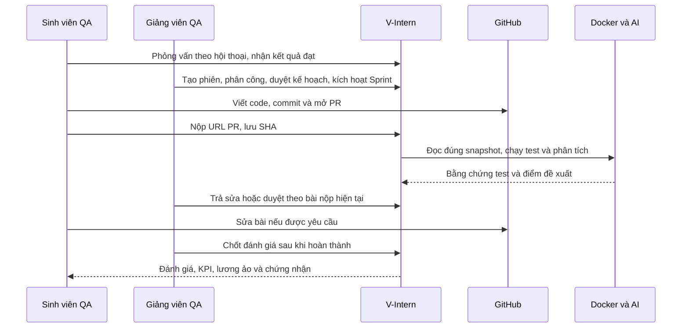

# Nghiệm thu nhập vai Sinh viên và Giảng viên — 23/10/2026

Đây là một lượt thực hành trên môi trường QA local, với sinh viên nghiệm thu riêng và bài tập do người kiểm thử viết. Không đánh giá một sinh viên thật và không reset dữ liệu chính. Mục tiêu là đi hết hành trình, kể cả bài sai, yêu cầu sửa, nộp lại và kiểm tra kết quả sau khi phiên kết thúc.

## 1. Đọc kết quả nhanh

| Kết quả | Giá trị đã kiểm chứng |
|---|---|
| Phỏng vấn | Gemini chấm 93,3; đạt ở lượt 2/3 |
| Kế hoạch | 2 Sprint, 4 nhiệm vụ; giảng viên kiểm tra rồi công bố |
| Sản phẩm | Sổ tay học tập: tạo/sửa, lưu cục bộ, tìm/xóa, xuất JSON |
| Nộp bài | 4 PR thật, sinh viên tạo/sửa bằng tài khoản GitHub riêng |
| Chấm bài | Docker chạy bộ test được niêm phong; AI đề xuất; giảng viên quyết định |
| Hoàn thành | 4/4 nhiệm vụ, 12/12 điểm độ lớn, 2 Sprint và phiên đã kết thúc |
| Đánh giá | 85,5/100, do giảng viên nhập rubric riêng rồi chốt |
| KPI | 95,7/100; nguồn tính hiển thị 50% bàn giao, 20% đúng hạn, 30% chất lượng |
| Lương ảo | 9.570.000 VND_VIRTUAL; gọi sinh lần hai không thêm giao dịch |
| Chứng nhận | VINT-2026-00000002; xác minh công khai hợp lệ |
| Báo cáo | PDF 3 trang, Excel có dữ liệu; chứng nhận PDF 1 trang đã kiểm bố cục |

## 2. Hành trình thực tế đã thực hiện

Sinh viên bắt đầu phỏng vấn và trả lời bốn câu đầu trên trình duyệt. Lượt đầu hết hạn do khoảng cách kiểm thử kéo dài; không reset lượt. Lượt thứ hai hoàn thành qua API hội thoại thực với câu trả lời tự soạn, không đọc rubric ẩn hoặc ghi điểm vào database. Gemini trả kết quả qua validator hiện hành.

Giảng viên tạo phiên, xem ứng viên, phân công và kích hoạt trên trình duyệt. Kế hoạch AI lần đầu không hợp lệ; lần thử lại sinh được hai Sprint/bốn nhiệm vụ. Giảng viên xem trước rồi công bố, sinh viên thấy Sprint được kích hoạt.

Repository được tạo dưới tài khoản dùng chung do Admin cấu hình. Sinh viên dùng danh tính GitHub khác để nhận lời mời, commit và tạo PR trong trình duyệt. Những thao tác lặp cho các nhiệm vụ tiếp theo dùng API thật và script nghiệm thu có kiểm tra trạng thái. Không thay response của ứng dụng hoặc trực tiếp cập nhật điểm/trạng thái bằng SQL.

## 3. Bài sai, sửa bài và duyệt

| Nhiệm vụ | Bằng chứng | Kết quả cuối |
|---|---|---|
| LEARNNOTESV1P4-108 | Cố ý bỏ kiểm tra tiêu đề: runner 1/2 test; giảng viên trả sửa 59,2. Sinh viên sửa PR: runner 2/2, AI 100; task vẫn chờ giảng viên | Giảng viên duyệt 100 |
| LEARNNOTESV1P4-109 | Kiểm tra lưu dữ liệu; runner 1/1 | Giảng viên duyệt 98 |
| LEARNNOTESV1P4-110 | Tìm kiếm, hủy xóa và xác nhận xóa; runner 3/3. Thay SHA trong lúc chờ duyệt bị từ chối 409 SUBMISSION_SHA_CHANGED; rút snapshot cũ và nộp lại | Giảng viên duyệt 98 |
| LEARNNOTESV1P4-111 | JSON có phiên bản và nội dung đúng; runner 1/1; 8 Node model tests đạt trong repository bài tập | Giảng viên duyệt 100 |

PR chỉ được merge sau khi API xác nhận giảng viên đã duyệt, đúng repo, tác giả và SHA. Đây là bốn PR trong repository bài thực hành; **tại thời điểm nghiệm thu, hai repository ứng dụng FE/BE chưa được push/merge**; lần công bố source/tài liệu ngày 23/10 được ghi trong [Git workflow](GIT-WORKFLOW.md).

[Mở repository bài thực hành](https://github.com/hbuivanhoi6-stack/vintern-so-tay-hoc-tap-ca-nhan-qa-aurora-thuc-hanh-va-ban-g-20261022-db9f98e8).

## 4. Quyền và tính toàn vẹn

Chín phép thử live đã đạt: sinh viên không tự chuyển Done; phụ thuộc chưa xong chặn bắt đầu; version cũ bị từ chối; không đọc task người khác; sinh viên không chấm; giảng viên ngoài phạm vi không duyệt; không tạo hai bài nộp đang chờ; sinh viên không tự cấp repository; sinh viên không tự cấp chứng nhận.

AI Mentor trả lời bằng context thật. AI hỗ trợ đánh giá chỉ là gợi ý: điểm chính thức còn trống cho tới khi giảng viên nhập 85/90/80/85 với trọng số 35/30/20/15. Backend tính 85,5 và chỉ công khai sau bước chốt. Gợi ý phát triển làm mới lần hai dùng lại snapshot; so sánh trước/sau xác nhận không đổi điểm, KPI hoặc task.

Chia sẻ phiên đã thử qua API: giảng viên quan sát yêu cầu quyền, chủ phiên cấp đúng một phiên, đọc được snapshot; thu hồi xong request tiếp theo bị 403. Không cấp quyền toàn hệ thống.

## 5. Lỗi tìm được và đã sửa

| Vấn đề | Cách sửa và kiểm chứng |
|---|---|
| Form khởi tạo dự án ở cột hẹp bó ô ngày/nút | Grid tự co theo bề rộng; nhóm nút xếp dọc, có focus state |
| Runner lỗi hạ tầng nhưng review cũ chặn thử lại | Chỉ cho retry evidence failed/not_configured; giữ lease và kết quả âm đã chạy hoàn tất; unit + live runner chứng minh |
| AI hỗ trợ đánh giá/khuyến nghị trả schema sai | Tối đa một lượt repair có audit; giữ validator, enum và bounds; không tự retry timeout; prompt v2 |
| Footer chứng nhận PDF tràn trang | Mỗi dòng có tọa độ/bề rộng và chiều cao đo thực; test tái hiện trước sửa, PDF tải lại từ API rồi render để kiểm |
| QA PDF trỏ nhầm API chính | Launcher QA đặt riêng CERTIFICATE_VERIFY_BASE_URL tại cổng 8081 |
| Kết thúc phiên thì mất trang gợi ý phát triển | Giữ quyền đọc kết quả với lịch sử assignment; người chưa từng được phân công vẫn bị khóa |
| CTA hiệu suất dẫn tới công việc đã khóa | Sau kết thúc, CTA dẫn tới đánh giá; assignment active vẫn dẫn tới công việc; test hai trạng thái |

## 6. Số liệu kiểm tra và cách hiểu

- FE: **82 file / 541 test**. BE: **78 suite / 625 test**. Không bỏ qua test. Kết quả lint/typecheck/build và thời điểm ghi ở hai trang Verification.
- SQL HTTP E2E: **25 suite / 237 test đạt theo ma trận tổng hợp**. 23 suite đạt trong lượt chạy riêng từng database; hai suite còn lại chạy lại trên hai database mới đạt 40/40. Không gọi đây là một lệnh full-suite xanh duy nhất. Giữ nguyên assertion/timeout; log lỗi SQL timeout của lần trước vẫn còn.
- Browser: xem `browser-final.json` để biết từng route, trạng thái và viewport. Kiểm bố cục ở 1440/1280/1024/768/390px; các màn hình có dữ liệu kết quả được kiểm thêm sau nhập vai. Không coi màn hình login/loading là trang nội bộ đã đạt.

Thư mục bằng chứng: `manual-runtime/aurora-handoff-20261022/` tại workspace. Tên thư mục giữ ngày bắt đầu 22/10; trường `checkedAt` dùng UTC. Ví dụ 22/10 lúc 19:20 UTC tương ứng 23/10 lúc 02:20 tại Việt Nam/Thái Lan.

| Tra cứu | Tệp bằng chứng |
|---|---|
| Ma trận E2E tổng hợp | `e2e-consolidated-final.json` |
| Các guard live | `guards-live.json` |
| SHA thay đổi | `sha-freshness-live.json` |
| Mentor/chia sẻ | `ai-and-sharing-live.json` |
| Khuyến nghị AI, không thay điểm | `recommendation-live-final.json` |
| Điểm/KPI/ledger/chứng nhận/báo cáo | `outcomes-live.json` |
| PDF: nội dung, số trang và giới hạn tọa độ | `pdf-verification.json`, `screens/qa-certificate-fixed.png` |
| Source hash, nhánh và runtime | `final-manifest.json` |

## 7. Giới hạn còn lại

Webhook GitHub của repository QA chưa cấu hình public endpoint; **chưa nghiệm thu delivery webhook live**. Kiểm PR/SHA thực tế trong lượt này gọi GitHub API. Test webhook HMAC/race có trong SQL E2E và không thay cho delivery thật.

Bộ test xuất JSON kiểm preview có phiên bản, không đối chiếu byte của file tải xuống từ trình duyệt. Điểm AI là kết quả của mẫu bài thực hành này, không phải cam kết độ chính xác cho mọi bài nộp. Ma trận viewport không thay audit WCAG hoặc đo hiệu năng đầy đủ. Production ngoài phạm vi được yêu cầu.

Dữ liệu QA được giữ lại để xem kết quả. Môi trường chính và ba tài khoản trắng gốc được bảo toàn; đường dẫn SQL và danh tính tài khoản được kiểm lại khi chốt runtime. Credential không nằm trong báo cáo.

## 8. Bắt đầu đọc bàn giao

[Chỉ mục bàn giao](WORKSPACE-HANDOVER.md) → [Frontend](https://github.com/vanhoi04082006-pixel/V-Intern-FE/blob/feat/ui-ux-overhaul/docs/HANDOVER.md) hoặc [Backend](HANDOVER.md). Muốn tự trải nghiệm, mở môi trường phù hợp và dùng tài khoản được bàn giao riêng; đừng dùng seed/reset để đưa dữ liệu về trạng thái ban đầu.
