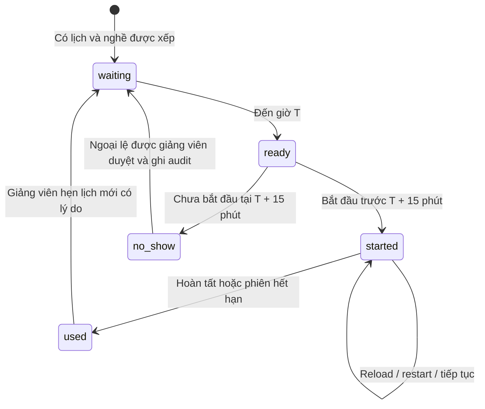

# Phỏng vấn theo lịch — phòng chờ, đi trễ và hẹn lại

G4 nối tiếp [cổng CV G3](CV-AND-INTERVIEW-SCHEDULING.md). Ứng viên được xếp nghề/lịch từ hồ sơ sẽ vào phòng chờ của chính lịch đó. Máy chủ kiểm tra thời gian và quyền bắt đầu; sửa URL, đổi đồng hồ máy hoặc gọi thẳng API không bỏ qua được lịch.

## Hiểu nhanh bằng một ví dụ

Giảng viên mở lịch Frontend lúc **09:00**. Sinh viên nhận email đăng nhập, đổi mật khẩu tạm và vào phòng chờ:

| Thời điểm máy chủ | Chưa bắt đầu | Đã bắt đầu trước đó |
|---|---|---|
| 08:59:59 | Chờ, nút bắt đầu bị khóa | Không phát sinh tình huống này qua cổng lịch |
| 09:00:00 | Được bắt đầu | Tiếp tục phiên đã lưu |
| 09:14:59 | Vẫn được bắt đầu | Tiếp tục phiên đã lưu |
| 09:15:00 | No-show, hồ sơ chờ đợt khác | Vẫn tiếp tục, theo hạn làm bài riêng |

Thời hạn bài phỏng vấn tính từ lúc phiên bắt đầu, theo cấu hình hiện hành. Mốc 15 phút là hạn **vào phòng**, không phải lúc cắt một phiên đang làm. Mở trang chờ chưa tiêu thụ lượt; bắt đầu thành công mới tăng một lượt. Tổng tối đa ba lượt; cấu hình có thể chặt hơn, không thể nâng vượt ba.

Mặc định no-show là giữ CV để chờ đợt tiếp theo. Ngoại lệ hẹn lại là quyết định của giảng viên có quyền, phải ghi lý do. Hồ sơ đã **hủy riêng** không được phục hồi ngầm bằng thao tác hẹn lại.

## Sinh viên thao tác thế nào?

Sau đăng nhập, mở bước vị trí/lịch trong onboarding. Hệ thống hiển thị tên nghề, ngày giờ, múi giờ, hạn bắt đầu và số lượt đã dùng/còn lại. Sinh viên qua CV không có ô tự chọn nghề tại đây.

Trước giờ, đọc lịch và bấm **Cập nhật lịch** nếu giảng viên vừa thay đổi. Khi đến giờ, bấm **Bắt đầu phỏng vấn**. Nếu mất mạng hoặc tải lại, tiếp tục cùng phiên. Không bấm tạo lượt khác để khắc phục lỗi tải trang; câu trả lời và phiên đã lưu vẫn được giữ.

Khi hết thời hạn bài làm, trang không cho tạo lượt mới bằng lịch cũ. Dùng **Xem lịch phỏng vấn tiếp theo** và trao đổi với giảng viên. Kết quả chưa đạt 50–70 có đề xuất nghề phù hợp dựa trên câu trả lời; muốn đổi nghề cho lượt tiếp theo cần lịch được giảng viên xếp đúng đề xuất đã lưu.

Nếu no-show, trang thông báo chờ đợt tiếp theo. Tại `/apply`, nút **Nộp hồ sơ đợt khác** kết thúc riêng phiên theo dõi cũ để mở form mới. Chọn một đợt mới đang nhận CV. Nếu chỉ còn đợt cũ, hãy chờ đợt khác; nộp trùng cùng email/đợt không ghi đè hồ sơ. CV, tài khoản, kết quả và lượt cũ vẫn còn.

## Giảng viên hẹn lại thế nào?

1. Mở **Tuyển dụng & hồ sơ CV**, chọn đợt và hồ sơ.
2. Đọc timeline, số lượt và kết quả trước đó. Nút **Hẹn phỏng vấn lại** chỉ mở khi còn lượt, lịch đã được dùng hoặc ghi nhận vắng mặt và không có phiên/đánh giá đang chạy.
3. Mở một khung giờ phù hợp nếu chưa có. Nghề phải là nghề hiện tại hoặc nghề được đề xuất từ kết quả đã lưu; lịch còn mở, còn chỗ và đủ thời gian chuẩn bị.
4. Chọn **Hẹn phỏng vấn lại**, chọn khung giờ và nhập lý do ít nhất 10 ký tự. Trường hợp vắng mặt được ghi rõ là ngoại lệ.
5. Xác nhận. Hệ thống tạo phiên bản lịch mới, giữ attendance cũ, vô hiệu mail cũ chưa gửi và xếp mail lịch/đăng nhập tương ứng. Gửi lại cùng yêu cầu không tạo thêm mail hoặc đặt lại số lượt.

Lịch mới phải sau thời điểm được phép phỏng vấn lại nếu đang có cooldown. Hẹn lại không sửa điểm, không hoàn lượt đã tiêu thụ và không đổi mật khẩu. Tài khoản tạm cần đổi/khôi phục quyền truy cập nếu đã hết hạn; API báo rõ trường hợp này thay vì reset ngầm. Việc phục hồi credential phải là thao tác riêng được kiểm quyền, không trộn vào hẹn lịch.

## Tài khoản cũ và tương thích

Các tài khoản lịch sử chưa liên kết hồ sơ CV giữ luồng chọn nghề trước đây, bao gồm các tài khoản trắng được bảo vệ. Mọi tài khoản đã liên kết CV chịu cổng lịch; `PATCH /recruitment/me/role` không dùng để đổi nghề hoặc mở lại kết quả. Tài khoản đã đạt không được hẹn lại để xóa kết quả; tài khoản có quyền giảng viên/Admin, kể cả quyền kế thừa qua nhóm, không bị biến thành tài khoản ứng viên.

## Cách hệ thống giữ lịch sử và chống tranh chấp

`interview_admissions` ghi một kết quả vào phòng cho mỗi `bookingId + bookingVersion`: hoặc `sessionId/startedAt`, hoặc `noShowAt`. Bản ghi lưu nghề, slot và thời gian tại thời điểm đó. Dời lịch không sửa snapshot của lượt trước; mỗi phiên chỉ gắn một admission.

Start, worker và hẹn lại giữ khóa theo thứ tự CV → profile → booking. Hai lệnh bắt đầu không tạo hai phiên; worker không đánh vắng người đã vào phòng. Worker xử lý từng hồ sơ riêng kể cả khi cùng một người có hồ sơ mới ở đợt khác.

No-show tại API phải được commit trước khi trả HTTP 409. Nếu ném exception ngay bên trong transaction sau khi ghi no-show, SQL sẽ rollback trạng thái; implementation trả kết quả chặn ra ngoài transaction rồi mới chuyển thành lỗi HTTP.

Máy trạng thái bổ sung đường chuẩn bị `interview_in_progress → role_selected` cho lệnh hẹn lại sau khi phiên đã hết hạn/hủy. Service chứng minh phiên cũ đã kết thúc trước khi dùng đường này. Endpoint tự chọn nghề vẫn chặn trạng thái đang phỏng vấn; giảng viên cũng không thể hẹn lại làm gián đoạn phiên đang chạy.

## API và nơi đọc code

| Hợp đồng | Nội dung |
|---|---|
| `GET /recruitment/me` | Thêm `interviewSchedule`: nghề, giờ, deadline, serverNow, phase và phiên đã vào |
| `POST /recruitment/me/interviews` | Giữ route/body cũ; kiểm lịch và ghi admission trong transaction |
| `PATCH /recruitment/me/role` | Từ chối đổi nghề trực tiếp nếu đã liên kết CV |
| `GET /recruitment-rounds/:id/applications/:applicationId` | Thêm `interviewPolicy` tối thiểu cho staff: số lượt, cooldown, nghề được phép, serverNow và quyền hẹn lại |
| `POST .../:applicationId/retake` | `{slotId, reason}`; staff đúng phạm vi; idempotence theo booking version/slot hiện tại |
| `POST /applications/leave` | Thu hồi capability trong DB và xóa cookie theo dõi; không xóa CV/tài khoản |

Prefix là `/api/v1`. Các field mới được thêm vào response; các route đọc/nộp/chấm cũ vẫn giữ hợp đồng. Giờ body do client gửi không quyết định quyền start. `src/recruitment/admission-window.ts` chứa quy tắc thời gian thuần; `interview-admissions.service.ts` giữ ledger/worker; `interview.service.ts` nối vào start. `applications/interview-bookings.service.ts` quản lý lệnh hẹn lại, quyền và mail.

## Vận hành và kiểm chứng

`APPLICATION_WORKER_ENABLED=true` bật cả xử lý CV và quét no-show; worker lịch chạy mỗi 30 giây, tối đa 100 hồ sơ mỗi lần. API start vẫn chặn đúng mốc dù worker chưa quét đến hồ sơ. Mọi thời gian lưu theo UTC; UI hiển thị múi giờ của slot.

Worker mail dùng giờ SQL làm nguồn mặc định cho availability/lease/expiry để các worker dùng cùng một đồng hồ. Test có thể truyền mốc thời gian rõ ràng; không tăng lease 90 giây hoặc số lượt gửi để xử lý lệch đồng hồ môi trường.

Migration G4 chỉ thêm ledger và index, không sửa credential hoặc số lượt. Rollback bị từ chối khi ledger đã có dữ liệu. Kiểm migration trên DB trống riêng; không chạy revert để thử trên DB chính.

Test: `test/scheduled-interviews.sql-spec.ts`, `test/interview-admission-migration.sql-spec.ts`, unit admission window/state machine và FE onboarding. Browser G4 dùng SQL/SMTP thật, model deterministic và clock fixture chỉ có trong harness loopback dùng DB disposable; hook đó không được nạp vào API native. Số liệu cuối xem báo cáo nghiệm thu G4 cùng manifest, không suy ra từ kết quả G3.
