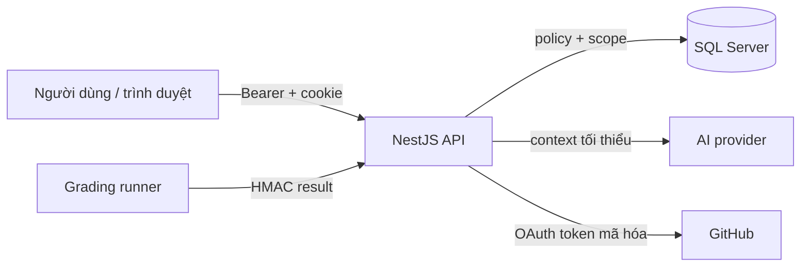

# Bảo mật và ranh giới tin cậy

Backend là **nơi quyết định quyền và trạng thái**. Frontend chỉ hiển thị; ẩn nút không phải biện pháp bảo mật. Tài liệu này mô tả ranh giới tin cậy, các bất biến phải giữ và những giới hạn cần nói đúng.

## 1. Một request được phép khi nào?

Request phải thỏa **tất cả** điều kiện:

1. Có danh tính hợp lệ (access token hoặc cơ chế public đã định).
2. Có permission phù hợp với hành động.
3. Bản ghi nằm trong scope/ownership của principal.
4. Trạng thái hiện tại cho phép hành động.
5. Input qua DTO/domain validation.

Thiếu bất kỳ điều kiện nào → từ chối bằng lỗi có `code`, không “cố gắng cho qua”.

## 2. Ranh giới tin cậy

| Ranh giới | Cơ chế chính |
|---|---|
| Người dùng → API | JWT, refresh rotation, guard, DTO whitelist/forbid unknown, rate limit |
| API → SQL | Truy vấn tham số hóa, transaction, optimistic version, kiểm tra ownership |
| API → AI | Context tối thiểu, tách nội dung không tin cậy khỏi instruction, structured schema |
| API → GitHub | OAuth state/PKCE, numeric ID bền vững, token mã hóa, URL/host policy |
| API → runner | Token riêng, suite/spec/SHA binding, chữ ký HMAC |
| Runner → API | Kết quả chỉ được nhận khi đúng request, suite và chữ ký |

## 3. Mật khẩu, token và log

### Mật khẩu

- Hash bằng **bcrypt**; giới hạn byte UTF-8 trước khi hash.
- Không trả hash, không log mật khẩu, không gửi qua prompt.
- Không dùng mật khẩu mẫu/`changeme` cho bất kỳ môi trường chia sẻ.

### Access token và refresh

- Access token ngắn hạn, chứa principal; **không** chứa toàn bộ quyền nghiệp vụ.
- Refresh cookie là **HttpOnly**, rotate theo family và phát hiện replay.
- Refresh/callback đến muộn không được hồi sinh phiên hoặc connection đã thu hồi.
- Logout thu hồi phía server; không chỉ xóa state trên UI.

### GitHub token

- Access/refresh token mã hóa theo user + AAD, có version và lease khi gia hạn.
- Refresh cạnh tranh dùng khóa/single-flight; không dùng refresh token cũ sau rotate.
- Không trả ciphertext/plaintext token ra FE, prompt, runner hoặc log.

### Audit và log

- Audit ghi hành động, resource ID và metadata an toàn.
- Không log toàn body auth, câu trả lời phỏng vấn, CV raw hoặc provider body chỉ để tiện debug.
- Khi chia sẻ log: giữ `code`, `traceId`, thời điểm; loại bỏ secret/PII.

## 4. Phân quyền: permission ≠ ownership

| Lớp | Ví dụ | Nơi kiểm |
|---|---|---|
| Authentication | Có token hợp lệ | Guard |
| Permission | `tasks.view`, `settings.update` | Guard/decorator |
| Scope | Task thuộc project/session được giao | Service/policy |
| Ownership | Sinh viên chỉ đọc bài của chính mình | Service/query |

Quy tắc:

- Giảng viên có `tasks.view` vẫn chỉ thấy task trong project/session được giao.
- API `own` lấy user từ token; client không gửi `internId` để đọc dữ liệu người khác.
- Quyền có thể đổi khi user bị khóa, mất ownership hoặc consent bị thu hồi; kiểm tra lại **lúc thao tác**, không tin tab đã mở.
- Không nới role hoặc bỏ guard để “chạy được”.

## 5. Dữ liệu sinh viên là không tin cậy

Nội dung do người dùng kiểm soát có thể chứa:

| Nguồn | Rủi ro |
|---|---|
| Câu trả lời phỏng vấn | Prompt injection yêu cầu bỏ qua quy tắc hoặc lộ token |
| README/source/diff | Hướng dẫn độc hại, file credential, nội dung quá lớn |
| PR | Thay đổi sau khi nộp; SHA khác bằng chứng đã lưu |
| Test của sinh viên | Tự tuyên bố pass hoặc bỏ qua assertion |
| Tên file/commit message | Chèn HTML/URL độc hại vào UI |

Biện pháp:

- Giữ nội dung không tin cậy ở vai trò **dữ liệu**, không phải chỉ thị.
- Collector giới hạn source/diff và lọc credential files.
- Runner không chạy trên API host; signer ở ngoài sandbox.
- `warning`/`truncated` evidence **không** được biến thành `complete=true`.
- AI review không phải authority; kết quả test phải đến từ runner tin cậy.

## 6. GitHub/OAuth

- Admin cấu hình tài khoản tạo repo qua `POST /github/repository-account`; body **không** chứa password/token.
- OAuth Admin cần `read:user public_repo`; giảng viên/sinh viên chỉ `read:user`.
- Callback phải trùng tuyệt đối OAuth App, gồm scheme/host/port.
- State/PKCE phải còn hạn và gắn đúng phiên.
- Danh tính ghép theo **numeric ID**, không đoán username từ email ứng dụng.
- Scope thiếu hoặc danh tính đổi → báo lỗi rõ; không âm thầm đổi owner hoặc mở rộng quyền.
- Không nhập token/mật khẩu/2FA vào task, PR, chat hoặc tài liệu.

## 7. Runner và bằng chứng chấm code

- Runner chạy trong container cách ly, không dùng process API.
- Kết quả chỉ hợp lệ khi HMAC đúng, gắn đúng `requestId`, task, spec, suite và SHA.
- Thiếu suite đúng task/spec → **không có trusted PASS**; có thể chuyển manual review theo policy kèm lý do/audit.
- Test chạy xong nhưng có check lỗi vẫn là **failed**, không phải “pass một phần”.
- Không lấy test của sinh viên làm bộ test tin cậy.

Chi tiết: [grading-runner](architecture/grading-runner.md).

## 8. Secret và cấu hình

| Không được làm | Làm thay thế |
|---|---|
| Commit `.env`, token, khóa | Dùng `.env.example`, cấu hình tại máy |
| Log/trả secret qua API | Chỉ trả trạng thái `configured/connected/ready` |
| Dùng chung một khóa cho JWT/GitHub/mail/runner | Mỗi mục đích một khóa riêng |
| Đổi encryption key khi chưa có kế hoạch migrate | Rotate có kế hoạch đọc dữ liệu cũ |
| Đưa `manual-runtime/private` lên GitHub | Giữ ngoài repo, bàn giao qua kênh riêng |

Các secret chính: `JWT_SECRET`, `GITHUB_CLIENT_SECRET`, `GITHUB_TOKEN_ENCRYPTION_KEY`, `GITHUB_WEBHOOK_SECRET`, `GRADING_RUNNER_TOKEN`, `GRADING_RUNNER_SIGNING_KEY`, `MAIL_ENCRYPTION_KEY`, `AI_API_KEY`, `LANGSMITH_API_KEY`.

## 9. Rate limit và tài nguyên

- `THROTTLE_*` giới hạn đăng ký, đăng nhập, phỏng vấn, chấm và AI generation.
- Rate limiter hiện theo **process**; nếu chạy nhiều instance phải xem lại (dùng store chia sẻ hoặc giới hạn tầng gateway).
- Không retry vô hạn khi gặp `429`/`5xx`; backoff có giới hạn.
- Giới hạn kích thước body, upload và thời gian job.

## 10. Giới hạn hiện tại cần hiểu đúng

| Giới hạn | Hệ quả |
|---|---|
| Rate limiter theo process | Chưa phù hợp cho multi-instance nếu không có store chung |
| Signup chưa có email verification/reset qua email đầy đủ | Không coi email là đã xác minh |
| Chưa có Google OAuth hoàn chỉnh | Không tuyên bố hỗ trợ mọi identity provider |
| Bằng chứng GitHub/runner với fixture cụ thể | Không chứng nhận mọi framework hay production an toàn |
| Chưa có production deployment | Không tuyên bố sẵn sàng production |
| Audit dependency là ảnh chụp lockfile | Phải chạy lại tại thời điểm review |

## 11. Checklist review bảo mật

- [ ] Endpoint mới có authentication + permission + ownership?
- [ ] DTO whitelist/forbid unknown; không nhận field ngoài contract?
- [ ] Response không lộ secret/PII; lỗi không lộ stack/SQL?
- [ ] Token/cookie/secret không vào log, URL hay ảnh chụp?
- [ ] Thay đổi trạng thái có transaction/version/idempotency?
- [ ] Nội dung người dùng/AI không được dùng làm instruction?
- [ ] Runner/HMAC vẫn bind đúng request + suite + SHA?
- [ ] Có test cho nhánh bị từ chối, không chỉ happy path?
- [ ] Dependency high/critical đã xử lý hoặc ghi rõ lý do?

## 12. Khi phát hiện sự cố

1. Ngừng thao tác gây lan rộng; giữ bằng chứng an toàn.
2. Xác định secret/dữ liệu/phạm vi bị ảnh hưởng.
3. Thu hồi/rotate qua quy trình phù hợp, có kế hoạch với dữ liệu đã mã hóa.
4. Sửa nguyên nhân gốc và thêm regression test chứng minh chặn lại được.
5. Ghi thời điểm/phiên bản và kết quả kiểm chứng; không viết “đã an toàn” chỉ vì unit test xanh.

Đọc tiếp: [DEPENDENCIES](DEPENDENCIES.md) · [GitHub/code review](architecture/github-code-review.md) · [runner](architecture/grading-runner.md) · [TESTING](TESTING.md).
