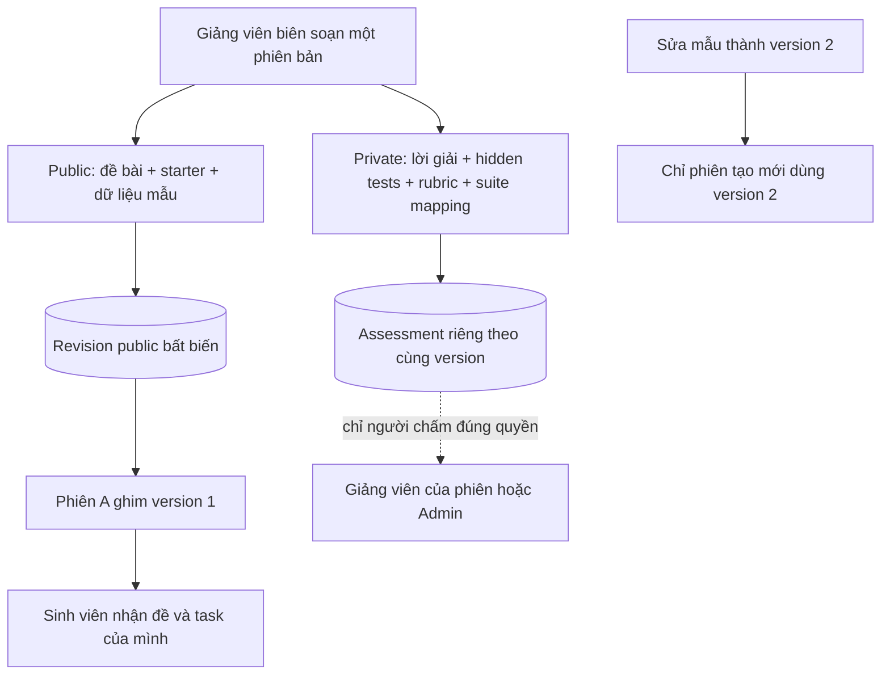

# Thư viện dự án nhỏ: đề bài, phiên bản và tài liệu chấm

Tài liệu này giải thích nền tảng **G2/P01**. Đề bài và starter là phần có thể giao cho sinh viên; lời giải, hidden tests, rubric và mapping suite là phần dành cho người chấm. Hai phần cùng có version nhưng được lưu và đọc qua các đường riêng.

P01 chưa biến sáu mẫu hiện tại thành bộ bài tập 3–7 ngày đã được chạy nghiệm thu. Bộ nội dung, starter/lời giải/biến thể sai, runner và giao diện thư viện mới nằm ở P02–P04. Những mẫu cũ 14 ngày vẫn hoạt động theo hợp đồng cũ.

## 1. Hình dung bằng một ví dụ

Giảng viên tạo mẫu “Sổ ghi chú”, version 1. Sinh viên cần biết mục tiêu, công nghệ, nhiệm vụ và cách chạy starter. Giảng viên cần thêm lời giải tham khảo, kiểm thử riêng và rubric để đánh giá.

Sau khi tạo phiên A từ version 1, giảng viên sửa mẫu thành version 2. Phiên A vẫn dùng đề và tài liệu chấm version 1; phiên B tạo sau lần sửa mới dùng version 2. Bỏ tài liệu chấm ở version 3 không xóa bằng chứng của phiên A/B.



## 2. Một gói mẫu nhỏ có những phần nào?

Blueprint vẫn giữ các trường hiện hành như roles, sprints/tasks/DoD, documentation, mục tiêu và phạm vi. Gói nhỏ bổ sung `learningPackage`:

| Trường | Người đọc cần hiểu |
|---|---|
| `schemaVersion: 1` | Phiên bản cấu trúc gói, khác số version của template |
| `prerequisites` | Kiến thức/công cụ cần có trước khi bắt đầu |
| `setup` | Cách chuẩn bị môi trường, cài đặt trong thư mục dự án |
| `run` | Cách chạy/demo/kiểm tra theo hướng dẫn của gói |
| `starterFiles` | Danh sách đường dẫn tương đối và nội dung file khởi đầu |
| `sampleData` | Các file dữ liệu minh họa được phép cho sinh viên xem |

Khi có learningPackage, server yêu cầu **1–2 Sprint, 3–6 task và tổng 3–7 ngày**. Mọi task cần key duy nhất, tối đa 64 ký tự chữ/số/gạch ngang/gạch dưới. Dependencies và milestones vẫn qua validator blueprint hiện có; thời lượng khai báo phải khớp tổng Sprint.

Đường dẫn dùng dạng `src/notes.cjs`, không dùng đường dẫn ổ đĩa hoặc `..`. Server chặn path tuyệt đối, backslash, ADS, tên thiết bị Windows, thư mục metadata như `.git`, đường dẫn trùng theo chữ hoa/thường và file đè lên thư mục. Các giới hạn này được kiểm cả khi import/seed qua boundary nghiệp vụ.

Mỗi file tối đa 20.000 ký tự; nhóm starter/sample tối đa 128.000 byte JSON UTF-8, nhóm solution/hidden tối đa 256.000 byte. Byte budget khác số ký tự. Giới hạn HTTP body hiện hành vẫn áp dụng. Nội dung file là dữ liệu được lưu, **server không chạy, giải nén, tải URL hoặc cài dependency từ các chuỗi này**.

## 3. Tài liệu chấm được tách ra sao?

`assessment` là trường ghi riêng khi tạo/sửa mẫu; nó không nằm trong `definition`. Cấu trúc v1:

| Trường | Ý nghĩa |
|---|---|
| `solutionFiles` | Lời giải tham khảo, không gửi qua response đề bài |
| `hiddenTestFiles` | Nội dung kiểm thử riêng của người chấm |
| `rubric` | Tiêu chí, diễn giải và trọng số; tổng phải bằng 100 |
| `taskSuites` | Mỗi task key ánh xạ tối đa một suiteId/digest khai báo |

Task key phải tồn tại trong blueprint. Thay key của task đang được mapping mà giữ assessment cũ bị từ chối; cần sửa cả mapping hoặc bỏ assessment trong **cùng lần tạo version mới**.

Digest có 64 ký tự hex chỉ chứng minh giá trị đúng định dạng. Nó chưa chứng minh suite có thật, code đã chạy hay binding đã được trusted runner duyệt. P03 còn phải chuẩn bị suite, chạy bài đúng/sai và khóa SHA/digest theo [hợp đồng runner](architecture/grading-runner.md).

Private assessment nằm ở `project_template_assessments`, public revision ở `project_template_revisions`. Mỗi hàng có SHA-256; trigger SQL từ chối UPDATE/DELETE. Sửa nội dung được thực hiện bằng cách thêm version mới trong transaction. Audit chỉ ghi metadata hành động, không sao chép lời giải/hidden tests.

## 4. Ai có quyền đọc và sửa?

| Người gọi | Đề bài/lịch sử public | Assessment thư viện | Assessment của phiên cụ thể |
|---|---|---|---|
| Admin | Theo permission quản lý mẫu | Cần `templates.assessment.read` | Được đọc với permission tương ứng |
| Giảng viên | Theo `projects.manage` như thư viện hiện hành | Cần `templates.assessment.read` | Cần thêm quyền quản lý đúng project/session |
| Sinh viên | Theo luồng task/workspace chính chủ; không tự có quyền thư viện quản trị | Bị từ chối | Bị từ chối |

Ghi assessment cần `templates.assessment.manage` và vai trò Admin/instructor đang hoạt động. Server vẫn chặn sinh viên nếu ai đó gán thêm cả projects.manage và các permission assessment; một permission giả không biến vai trò sinh viên thành người chấm.

Migration cấp hai permission mới cho Admin/instructor, không cấp cho intern. Thu hồi permission hoặc khóa tài khoản có hiệu lực ở request tiếp theo. Các AI đọc đề bài qua project context chỉ nhận snapshot public; thêm bảng assessment không tự cấp tool/permission cho Agent.

## 5. Dùng API mà không nhầm phiên bản

Các đường dẫn sau nằm sau `/api/v1`; cần bearer token. Editor thư viện hiện hữu tiếp tục dùng API cũ. UI soạn/preview gói nhỏ là hạng mục P04, chưa nằm trong P01.

| Thao tác | Endpoint |
|---|---|
| Tạo mẫu kèm assessment ghi riêng | `POST /project-templates` |
| Sửa public và/hoặc assessment | `PATCH /project-templates/:id` |
| Danh sách version public | `GET /project-templates/:id/revisions?page=1&pageSize=20` |
| Đọc một version public | `GET /project-templates/:id/revisions/:version` |
| Đọc assessment hiện tại | `GET /project-templates/:id/assessment` |
| Đọc assessment version cụ thể | `GET /project-templates/:id/revisions/:version/assessment` |
| Đọc assessment đã ghim cho project | `GET /projects/:id/template-assessment` |

Khi tạo, gửi các trường blueprint hiện hành, learningPackage tùy chọn và assessment ở **top-level**. Response chỉ trả definition public; muốn đọc tài liệu chấm phải gọi endpoint riêng bằng đúng quyền.

PATCH dùng expectedVersion để tránh ghi đè một editor khác. Ba cách xử lý assessment khác nhau:

```json
{ "expectedVersion": 1, "name": "Sổ ghi chú — hướng dẫn rõ hơn" }
```

Bỏ trường assessment nghĩa là giữ nguyên tài liệu chấm khi public lên version 2.

```json
{ "expectedVersion": 2, "assessment": null }
```

Null nghĩa là version 3 không có assessment. Version 1/2 và run cũ vẫn giữ tài liệu ban đầu. Muốn thay assessment, gửi object đầy đủ schema v1 ở top-level; không nhét assessment vào `definition`.

Chỉ thay assessment cũng tăng template version. Chỉ archive/restore status vẫn giữ hành vi phiên bản trước đây: archive chặn tạo phiên mới, không xóa run cũ. API không tự đổi một mẫu active thành “đã kiểm chứng”; người biên soạn còn phải duyệt nội dung và nghiệm thu P03.

## 6. Vì sao có hai loại snapshot?

`project_templates` giữ bản hiện tại để thư viện tra cứu nhanh. `project_template_revisions` giữ nội dung bất biến theo version. `template_runs.snapshotJson` giữ đề bài riêng của một lần tổ chức; nó không chứa assessment. Endpoint assessment theo project lấy đúng templateId/templateVersion đã ghim, không tự lấy version mới nhất.

Migration chỉ backfill **version hiện tại thực sự còn trong DB**. Nó không đoán lại các version đã mất. Run cũ vẫn đọc snapshot cũ theo luồng trước đây; nếu version cũ chưa có assessment thì trả null, không tự lấy lời giải của version mới để thay vào.

Seed bundled đã được nối vào revision store. Nó vẫn chỉ nâng cấp mẫu legacy chưa chỉnh sửa, giữ mẫu custom/archived/later-version và không sửa template_runs. Chạy seed hai lần không tạo thêm version hoặc bản ghi lặp.

## 7. Khi thao tác thất bại

| Mã/trạng thái | Cách xử lý |
|---|---|
| `400 INVALID_TEMPLATE_PACKAGE` | Kiểm schema, file path/budget, quy mô 3–7 ngày, task mapping và tổng rubric |
| `400 VALIDATION_ERROR` | Kiểm trường thừa/nested assessment/kiểu dữ liệu ở DTO |
| `403` | Kiểm role, permission và quyền quản lý phiên; không retry bằng ID của người khác |
| `404` | Mẫu/version không tồn tại; lịch sử trước baseline có thể không còn revision tập trung |
| `409 TEMPLATE_VERSION_CONFLICT` | Tải bản mới, so sánh rồi gửi lại với expectedVersion mới |
| `409 TEMPLATE_REVISION_CONFLICT` | Có nội dung khác đã được giữ cho cùng version; cần điều tra, không ghi đè lịch sử |
| `500 TEMPLATE_REVISION_INTEGRITY` | Hash nội dung không khớp; giữ bằng chứng, kiểm storage/migration, không tự sửa hash để che lỗi |

Vận hành local: xem [LOCAL-DEVELOPMENT](LOCAL-DEVELOPMENT.md). Trước npm/build/test chạy storage wrapper trong cùng process PowerShell. E2E/migration test chỉ dùng DB disposable; migration demo phải so counts/digest trước/sau, không reset hoặc seed lại tài khoản.

## 8. Bản đồ code và kiểm chứng

| Cần sửa/đọc | Vị trí |
|---|---|
| Schema, paths, budgets, public projection | `src/templates/template-package.ts` |
| Revision/hash/assessment permissions | `src/templates/template-revisions.store.ts` |
| Create/update/start/context | `src/templates/templates.service.ts` |
| DTO/routes | `template.dto.ts`, `templates.controller.ts` trong cùng module |
| Backfill và immutable SQL constraints | `CreateTemplateMaterials1763068800000` |
| Unit security/legacy | `template-package.spec.ts`, `learning-library-seed.spec.ts` |
| HTTP, private/public và snapshot | `test/template-materials.e2e-spec.ts` |
| Migration trên schema cũ | `test/template-materials-migration.sql-spec.ts` |

[Đặc tả P01](../SPEC-small-project-library.md) ghi tiêu chí; [báo cáo P01](reports/small-project-foundation-20261024.md) ghi số liệu, nguồn và trạng thái triển khai. Không lấy test fixture có marker PRIVATE làm nội dung mẫu đã nghiệm thu cho sinh viên.
