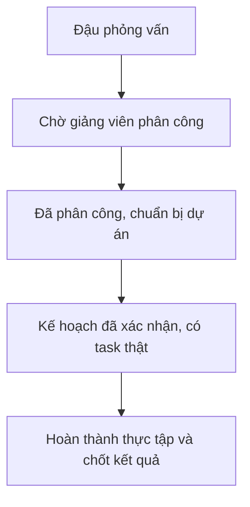

# Hiểu V-Intern trước khi đọc code

> Bộ bàn giao theo lộ trình đọc: [HANDOVER](HANDOVER.md). Trang này là chương tra cứu chuyên sâu; kết quả chạy thực tế xem [VERIFICATION](VERIFICATION.md).

## Một câu chuyện xuyên suốt

Lan là sinh viên muốn thực tập lập trình. Cô Mai là giảng viên phụ trách một nhóm. Admin chuẩn bị tài khoản, thư viện dự án và kết nối GitHub. Ta dùng ba nhân vật này để giải thích các bước; đây là ví dụ, không phải dữ liệu đã tạo trong hệ thống.

Lan đăng ký và phỏng vấn cho Backend Developer. Nếu điểm tổng hợp là 75, Lan đậu và chờ cô Mai phân công. Nếu điểm là 62, AI đọc câu trả lời, đề xuất một vai trò khác và giải thích vì sao. Lan được quyền chọn lại, trong giới hạn ba lượt tổng cộng. Nếu điểm dưới 50, Lan xem phần cần cải thiện và chuẩn bị phỏng vấn lại.

Cô Mai chọn mẫu “Sổ tay học tập”, tạo phiên cho nhóm và phân công Lan vào một vị trí còn trống. Khi bắt đầu, AI đề xuất kế hoạch. Cô Mai kiểm tra và xác nhận. Lúc đó Lan mới thấy các nhiệm vụ thật trên Sprint Board.

Lan làm một nhiệm vụ, nộp liên kết PR vào repository của phiên. Hệ thống ghi lại commit cụ thể, thu thập source và chạy quy trình review. Cô Mai đọc kết quả AI, test và bài làm rồi quyết định yêu cầu sửa hay duyệt. Khi kết thúc kỳ, các dữ liệu đã được xác nhận trở thành căn cứ đánh giá, KPI và chứng nhận.

## Phân biệt các khái niệm dễ nhầm

| Khái niệm | Nghĩa trong hệ thống | Ví dụ |
|---|---|---|
| Vai trò ứng tuyển | Hướng chuyên môn muốn học | Frontend, Backend, QA |
| Vai trò tài khoản | Quyền sử dụng ứng dụng | Sinh viên, giảng viên, Admin |
| Mẫu dự án | Bộ yêu cầu có phiên bản, dùng lại được | Sổ tay học tập v1 |
| Dự án của một phiên | Bản triển khai cụ thể từ mẫu | Nhóm thực tập của cô Mai |
| Phiên thực tập | Thời gian, người phụ trách và đội hình | Học kỳ tháng 10–12 |
| Assignment | Phân công một sinh viên vào vị trí trong phiên | Lan làm Backend |
| Sprint | Một giai đoạn làm việc có thời hạn | Nền tảng và luồng chính |
| Task | Một đầu việc có người nhận và tiêu chí hoàn thành | Lưu và khôi phục ghi chú |
| Submission | Một lần nộp bài có bằng chứng bất biến | PR và head SHA lúc nộp |
| Evaluation | Đánh giá học tập chính thức của giảng viên | Đánh giá cuối kỳ |
| KPI | Tổng hợp có công thức từ kết quả đã lưu | Hoàn thành, chất lượng, đúng hạn |

“Backend Developer” không cấp quyền quản trị backend. Tương tự, nhận lời mời repository GitHub không cho phép một sinh viên tự duyệt task trên V-Intern.

## Bốn mốc khác nhau

Đậu phỏng vấn không tự tạo dự án. Một phiên đã có kế hoạch nháp cũng chưa có nghĩa sinh viên đã nhận task. Đây là hai nguyên nhân thường gặp khi người dùng thấy giảng viên có nội dung nhưng sinh viên vẫn đang chờ.

## AI làm gì và con người quyết định gì?

| Công việc | AI | Backend / giảng viên |
|---|---|---|
| Phỏng vấn | Hỏi theo nội dung đã chọn, phân tích câu trả lời | BE áp công thức và giới hạn lượt |
| Đề xuất vai trò | Chọn hướng có căn cứ từ câu trả lời | Sinh viên tự chọn lần tiếp theo |
| Kế hoạch | Tạo bản nháp Sprint/task | Giảng viên sửa và xác nhận |
| Mentor | Giải thích, gợi ý cách làm và kiểm tra | Không sửa điểm hay task thay người học |
| Review code | Nhận xét từ source/evidence đã thu thập | Runner kiểm thử; giảng viên quyết định cuối |
| KPI/chứng nhận | Không tự chốt | Công thức và điều kiện xác định tại BE |

## Đọc các con số đúng cách

- **0%** nghĩa là đã đo và kết quả bằng không.
- **Chưa đo được** nghĩa là thiếu dữ liệu hoặc mẫu số chưa có.
- Biểu đồ phân bố task thể hiện trạng thái hiện tại, không chứng minh xu hướng cải thiện.
- Điểm AI review không phải điểm đánh giá cuối kỳ. Cần nhìn đúng cột nguồn và thời điểm.
- Báo cáo đã lưu là bản chụp tại thời điểm tạo; sửa task sau đó không làm báo cáo cũ tự đổi.

Đọc tiếp [cách dùng từng vai trò](USER-JOURNEYS.md) hoặc [chạy local](LOCAL-DEVELOPMENT.md).
