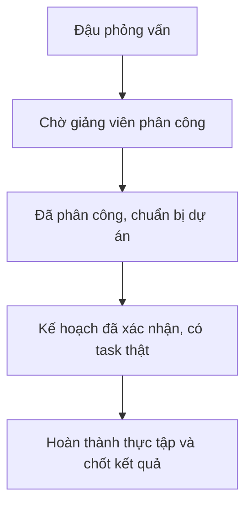

# Hiểu V-Intern trước khi đọc code

Tài liệu này trả lời ba câu: **sản phẩm làm gì**, **ai quyết định điều gì** và **các khái niệm nào dễ nhầm**. Khi đã nắm phần này, đọc [kiến trúc](ARCHITECTURE.md) rồi [bản đồ code](CODE-MAP.md) sẽ nhanh hơn nhiều.

> Bộ bàn giao theo lộ trình đọc: [HANDOVER](HANDOVER.md). Bằng chứng chạy thật: [VERIFICATION](VERIFICATION.md).

## 1. Một câu chuyện xuyên suốt

Lan là sinh viên muốn thực tập lập trình. Cô Mai là giảng viên phụ trách một nhóm. Admin chuẩn bị tài khoản, thư viện dự án và kết nối GitHub. Ba nhân vật này chỉ là ví dụ, không phải dữ liệu đã tạo trong hệ thống.

1. Lan đăng ký, chọn Backend Developer và làm bài phỏng vấn.
2. Điểm 75 → Lan đậu và chờ phân công. Điểm 62 → AI đề xuất hướng khác kèm lý do; Lan tự chọn lại trong giới hạn ba lượt. Điểm dưới 50 → xem phần cần cải thiện rồi phỏng vấn lại khi còn lượt.
3. Cô Mai chọn mẫu “Sổ tay học tập”, tạo phiên, phân công Lan vào một vị trí còn trống.
4. AI đề xuất kế hoạch Sprint/task. Cô Mai đọc, sửa và xác nhận. Lúc đó Lan mới thấy công việc thật.
5. Lan làm task, nộp PR vào repository của phiên. Hệ thống ghim đúng commit, thu thập bằng chứng, chạy review.
6. Cô Mai đọc source, test, nhận xét AI rồi quyết định trả sửa hoặc duyệt.
7. Khi kết thúc kỳ, dữ liệu đã xác nhận trở thành căn cứ đánh giá, KPI, lương ảo và chứng nhận.

## 2. Phân biệt các khái niệm dễ nhầm

| Khái niệm | Nghĩa trong hệ thống | Ví dụ |
|---|---|---|
| Vai trò ứng tuyển | Hướng chuyên môn muốn học | Frontend, Backend, QA |
| Vai trò tài khoản | Quyền sử dụng ứng dụng | Sinh viên, giảng viên, Admin |
| Mẫu dự án | Bộ yêu cầu có phiên bản, dùng lại được | Sổ tay học tập v1 |
| Dự án của một phiên | Bản triển khai cụ thể từ mẫu | Nhóm thực tập của cô Mai |
| Phiên thực tập | Thời gian, người phụ trách và đội hình | Học kỳ tháng 10–12 |
| Assignment | Phân công một sinh viên vào vị trí trong phiên | Lan làm Backend |
| Sprint | Một giai đoạn làm việc có thời hạn | Nền tảng và luồng chính |
| Task | Đầu việc có người nhận và tiêu chí hoàn thành | Lưu và khôi phục ghi chú |
| Submission | Một lần nộp bài có bằng chứng bất biến | PR và head SHA lúc nộp |
| Evaluation | Đánh giá học tập chính thức của giảng viên | Đánh giá cuối kỳ |
| KPI | Tổng hợp có công thức từ kết quả đã lưu | Hoàn thành, chất lượng, đúng hạn |

“Backend Developer” **không** cấp quyền quản trị backend. Nhận lời mời repository GitHub **không** cho phép sinh viên tự duyệt task trên V-Intern.

## 3. Bốn mốc khác nhau

- Đậu phỏng vấn **không** tự tạo dự án.
- Có assignment **chưa** có nghĩa đã có task.
- Kế hoạch nháp **chưa** phải công việc chính thức.
- Sprint `planned` **chưa** phải Sprint đang chạy.
- Task Done **không** đồng nghĩa cả phiên hoàn thành.

Đây là các nguyên nhân thường gặp khi giảng viên thấy nội dung nhưng sinh viên vẫn đang chờ.

## 4. Ba vai trò, ba phạm vi

| Vai trò | Làm được gì | Không được suy ra |
|---|---|---|
| Sinh viên | Tuyển dụng, workspace của chính mình, nộp bài, xem kết quả | Không đọc dữ liệu người khác bằng cách đổi ID |
| Giảng viên | Mẫu dự án, phiên, phân công, kế hoạch, chấm bài, báo cáo trong scope | Có permission không có nghĩa quản lý mọi phiên |
| Admin | Người dùng, quyền, nghề nghiệp, câu hỏi, kho tri thức, cấu hình, KPI, chứng nhận | Không thay giảng viên chấm từng bài |
| Hệ thống | Guard, policy, transaction, worker, runner, audit | Không tự quyết định thay con người |

Chi tiết phân quyền: [SECURITY](SECURITY.md). Luồng theo vai: [USER-JOURNEYS](USER-JOURNEYS.md).

## 5. AI làm gì và con người quyết định gì?

| Công việc | AI | Backend / giảng viên |
|---|---|---|
| Phỏng vấn | Hỏi theo nội dung đã chọn, phân tích câu trả lời | BE áp công thức và giới hạn lượt |
| Đề xuất vai trò | Chọn hướng có căn cứ từ câu trả lời | Sinh viên tự quyết định lần tiếp theo |
| Kế hoạch | Tạo bản nháp Sprint/task | Giảng viên sửa và xác nhận |
| Mentor | Giải thích, gợi ý cách làm | Không sửa điểm hay task thay người học |
| Review code | Nhận xét từ source/evidence đã thu thập | Runner kiểm thử; giảng viên quyết định cuối |
| KPI/chứng nhận | Không tự chốt | Công thức và điều kiện xác định tại BE |

Nguyên tắc bất biến: **AI đề xuất, hệ thống kiểm tra, con người chốt.** AI không cấp quyền, không tự chuyển task sang Done và không thay thế kết quả test.

## 6. Đọc các con số đúng cách

| Cách ghi | Nghĩa |
|---|---|
| `0` | Đã đo và kết quả bằng không |
| `null` / “chưa đo được” | Thiếu dữ liệu hoặc chưa có mẫu số |
| `insufficient_data` | Có dữ liệu nhưng chưa đủ để kết luận |
| Snapshot | Nội dung tại thời điểm ghi; sửa dữ liệu hiện tại không đổi bản cũ |
| Điểm AI review | Đề xuất kỹ thuật, không phải điểm đánh giá cuối kỳ |

Biểu đồ phân bố task thể hiện trạng thái hiện tại, không chứng minh xu hướng cải thiện. Báo cáo đã lưu là ảnh chụp, không tự cập nhật.

## 7. Đọc tiếp

| Bạn muốn | Đi tới |
|---|---|
| Chạy thử | [LOCAL-DEVELOPMENT](LOCAL-DEVELOPMENT.md) |
| Hiểu kiến trúc | [ARCHITECTURE](ARCHITECTURE.md) |
| Tìm file | [CODE-MAP](CODE-MAP.md) |
| Gọi API | [api/README](api/README.md) |
| Tra nhánh nghiệp vụ | [WORKFLOW-MATRIX](WORKFLOW-MATRIX.md) |
| Kiểm thử | [TESTING](TESTING.md) |
