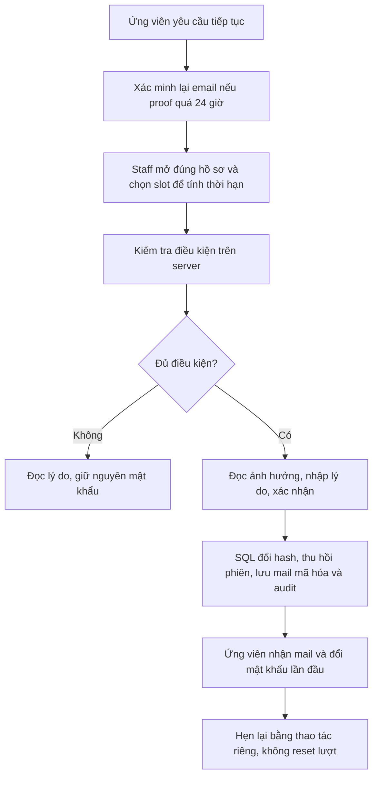
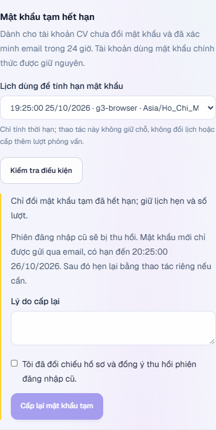

# Khôi phục mật khẩu tạm khi ứng viên quay lại

Đây là thao tác riêng cho người phụ trách tuyển dụng. **Gửi lại email** không đổi mật khẩu; **cấp lại mật khẩu tạm** vô hiệu mật khẩu tạm cũ và phiên đăng nhập cũ. Không dùng chức năng này để reset mật khẩu chính thức.

## Khi nào cần dùng?

An nộp CV, nhận lịch và tài khoản tạm nhưng vắng mặt. Sau khi được phép hẹn lại, mật khẩu tạm đã hết hạn nên An không đăng nhập được. Giảng viên cần kiểm tra hồ sơ và cấp credential mới trước khi hẹn lại. Lịch sử vắng mặt, CV và số lượt đã dùng vẫn được giữ.

## Các bước trên giao diện

1. Ứng viên vào cổng **Nộp CV**, dùng phần lấy lại đường dẫn theo dõi với email đã nộp; mở liên kết mới trong email. Việc xác minh lại không tạo hồ sơ, không đổi role hoặc số lượt. Bằng chứng xác minh phải trong vòng 24 giờ.
2. Giảng viên mở **Hồ sơ CV & lịch tuyển** → chọn đúng đợt → **Hồ sơ ứng tuyển** → **Xem hồ sơ**.
3. Tại **Mật khẩu tạm hết hạn**, chọn khung giờ đang mở để tính hạn credential. Đây **không phải đặt lịch** và không giữ chỗ. Thời hạn là cuối khung giờ đã chọn cộng 24 giờ.
4. Bấm **Kiểm tra điều kiện**. Nếu server từ chối, đọc lý do và xử lý điều kiện trước; nút cấp lại không xuất hiện.
5. Đọc tác động, nhập lý do 10–1000 ký tự và tích xác nhận thu hồi phiên cũ. Bấm **Cấp lại mật khẩu tạm** một lần.
6. Thông báo thành công nghĩa là credential đã đổi và mail đã vào hàng đợi. Chờ SMTP giao nhận; không hứa mail đã đến inbox chỉ vì API trả thành công.
7. Ứng viên dùng email mới, đăng nhập và đổi mật khẩu tại màn hình bắt buộc. Nếu cần, giảng viên thực hiện **Hẹn phỏng vấn lại** riêng. Cổng lịch/lượt vẫn kiểm điều kiện hiện tại.

## Điều kiện bảo vệ tài khoản

| Điều kiện | Vì sao |
|---|---|
| Staff có `applications.manage`, là chủ đợt hoặc Admin | Không cấp lại tài khoản qua hồ sơ của người khác |
| Đúng email hồ sơ đã xác minh gần đây và user active | Không gửi credential đến email vừa thay không được đối chiếu |
| User là intern; không có role instructor/admin | Không dùng credential tuyển dụng để chiếm tài khoản quản lý |
| Có bằng chứng mail cấp tài khoản CV, vẫn `mustChangePassword` và mật khẩu tạm đã hết hạn | Bảo vệ mật khẩu chính thức và tài khoản trắng |
| Không có phỏng vấn/đánh giá đang chạy, chưa đạt và còn lượt theo cấu hình | Không đổi quyền truy cập giữa lượt hoặc tạo đường vượt ngân sách lượt |
| Slot thuộc đúng đợt chưa đóng, đang mở và trong tương lai | Thời hạn được tính từ một lịch có thật, không nhận ngày hết hạn tùy ý |

Mỗi preview có revision gắn với hồ sơ, proof email, user/authVersion, trạng thái/lượt và slot. Server kiểm lại bên trong transaction. Preview cũ trả `CREDENTIAL_RECOVERY_CHANGED`: tải lại, không tự lặp lệnh đã cũ. Bấm đồng thời/replay một preview đã thành công trả cùng receipt, không tạo password hoặc mail thứ hai.

## Mật khẩu và email đi đâu?

Password được sinh bằng bộ tạo ngẫu nhiên mật mã, lưu **bcrypt hash** trong `users`. Raw password chỉ nằm trong payload mail mã hóa bằng khóa riêng; không trả qua API, không đưa vào Agent, audit hoặc preview Admin. Sau khi SMTP chấp nhận, outbox xóa payload nhạy cảm theo cơ chế hiện có.

Trong cùng giao dịch, hệ thống tăng `authVersion`, thu hồi refresh token, hủy mail credential cũ chưa giao, lưu email mới và audit. Nếu không lưu được mail/audit thì toàn bộ thay đổi rollback. Email cũ đang `sending` chặn cấp chồng: chờ kết quả giao nhận rồi thử lại. SMTP timeout là chưa chắc giao nhận, không được hiển thị như đã nhận thành công.

`verifiedAt` ban đầu vẫn được giữ. Mỗi lần xác minh lại có event `email_reverified`; recovery dùng proof mới nhất theo giờ SQL UTC. Giao diện hiển thị ngày giờ địa phương. Không cần migration mới cho Q05.

## API và bản đồ code

Tiền tố `/api/v1`; cần đăng nhập và quyền/phạm vi nói trên:

| Request | Ý nghĩa |
|---|---|
| `GET /recruitment-rounds/:id/applications/:applicationId/credential-recovery?slotId=...` | Preview `allowed`, `message`, `revision`, `expiresAt`; không có password |
| `POST /recruitment-rounds/:id/applications/:applicationId/recover-credentials` | Body: `slotId`, `expectedRevision`, `reason`; trả `recovered`, `duplicate`, `mailId` |

BE: `src/applications/application-credential-recovery.service.ts` giữ điều kiện, revision, giao dịch; DTO/controller kiểm input; `applications.service.ts` ghi proof xác minh lại; outbox và transport vẫn thuộc module communications. Cổng đặt lịch ban đầu, bắt đầu và retake dùng giới hạn canonical, mặc định tối đa **ba lượt tổng cộng**, có thể cấu hình chặt hơn.

FE: `src/lib/api/credential-recovery.ts` kiểm response; `src/components/applications/credential-recovery.tsx` hiển thị hai bước preview/xác nhận, được gắn vào chi tiết hồ sơ staff. Sinh viên không có nút reset của staff.

## Đã kiểm và giới hạn

- 15 ca SQL/HTTP recovery: concurrency/replay, scope, DTO, mật khẩu chính thức, credential chưa hết hạn, email thay đổi/proof cũ, staff, thiếu provenance, phiên đang chạy, đợt đóng, hết lượt, revision cũ, rollback và SMTP đang gửi.
- Login cũ bị từ chối; login mới và đổi password thật qua HTTP đạt; số lượt và booking version giữ nguyên.
- Ba ca unit UI mới; typecheck/lint và production build QA đạt.
- Chrome đã cấp lại bằng giao diện giảng viên ở 390/768/1024/1280/1440, nhận credential mới qua **SMTP local**, rồi đăng nhập/đổi password. Không có bằng chứng giao email đến nhà cung cấp ngoài.
- Luồng CV/lịch dùng graph Agent thật với **provider fixture được khai báo**. Không trình bày kết quả này thành chất lượng đánh giá CV của model live.

Xem [nhận CV và lịch](CV-AND-INTERVIEW-SCHEDULING.md), [phỏng vấn theo lịch](SCHEDULED-INTERVIEWS.md), [quyền GitHub sau bàn giao](REPOSITORY-ACCESS-RECOVERY.md) và [checklist G7](../tasks/g7-execution.md).
