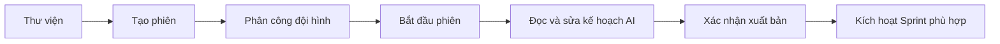

# Hướng dẫn trải nghiệm một kỳ thực tập

Đọc chương này theo thứ tự nếu bạn muốn kiểm tra hệ thống từ đầu đến cuối. Với database đã có dữ liệu, dùng phiên/tài khoản hiện có và bỏ qua bước tạo mới tương ứng. Các thao tác nộp, chấm và chốt làm thay đổi dữ liệu; chỉ thực hiện khi bạn muốn ghi kết quả thật.

## Admin: chuẩn bị môi trường

1. Kiểm tra user, vai trò và quyền. Tài khoản sinh viên chỉ có quyền học tập; giảng viên phải có quyền quản lý các chức năng được giao.
2. Mở thư viện mẫu, xem mục tiêu, vai trò, lộ trình, đầu ra và tiêu chí hoàn thành. Sửa mẫu có version check; các phiên cũ giữ snapshot.
3. Kiểm tra ngân hàng câu hỏi đủ nội dung cho năm vai trò, đặc biệt phần giới thiệu, chuyên môn và tiếng Anh.
4. Nhập cấu hình AI tại server; trang Admin điều chỉnh model/timeout/retry trong giới hạn cho phép.
5. Liên kết GitHub của tài khoản dùng tạo repo chung, sau đó chọn tài khoản đó trong cài đặt hệ thống.

**Hoàn tất khi:** trạng thái hệ thống cho thấy cấu hình cần thiết có mặt, thư viện sử dụng được và không lộ secret trên giao diện. Trạng thái cấu hình chưa thay cho việc thử một lời gọi tích hợp thật.

## Sinh viên: phỏng vấn và chọn hướng

Chọn vai trò dựa trên điều bạn muốn thực hành, bắt đầu phỏng vấn và đọc từng câu. Hệ thống gửi câu tuần tự. Lưu câu trả lời trước khi chuyển tiếp; phần hỏi thêm chỉ dùng để làm rõ bằng chứng cho câu hiện tại.

| Kết quả mới | Màn hình nên hiểu thế nào? | Việc tiếp theo |
|---|---|---|
| Dưới 50 | Chưa đạt vị trí đã chọn | Đọc phản hồi; chuẩn bị lại nếu còn lượt |
| 50–70, gồm cả 50 và 70 | AI thấy một hướng khác đáng khám phá | Đọc lý do/câu hỏi được viện dẫn; tự chọn role rồi phỏng vấn lại |
| Trên 70 | Đậu vị trí đã chọn | Vào workspace và chờ phân công |

Mỗi lần **bắt đầu một phiên phỏng vấn mới** tiêu thụ một lượt. Đổi role hoặc chấm lại bài do lỗi AI không tự tạo lượt mới. Tổng giới hạn là 3; thời gian chờ do API trả về. Hết lượt thì liên hệ giảng viên/Admin để được hướng dẫn, không tạo tài khoản mới nhằm làm mới lượt.

Nếu AI lỗi khi chấm, câu trả lời đã nộp vẫn được giữ. Chọn chấm lại bài hiện có. Không nhầm lỗi dịch vụ với kết quả rớt.

## Giảng viên: từ mẫu dự án đến nhiệm vụ thật

Trong trang chi tiết mẫu, đọc mục lục và dùng vùng “Khởi tạo phiên thực tập” để đặt tên, ngày bắt đầu/kết thúc. Mở thiết lập phiên, thêm sinh viên đủ điều kiện vào đúng role còn chỗ. Một sinh viên đã có assignment active không được nhận thêm assignment active khác.

Khi AI tạo nháp, kiểm tra người nhận, hạn, phụ thuộc, đầu ra và DoD của từng task. Xác nhận kế hoạch sau khi đã đọc. Nếu chỉ có bản nháp, sinh viên chưa có nhiệm vụ để làm. Một project chỉ có tối đa một Sprint active; Sprint planned chưa phải Sprint đang chạy.

**Hoàn tất khi:** giảng viên và sinh viên nhìn thấy cùng phiên/Sprint/task đã xuất bản, với đúng người nhận và trạng thái.

## Sinh viên: làm, nộp và đọc phản hồi

1. Mở Công việc hoặc Sprint Board. Đọc yêu cầu, đầu ra, DoD và nhiệm vụ phụ thuộc.
2. Bắt đầu task từ Cần làm sang Đang làm. Nếu server nêu task đang chặn, hoàn thành hoặc trao đổi về phụ thuộc đó trước.
3. Làm bài trong repository của phiên. Liên kết GitHub và chấp nhận lời mời trước khi push.
4. Kiểm tra bài rồi nộp PR/commit theo hướng dẫn của task. Mô tả việc đã làm và bằng chứng kiểm thử.
5. Task sang Chờ duyệt sau khi nộp thành công. Xem AI review, kết quả test và nhận xét giảng viên riêng biệt.
6. Nếu cần sửa, tạo bài sửa rồi nộp lần mới theo luồng cho phép. Đừng giả định sửa branch sẽ thay bằng chứng của lần nộp cũ.

Kéo thẻ sang Chờ duyệt có thể mở hộp nộp bài; chưa xác nhận nộp thì trạng thái không đổi. Kéo sang Hoàn thành không thay cho phê duyệt của giảng viên.

## Giảng viên: duyệt bài có căn cứ

Mở hàng chờ duyệt hoặc task trong phiên. Kiểm tra đúng repository, người nộp và SHA. Xem source/evidence có đầy đủ hay bị giới hạn. Đọc các test đã chạy, những test thất bại và rubric chính thức. Nhập điểm, phản hồi và quyết định; AI không bấm duyệt thay giảng viên.

Thiếu bằng chứng AI/runner có thể cần một lý do đánh giá thủ công theo policy; công việc đang chấm không được coi là đã hoàn tất. Nếu PR thay đổi, kiểm tra freshness trước khi xác nhận.

## Kết thúc và tra cứu

Giảng viên chốt evaluation và KPI theo đúng kỳ. Lương ảo lấy từ KPI đã chốt, chỉ là đơn vị mô phỏng học tập. Chứng nhận được cấp khi đủ điều kiện và giữ snapshot thông tin tại lúc cấp. Sinh viên hết assignment active vẫn có thể đọc kết quả của chính mình khi đã có lịch sử; không tiếp tục được mở công việc/Mentor của assignment cũ như đang hoạt động.

Để lưu một thời điểm đối chiếu, tạo báo cáo với đúng project/session và khoảng ngày. Mở bản đã lưu rồi tải PDF/XLSX/CSV. Nếu dữ liệu sau đó thay đổi, tạo bản mới thay vì hiểu rằng báo cáo cũ tự cập nhật.
