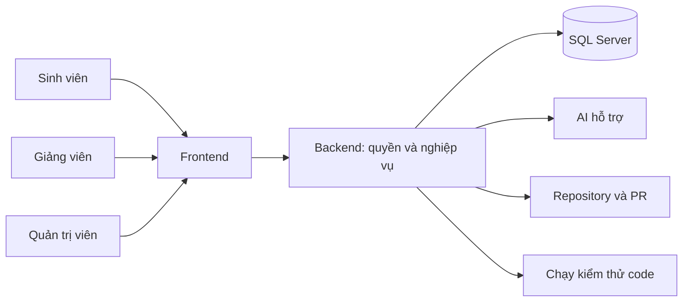

# Bàn giao V-Intern — bắt đầu tại đây

V-Intern gồm **hai repository**: Frontend phục vụ giao diện, Backend giữ dữ liệu và quy tắc. Bộ bàn giao bên dưới dùng cùng một hành trình thực tập để giải thích từ thao tác của người dùng đến code và cách vận hành.

## Chọn lộ trình đọc

| Bạn cần | Tài liệu |
|---|---|
| Demo trước giảng viên bằng hai tài khoản mới | [Kịch bản và checklist demo](DEMO-GUIDE.md) |
| Hiểu cách dùng trước khi đọc code | [Câu chuyện sản phẩm](START-HERE.md) → [Hành trình từng vai trò](USER-JOURNEYS.md) |
| Tiếp nhận toàn bộ giao diện | [Bàn giao Frontend](https://github.com/vanhoi04082006-pixel/V-Intern-FE/blob/feat/ui-ux-overhaul/docs/HANDOVER.md) |
| Tiếp nhận API, SQL và nghiệp vụ | [Bàn giao Backend](HANDOVER.md) |
| Tra cứu mọi URL của ứng dụng | [Bản đồ route từ source](https://github.com/vanhoi04082006-pixel/V-Intern-FE/blob/feat/ui-ux-overhaul/docs/ROUTE-MAP.md) |
| Hiểu Aurora Glass và sửa UI đồng bộ | [UI system](https://github.com/vanhoi04082006-pixel/V-Intern-FE/blob/feat/ui-ux-overhaul/docs/UI-SYSTEM.md) → [Token/CSS](https://github.com/vanhoi04082006-pixel/V-Intern-FE/blob/feat/ui-ux-overhaul/docs/workspace-design-system.md) |
| Đọc từng domain chuyên sâu | [Mục lục Backend](README.md) |
| Tiếp nhận nhánh và công việc đang làm | [FE Git](https://github.com/vanhoi04082006-pixel/V-Intern-FE/blob/feat/ui-ux-overhaul/docs/GIT-WORKFLOW.md) · [BE Git](GIT-WORKFLOW.md) |
| Kiểm chứng đúng thời điểm | [FE](https://github.com/vanhoi04082006-pixel/V-Intern-FE/blob/feat/ui-ux-overhaul/docs/VERIFICATION.md) · [BE](VERIFICATION.md) |

## Nhìn toàn hệ thống

## Địa chỉ local

- Ứng dụng: http://localhost:3001
- API chính: http://localhost:8080/api/v1
- Swagger: http://localhost:8080/api/docs

Đọc hướng dẫn môi trường trước khi chạy lệnh. API chính có launcher chỉ định database; không suy ra database đang chạy chỉ từ `.env`. Giữ nguyên dữ liệu và ba tài khoản gốc. Thông tin đăng nhập được bàn giao riêng, không ghi trong tài liệu này.

## Lần cập nhật Aurora Glass

Đọc [nghiệm thu nhập vai ngày 23/10](ROLEPLAY-ACCEPTANCE.md) để xem hành trình từ phỏng vấn tới PR, chấm bài và chứng nhận. [Frontend Verification](https://github.com/vanhoi04082006-pixel/V-Intern-FE/blob/feat/ui-ux-overhaul/docs/VERIFICATION.md) và [Backend Verification](VERIFICATION.md) là hai mốc số liệu hiện hành.

Xem [báo cáo thực hiện](reports/aurora-handoff-20261022.md). Phạm vi giao diện là Sinh viên và Giảng viên. Bộ tài liệu có hướng dẫn sử dụng, sơ đồ kiến trúc, quy tắc nghiệp vụ, bảng tra cứu, hướng dẫn local, kiểm thử và nhánh Git.

Tài liệu Markdown được thiết kế để đọc trên GitHub hoặc trình xem Markdown có hỗ trợ Mermaid. Mỗi chương vẫn có bảng và mô tả bằng chữ, nên nội dung không phụ thuộc hoàn toàn vào việc render sơ đồ.
