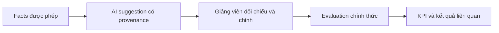

# AI hỗ trợ giảng viên đánh giá

## Sản phẩm của tính năng

Một gợi ý rubric/feedback dựa trên facts của sinh viên, project và session nằm trong scope giảng viên. Gợi ý giúp đọc bằng chứng nhanh hơn; không phải một evaluation đã chốt.

## Đọc và sử dụng đúng

Kiểm tra đúng người và kỳ trước khi sinh gợi ý. Đọc lý do, nguồn dữ liệu và những chỗ thiếu. Sau đó nhập/chọn điểm trong evaluation chính thức theo quyền hiện có. AI suggestion không gọi finalize thay người dùng và không mở quyền trên một sinh viên ngoài scope.

## Nhánh lỗi

Prompt hiện hành là `evaluation-assistance-v2`. Nếu provider trả nội dung sai schema, service dùng chung `generateWithSchemaRepair`: tối đa một lượt repair có audit, vẫn qua validator và bounds cũ. Lỗi timeout/cấu hình không tạo thêm vòng repair. Nếu vẫn sai, request thất bại và evaluation chính thức được giữ nguyên. Xem `suggestion-repair.ts` và unit tests cạnh file để hiểu ranh giới retry.

- Thiếu quyền/ownership: từ chối trước khi gửi context ra provider.
- Provider/schema lỗi: trả lỗi và giữ evaluation hiện tại; không điền điểm giả.
- Thiếu facts: mô tả thiếu, không tự biến thành 0 hoặc một nhận xét tích cực.
- Scope thay đổi: kiểm tra lại khi đọc/thao tác, không dựa vào việc một suggestion đã từng hiển thị.

Suggestion có AI run/model/prompt version để truy vết. Nếu formula hoặc quyền đánh giá đổi, sửa domain service tương ứng; không sửa prompt để vòng qua guard.

Nguồn: [evaluation assistance](../../src/ai/evaluation-assistance), [evaluation](../../src/evaluation), [đánh giá và KPI](evaluation-performance-kpi.md).
