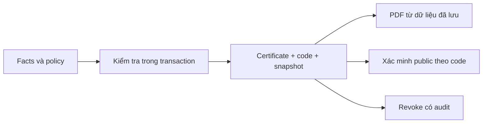

# Chứng nhận và xác minh

## Điều kiện cấp

Policy `V-INTERN-COMPLETE v1` dùng facts đã lưu, không gọi AI để quyết định đủ điều kiện. BE xem recruitment đã passed, có assignment completed, evaluation finalized và KPI finalized đạt các ngưỡng policy. Điểm thiếu không được thay bằng 0 hoặc điểm nháp.

Khi chưa đủ điều kiện, `409 CERTIFICATE_NOT_ELIGIBLE` trả các lý do có cấu trúc. Người vận hành nên đọc lý do, không sửa profile trực tiếp để bỏ qua điều kiện.

## Snapshot giữ những gì?

Chứng nhận mới gắn project/session/assignment và ngày hoàn thành của cùng assignment completed gần nhất. Tên người, role, dự án và phiên được snapshot. Một assignment active mới hơn không được thay context của kỳ đã hoàn thành.

Sửa tên người/project/session sau cấp không làm nội dung verify hoặc PDF đã snapshot thay đổi. Chứng nhận cũ chỉ có thể backfill dữ liệu thực còn biết; không có ngày hoàn thành gốc thì để null và nói rõ chưa ghi nhận.

## Đọc, tải và thu hồi

Sinh viên tải chứng nhận của mình. Quản lý cần permission/scope. Public verify dùng code, trả thông tin đã được phép theo trạng thái. Chứng nhận revoked vẫn có record nhưng không được phát PDF như issued; verify phản ánh thu hồi và hạn chế thông tin công khai theo policy.

Hai yêu cầu cấp cạnh tranh phải hội tụ về một chứng nhận theo uniqueness, không tạo hai số cấp. Revoke có audit; không xóa lịch sử để che việc thu hồi.

## Sau khi kết thúc phân công

Workspace có thể unassigned nhưng `hasAssignmentHistory` cho phép FE giữ đường đọc các kết quả của chính người học. Flag này không cấp quyền đọc dữ liệu người khác và không mở task/Mentor/AI recommendations khi không còn assignment active.

Chứng nhận nền tảng không được diễn giải thành chứng chỉ pháp lý hoặc nghề nghiệp của một tổ chức khác.

Nguồn: [certificate policy](../../src/certificates/certificate-policy.ts), [certificate module](../../src/certificates), [KPI](evaluation-performance-kpi.md).
