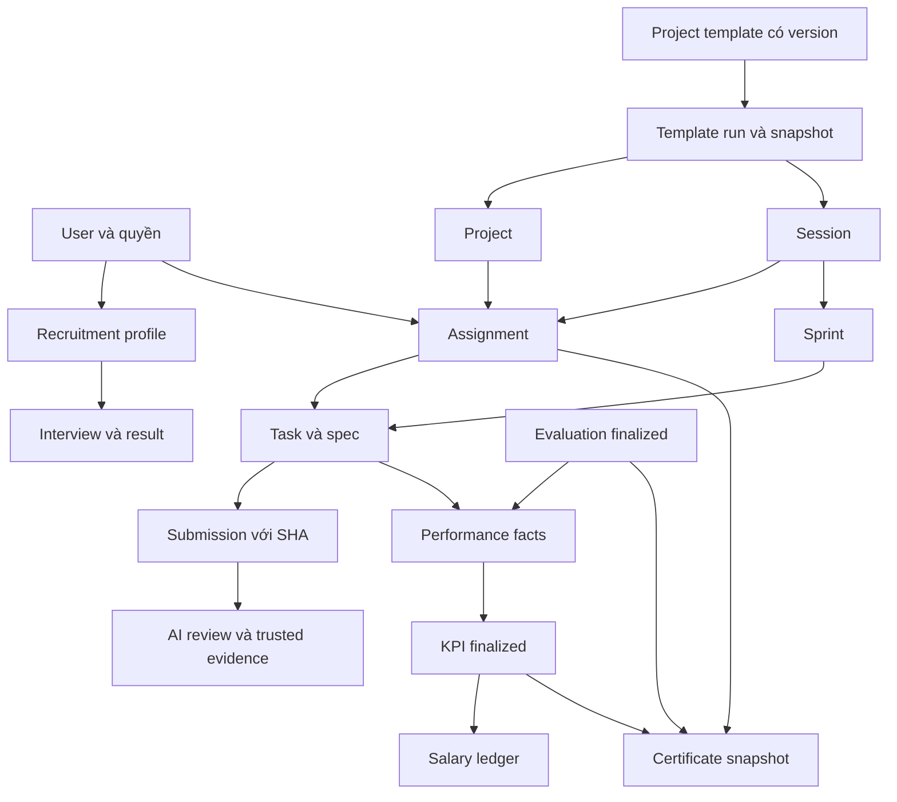

# Kiến trúc và quan hệ dữ liệu

## Hệ thống được chia theo công việc

Backend là một ứng dụng NestJS gồm nhiều module. Mỗi module quản lý một nhóm quy tắc, ví dụ recruitment biết một người đã đậu chưa, assignment biết người đó được giao vào phiên nào, task biết công việc đang ở bước nào. Chúng dùng chung SQL Server nhưng không được tự sửa trạng thái của nhau ngoài luồng nghiệp vụ đã xác định.

## Các nhóm bảng

| Nhóm | Dữ liệu chính | Điều cần bảo toàn |
|---|---|---|
| Danh tính | users, roles, permissions và các bảng nối | Permission lấy theo principal, password hash không trả ra API |
| Tuyển dụng | profile, session, question snapshot, answer, result, conversation turns | Giữ câu đã hỏi, bài đã nộp và provenance |
| Học tập | templates, runs, projects, sessions, members, assignments | Run giữ version/snapshot; không dùng task chéo phiên |
| Công việc | sprints, tasks, specs, comments, histories, submissions | Trạng thái hợp lệ, assignee đúng, evidence bất biến |
| GitHub | connections, oauth states, repositories, invitations, deliveries | Token mã hóa; GitHub numeric ID không bị thay bằng username |
| Kết quả | evaluations, KPI, ledger, certificates, reports | Chốt và snapshot có nghĩa khác dữ liệu đang cập nhật |
| Giám sát | audit, activity, notifications, alert dispatches, ai_runs | Không lộ bí mật; retry không nhân đôi tác dụng |

## Ownership khác với permission

Permission cho biết người dùng được phép dùng loại chức năng nào. Ownership/scope cho biết được dùng chức năng đó trên bản ghi nào. Một giảng viên có `tasks.view` vẫn không được đọc mọi task trong trường. Service phải gắn truy vấn với project/session mà người đó được giao.

Sinh viên dùng các API own theo user trong JWT. Client không thể đổi `internId` để truy cập bài người khác. Sharing là một luồng snapshot chỉ đọc, không biến người được chia sẻ thành co-instructor.

## Transaction, version và idempotency

Transaction gom những thay đổi phải thành công cùng nhau, ví dụ assignment và membership. Optimistic version phát hiện hai người sửa cùng một bản cũ. Idempotency key giúp bấm lại cùng yêu cầu không tạo thêm phiên, task hoặc ledger. Lease cho một worker quyền xử lý trong thời gian ngắn; HTTP GitHub/AI không giữ khóa SQL suốt thời gian chờ.

Vì vậy “bấm lại” không luôn có nghĩa “tạo lại”. Hãy xem `requestId`, version và trạng thái đang chạy trước khi xử lý lỗi cạnh tranh.

## Ba kiểu dữ liệu cần phân biệt

1. **Dữ liệu đang sống:** task hiện tại có thể thay trạng thái theo quy tắc.
2. **Lịch sử append-only:** lần chuyển trạng thái hoặc ledger giữ dấu vết thay đổi.
3. **Snapshot:** đề bài đã giao, SHA bài nộp, báo cáo/chứng nhận đã cấp giữ nội dung tại thời điểm ghi.

Sửa template không tự sửa run cũ; sửa tên người không làm chứng nhận cũ đổi theo; sửa PR không tự thay commit đã nộp. Đây là cách hệ thống giữ khả năng đối chiếu.

Nguồn: [AppModule](../../src/app.module.ts), [entity registry](../../src/database/entities.ts), [migrations](../../src/database/migrations), [bản đồ code](../CODE-MAP.md).
