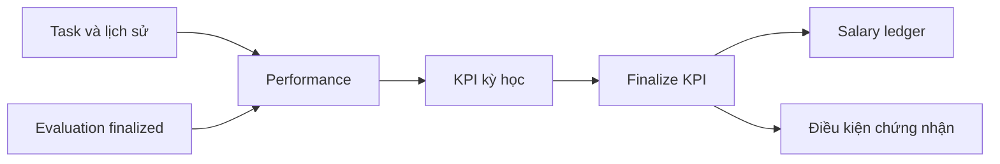

# Điểm chính thức, hiệu suất và KPI

## Ba khái niệm phục vụ ba mục đích

**Evaluation** là nhận xét/điểm giảng viên chốt theo rubric. **Performance** là các chỉ số được tính từ công việc và điểm đã lưu. **KPI** là một công thức có version tổng hợp một số chỉ số cho một kỳ.

## Evaluation

Giảng viên chọn kỳ/sinh viên trong scope, nhập đầy đủ tiêu chí và trọng số hợp lệ. Document đi từ draft → submitted → finalized. Một bản finalized không được âm thầm sửa điểm. Kỳ đánh giá có lifecycle riêng; kỳ đóng hoặc tiêu chí không đầy đủ phải trả lỗi phù hợp.

AI hỗ trợ có thể đề xuất, nhưng không finalize hoặc thay điểm chính thức. Không dùng AI review của một task thay cho evaluation cả kỳ.

## KPI v1 tính như thế nào?

| Thành phần | Trọng số cấu hình | Nguồn |
|---|---:|---|
| Delivery | 50% | Story-point completion; fallback task completion theo policy |
| Quality | 30% | Điểm evaluation finalized trung bình |
| Timeliness | 20% | Tỷ lệ hoàn thành đúng hạn |

Thiếu thành phần thì chuẩn hóa lại trọng số của phần có dữ liệu. Ví dụ delivery 80, quality 90, chưa đo timeliness:

`(80×50 + 90×30) / (50+30) = 83,75 → 83,8`.

Không phải `80×0,5 + 90×0,3 + 0×0,2`. Nếu tất cả thành phần đều thiếu, kết quả là `insufficient_data`, không có điểm và không phạt bằng 0.

## Calculate khác với finalize

Calculate khóa kỳ để tránh hai lần tính chạy cùng lúc, lưu result và provenance từng người bằng transaction ngắn rồi mở lại kỳ để được tính lại trước chốt. Finalize khóa kết quả cho các nghiệp vụ sau; không tính lại ngầm sau finalized.

| Tình huống | Hành vi |
|---|---|
| Calculate đang chạy | Request cạnh tranh nhận mã đang xử lý |
| Thiếu dữ liệu | Giữ insufficient_data và nguồn thiếu |
| Đã finalize | Không cho sửa/tính lại âm thầm |
| Truy cập ngoài scope | Từ chối ở BE |

Điểm mới của phỏng vấn không đổi công thức KPI hay ngưỡng chứng nhận. Đây là các policy riêng, cần đọc đúng module.

Nguồn: [evaluation](../../src/evaluation), [KPI formula](../../src/kpi/kpi-formula.ts), [KPI service](../../src/kpi/kpi.service.ts), [performance](student-performance.md).
