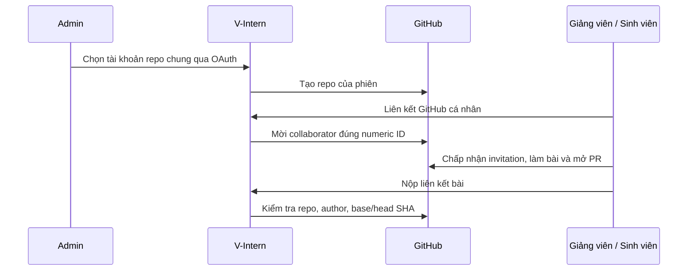

# GitHub: từ liên kết tài khoản đến một bài code được duyệt

## Ai tạo repository?

Admin chọn một tài khoản GitHub đã liên kết làm tài khoản tạo repo chung. Giảng viên khởi động phiên; server tạo repo bằng tài khoản chung. Giảng viên và sinh viên chỉ cần liên kết danh tính của mình để nhận quyền cộng tác/chứng minh người nộp.

Gmail là địa chỉ email, không tự thay cho một tài khoản GitHub. Không đoán username từ email. GitHub gửi lời mời đến danh tính đã liên kết; người dùng cần chấp nhận lời mời trên GitHub trước khi push.

## OAuth được bảo vệ thế nào?

Admin cần scope `read:user public_repo`; danh tính giảng viên/sinh viên dùng `read:user` theo luồng của ứng dụng. Callback phải trùng URL đã đăng ký. State dùng một lần, hạn 10 phút; cookie HttpOnly và PKCE S256 bảo vệ callback. BE kiểm tra lại user active và numeric GitHub ID.

Token được mã hóa AES-256-GCM theo user với AAD riêng. Một numeric GitHub ID chỉ liên kết với một user ứng dụng. FE, model, runner và log không nhận plaintext token. Username có thể đổi; numeric ID mới là căn cứ danh tính bền vững.

## Tên và quyền của repo

Tên repo mới có dạng `vintern-{projectSlug24}-{sessionSlug28}-{YYYYMMDD}-{sessionId8}`: chữ thường, bỏ dấu, có mã cuối tránh trùng. Tên đã lưu giữ nguyên khi đổi tên phiên. Repo ID, owner ID và marker phiên được đối chiếu trước thao tác.

Đổi tài khoản chung áp dụng cho repo mới, không âm thầm chuyển chủ repo cũ. Repo cũ tiếp tục dùng ownerUserId đã lưu. Liên kết muộn được lần đồng bộ thành viên tiếp theo xử lý. Batch invite có giới hạn; lỗi một thành viên không được che thành tất cả đã nhận quyền.

## Token hết hạn và cạnh tranh

Service refresh access/refresh theo cùng danh tính và scope. Một process dùng promise chung; nhiều worker dùng SQL lease/version. Không giữ transaction xuyên HTTP GitHub. Disconnect, reconnect, khóa user hoặc callback mới không bị một response refresh đến muộn ghi đè.

Token legacy còn hạn vẫn có thể sử dụng. Nếu token không thể gia hạn, người dùng liên kết lại. Đọc status không tự gọi provider và không chứng minh token còn dùng được cho mọi thao tác.

## Một lần nộp code được khóa thế nào?

### Ai có quyền chạy Agent sau khi sinh viên nộp bài?

Sinh viên được yêu cầu kiểm tra bài của chính mình, nhưng không nhận quyền giảng viên và không trực tiếp truy cập kho tài liệu nội bộ. Với yêu cầu này, server đọc mentor của dự án từ database, kiểm tra tài khoản còn hoạt động, vai trò giảng viên/Admin, quyền `tasks.manage` và quyền quản lý đúng dự án/phiên. Agent chạy theo người phụ trách đã được kiểm tra. Yêu cầu từ giảng viên được kiểm tra theo chính người đó; server không chọn một người khác để vượt qua quyền bị thu hồi.

Provenance giữ sinh viên ở `ai_runs.userId`, giảng viên ở actor của Agent; bằng chứng review ghi thêm `requestedByUserId` và `reviewerActorId`. Scope của Agent được kiểm tra lại trước mỗi bước đọc/gọi mô hình. Thiếu người phụ trách hoặc mất quyền trả `AI_REVIEWER_UNAVAILABLE`, không chạy Docker/model để chấm và không chuyển bài thành đạt. Nhận xét AI vẫn chỉ là đề xuất; giảng viên quyết định chính thức.

Kiểm thử hồi quy: `code-review-authority.spec.ts` kiểm tra phạm vi và quyền bị thu hồi; `code-review.service.spec.ts` tái hiện trường hợp tự chấm sau khi sinh viên nộp bài, bảo đảm không dùng actor sinh viên cho Agent reviewer.

Collector đọc cả module JavaScript `.cjs` và `.mjs`, áp dụng cùng kiểm tra SHA, credential, diff và giới hạn 30.000 byte/tệp như `.js`. Tệp quá lớn vẫn khiến bằng chứng chưa đầy đủ; ví dụ lockfile lớn không được bỏ qua chỉ để đổi kết luận thành đạt. Khi cần quyết định thủ công, giảng viên phải kiểm tra phần chưa được Agent đọc và ghi lý do rõ ràng, giữ nguyên trạng thái/provenance của lượt AI.

Từ `code-review-v3`, JSON Schema gửi provider được sinh từ chính Zod schema kiểm tra cấu trúc ở server: rubric sáu chiều 0–100, summary 10–4.000 ký tự, tối đa 40 finding và 20 limitation. Model vẫn không được tự thêm trường pass/approval/score. Server tính điểm và kiểm tra thêm file/dòng citation theo snapshot thực. JSON sai, citation sai hoặc response chưa hoàn tất vẫn thất bại; không sửa chuỗi, bỏ finding hoặc tạo điểm thay model.

Đầu vào chỉ nhận URL/ref theo policy GitHub, đúng repo phiên và đúng danh tính. Bài nộp ghi base/head SHA bất biến. Collector lấy source/diff có giới hạn, loại file có thể chứa credential và đánh dấu thiếu/truncated. Không lấy arbitrary URL hoặc làm theo hướng dẫn nằm trong README/source sinh viên.

| Bằng chứng | Chứng minh điều gì? | Không tự chứng minh điều gì? |
|---|---|---|
| Repository/author/SHA | Bài nào, của ai, phiên nào | Bài đúng chức năng |
| AI nhận xét source | Nhận xét trên phần source đã thu thập | Toàn repo đã được đọc/chạy |
| Trusted runner | Bộ test đã duyệt của đúng task/spec đã chạy | Mọi yêu cầu trên mọi framework đều đúng |
| GitHub Actions sinh viên | CI của repo đã báo gì | Bộ test độc lập đáng tin |
| Giảng viên rubric | Quyết định chấm chính thức | Tự thay thế toàn bộ provenance |

PR thay base/head sau nộp phải qua freshness check. Hệ thống không auto merge. AI không tự chuyển task Done. Thiếu source/suite/runner tạo trạng thái chưa đủ bằng chứng, không sinh PASS giả.

## Webhook và sự kiện

Webhook public HTTPS có HMAC secret. BE xác minh raw body, chống delivery trùng và lưu quan sát; replay/redelivery không nhân đôi tác dụng. Payload GitHub vẫn là dữ liệu ngoài, không được cấp quyền quản trị chỉ vì đến từ webhook.

Nguồn: [GitHub module](../../src/github), [code-review](../../src/code-review), [ADR tài khoản chung](../decisions/0002-admin-repository-account.md), [runner](grading-runner.md). [LIVE-GITHUB](../LIVE-GITHUB.md) là bằng chứng lịch sử, không phải trạng thái live hiện tại.
