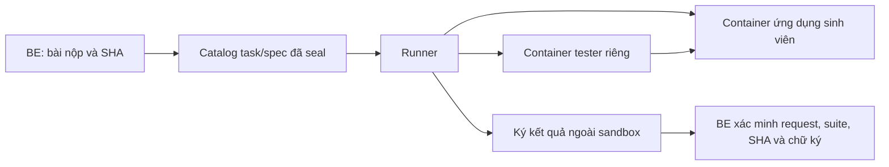

# Runner chấm code và bộ test tin cậy

## Tại sao runner phải riêng?

Bài sinh viên là code chưa tin cậy. Chạy trực tiếp trên API host có thể ảnh hưởng secret, dữ liệu và dịch vụ khác. Runner là service độc lập dùng container và bộ test do đơn vị vận hành/giảng viên kiểm soát.

## Một suite gắn với cái gì?

`GRADING_SUITES_JSON` map `templateCode:taskId` đến `{id,digest}`. Digest gắn repository, task/spec hash, image bất biến, lệnh và checks. Bộ test của task A không tự trở thành bộ test của task B, dù cùng template.

Tạo catalog bằng công cụ trong [grading-runner](../../grading-runner/README.md), đọc yêu cầu thật và review trước khi seal. Sửa spec/image/test làm đổi digest; phải duyệt lại binding.

## Request và response

| Hướng | Trường quan trọng |
|---|---|
| BE → runner | repository, headSha, baseSha, templateCode, taskId, taskSpecHash, suiteId, suiteDigest, nonce, requestHash |
| Runner → BE | payload và signature |
| Payload | completed status, requestHash, headSha, suiteId/digest, passed, failed, summary |
| Bằng chứng chi tiết mới | executionTimeMs, score, checks có tên/kết quả/log giới hạn |

`requestHash` dùng SHA-256 của bytes JSON theo hợp đồng adapter. `signature` là HMAC-SHA256 trên `JSON.stringify(payload)` bằng signing key riêng. BE so sánh chữ ký constant-time, kiểm tra lại toàn bộ binding và tính nhất quán của counts/score. Chỉ có chữ ký hợp lệ chưa đủ để bỏ qua schema hoặc request mismatch.

Kết quả cũ chưa có nhóm chi tiết execution/checks vẫn đọc theo hợp đồng legacy; không tạo thời gian chạy hoặc điểm test giả cho lịch sử.

## Ranh giới thực thi

- Archive chỉ lấy từ codeload GitHub cố định, có giới hạn kích thước; không extract source tùy ý trên API host.
- App và tester là hai container non-root, root filesystem read-only, capabilities bị bỏ, no-new-privileges.
- Có giới hạn CPU, RAM, PID, output và deadline; không có host secret, Docker socket hoặc mạng Internet của bài.
- Tester không mount source/import test sinh viên; chỉ kiểm tra giao diện chức năng được duyệt.
- Signer ở ngoài sandbox. Dọn tester trước app; cleanup lỗi không sinh kết quả đạt.

Runner có các profile và bộ test mẫu cụ thể, không phải một máy chấm mọi công nghệ tự động. Đọc README runner để biết entry, data-testid/API contract và giới hạn của suite đã chọn.

## Các kết quả cần phân biệt

| Tình huống | Cách diễn giải |
|---|---|
| Suite chạy xong, có failed checks | Bài đã được kiểm tra và còn lỗi theo suite đó |
| Thiếu suite/source/runtime hoặc timeout | Chưa đủ bằng chứng thực thi; không phải đã chạy đạt |
| HMAC/request/SHA không khớp | Từ chối bằng chứng |
| AI cho điểm tốt nhưng test lỗi | Giữ hai nguồn tách biệt để giảng viên quyết định |

Giới hạn adapter gồm deadline và schema counts/checks; giá trị cụ thể nằm trong source/README runner. Không hạ các giới hạn hoặc bỏ negative tests chỉ để một bài được PASS.

Nguồn: [runner source và cách chạy](../../grading-runner/README.md), [code-review](../../src/code-review), [GitHub review](github-code-review.md).
