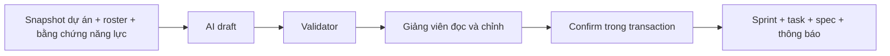

# Kế hoạch AI: từ gợi ý đến công việc thật

## Vì sao có bước nháp?

AI có thể đề xuất một kế hoạch chưa khớp đội hình, thời gian hoặc phụ thuộc. Bước nháp cho giảng viên đọc, sửa và xác nhận trước khi sinh viên nhận việc. Sinh bản nháp không phải publish task.

## AI nhận dữ liệu nào?

Blueprint, thời gian phiên, đội hình, kết quả phỏng vấn đã có, điểm mạnh và điểm cần cải thiện. Thiếu dữ liệu được ghi rõ bằng null/list rỗng. Prompt không được bịa một sinh viên, một điểm hoặc một kỹ năng để lấp chỗ thiếu.

## Đọc một task trong bản nháp

| Field | Ý nghĩa |
|---|---|
| `key` | Khóa ổn định trong bản nháp để tham chiếu |
| Assignee, priority, deadline | Ai làm, cần ưu tiên gì, khi nào bàn giao |
| Acceptance criteria / DoD | Điều kiện kiểm tra để xác nhận hoàn thành |
| Expected output | Sản phẩm/bằng chứng cần nộp |
| Estimated hours, complexity, skills | Ước lượng và mục tiêu học tập |
| `dependsOn`, `parentKey` | Tiền nhiệm và quan hệ task con |
| Milestone/taskKeys | Những đầu việc tạo thành mốc nghiệm thu |

## Những nhánh bị từ chối

Validator chặn key trùng, tham chiếu lạ, tự phụ thuộc, vòng lặp, phụ thuộc sai thứ tự và milestone ngoài cửa sổ kế hoạch. Confirm còn kiểm tra quyền, roster, session/template version, hạn và requestId. UUID được cấp trước để đổi các key nội bộ thành task ID thật.

Nếu provider trả JSON/quan hệ ngày sai, helper có một lần sinh lại theo cùng input/validator cho luồng tương ứng; mỗi lời gọi có `ai_runs`. Hết lượt vẫn sai thì giữ lỗi để retry có kiểm soát, không tạo task một phần hoặc kết quả giả.

## Sau khi xác nhận

Spec lưu yêu cầu, phụ thuộc bằng ID thật và metadata cần nghiệm thu. Các thông báo/milestone được ghi cùng transaction; replay request không gửi thêm lần nữa. Sinh viên thấy task đã publish và phải chờ tiền nhiệm Done trước khi bắt đầu hoặc nộp task phụ thuộc.

Sửa yêu cầu có thể làm đổi spec hash gửi runner. Bộ test seal theo spec cũ không được tự dùng lại cho đề mới.

Nguồn: [ai-generation](../../src/ai-generation), [task spec](../../src/tasks), [template](project-blueprints.md), [task workflow](sprint-task-core.md).
