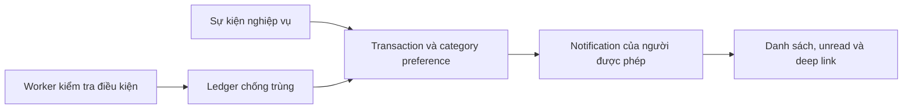

# Thông báo và cảnh báo tự động

## Hai nguồn thông báo

Thông báo sự kiện đến từ một việc vừa xảy ra: nộp bài, AI review, giảng viên chấm, kết quả phỏng vấn, phân công, chứng nhận hoặc chia sẻ. Cảnh báo định kỳ nhìn trạng thái vẫn cần chú ý: task quá hạn, bài chờ duyệt, kế hoạch/repository gặp lỗi.

## Ai nhận và ai được đọc?

List/unread/read/read-all chỉ thao tác notification của principal. Nộp bài gửi cho reviewer hiện tại; AI review gửi thông tin phù hợp cho sinh viên/reviewer; giảng viên chấm gửi lại người học. Deep link theo role/lifecycle, không mở một trang được bảo vệ chỉ nhờ có notification.

Preference theo category được áp ở BE. Tắt category không làm thay task hoặc điểm. Đánh dấu đã đọc cũng không chấp nhận bài nộp, đổi trạng thái tuyển dụng hay xác nhận một lời mời.

## Chống gửi trùng khi quét định kỳ

Worker dùng ledger SQL chung để hai process không gửi cùng một sự kiện nhiều lần. Ngay trước khi gửi phải kiểm tra lại điều kiện và scope trong transaction. Category bị tắt ghi quyết định muted để lần quét sau không lặp mãi cùng sự kiện; bật lại không tự gửi bù những quyết định đã muted.

Deadline thay đổi hoặc một provisioning lease mới có thể tạo sự kiện mới. Đọc/xóa notification không làm cảnh báo cũ tự gửi lại. Ledger giữ notificationId nullable nên retention notification không làm mất căn cứ chống trùng.

## Những điều worker không làm

Worker không tự thay deadline, chuyển task, chấm điểm hay sửa lifecycle. Nó không gửi email/SMS ngoài ứng dụng trong luồng này. Raw provider error/secret không được chép vào thông báo. Trang Admin cho biết trạng thái instance nhận request; ledger SQL mới là căn cứ chung giữa các instance.

## Điều tra một cảnh báo sai

Đối chiếu task/session ID, thời điểm UTC, deadline, state mới nhất, recipient scope và category preference. Kiểm tra dispatch ledger trước khi kết luận worker không chạy hoặc cần xóa thông báo để gửi lại.

Nguồn: [notifications](../../src/notifications), [audit](../../src/audit), [cấu hình](../CONFIGURATION.md).
