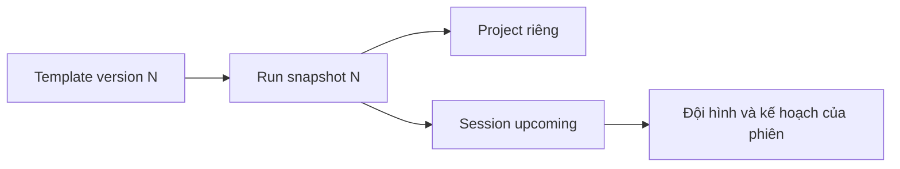

# Dự án mẫu và phiên bản đề bài

G2/P01 bổ sung learningPackage v1, revision bất biến và assessment riêng theo version. [Hướng dẫn đầy đủ](../SMALL-PROJECT-LIBRARY.md) giải thích public/private, permissions, API, migration và ranh giới P02–P04; các blueprint cũ bên dưới tiếp tục hoạt động.

## Blueprint dùng để làm gì?

Một blueprint mô tả một dự án có thể tổ chức nhiều lần: mục tiêu, phạm vi, công nghệ, đội hình, lộ trình và tiêu chí nghiệm thu. Nó không phải một dự án sinh viên đã hoàn thành. Giảng viên đọc blueprint để biết cần giao gì và đánh giá trên căn cứ nào.

Các trường sâu nằm trong `definition` JSON. Metadata ngoài cùng giúp tìm kiếm/thư viện; service giữ metadata và definition đồng bộ khi sửa.

| Phần | Câu hỏi trả lời cho người đọc |
|---|---|
| Mục tiêu và phạm vi | Làm sản phẩm gì, vì sao, điều gì không làm? |
| Roles/capacity | Cần những vị trí nào và bao nhiêu người? |
| Yêu cầu chức năng/phi chức năng | Sản phẩm phải làm được gì, dưới điều kiện nào? |
| Sprint/task/DoD | Học và bàn giao theo giai đoạn nào? |
| Milestone/đầu ra/acceptance | Dựa trên bằng chứng gì để nghiệm thu? |
| Kiến trúc và test contract | Thành phần nào kết nối với nhau, test gì được tin cậy? |

## Khi tạo phiên từ mẫu

Start template tạo project/session/role slots trong transaction. `requestId` ổn định giúp thao tác bấm lại trả cùng run. Một mẫu có nhiều run, nhưng task, roster và repository không dùng chéo giữa các phiên.

Snapshot giữ đề bài và version lúc tạo. Khi Admin sửa template lên version mới, các phiên cũ không tự thay yêu cầu giữa chừng.

## Sửa, archive và khôi phục

Editor mới gửi `expectedVersion`; một editor đang giữ bản cũ nhận `409 TEMPLATE_VERSION_CONFLICT` để tải lại và so sánh. Template code giữ nguyên. Đổi name/category/difficulty vẫn cập nhật definition và tăng version, tránh thư viện nói một đằng trong khi đề bài ghi một nẻo.

Archive ngăn tạo phiên mới nhưng không xóa run cũ. Restore cho phép dùng lại. Mã project/session được rút prefix để template code dài vẫn không làm vượt giới hạn mã.

## Kiểm tra trước khi sử dụng

Đọc đủ đầu ra và acceptance, không chỉ tên mẫu. Kiểm tra graph phụ thuộc không tự tham chiếu/vòng lặp, role đủ capacity và hạn task nằm trong cửa sổ kế hoạch. Seed có tính lặp an toàn cho cấu hình bundled; không chạy seed như một cách xóa hoặc ghi đè mẫu tùy chỉnh.

Ví dụ: đổi một tiêu chí API của mẫu mới không làm suite đã seal cho task cũ tự phù hợp. Spec hash và suite binding cần được đối chiếu lại ở luồng runner.

Nguồn: [templates](../../src/templates), [template policy](../../src/templates/template-policy.ts), [kế hoạch](learning-plans.md), [runner](grading-runner.md).
