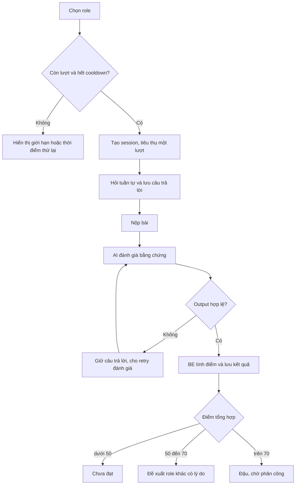

# Phỏng vấn AI: câu hỏi, điểm và hướng tiếp theo

## Mục tiêu

Phỏng vấn giúp xác định điểm xuất phát cho thực tập. Kết quả dùng câu trả lời của chính sinh viên, không lấy tên, giới tính hay hoàn cảnh cá nhân để đánh giá. Chọn role là chọn hướng chuyên môn; không cấp thêm quyền tài khoản.

Năm hướng hiện có là Frontend, Backend, Fullstack, QA và Business Analyst. Ngân hàng bundled có 185 câu; số lượng active thực tế cần kiểm tra qua quản trị vì câu có thể được sửa hoặc ngừng dùng.

## Từ bắt đầu đến kết quả

## Thành phần bài phỏng vấn

Phiên mới có 10 câu chính: 2 làm quen → 6 chuyên môn → 2 tiếng Anh. Khi nguồn câu đủ, chuyên môn tăng dần 2 dễ, 3 trung bình, 1 khó. Có tối đa 2 câu phụ thích ứng để làm rõ câu chuyên môn; bằng chứng phụ vẫn thuộc cùng tiêu chí, không nhân đôi trọng số.

Câu đã gửi được lưu cùng wording và clarification. Reload phải khôi phục câu đó, không gọi AI để đổi đề. Student API không trả rubric, đáp án mẫu hoặc các câu tương lai. Phiên 8 câu lịch sử vẫn đọc theo hợp đồng cũ.

## Công thức và ba mức điểm mới

`Overall = round1(round1(technical) × 0,7 + round1(soft) × 0,3)`.

| Điểm đã làm tròn | Kết quả mới | Có đủ điều kiện phân công? |
|---|---|---|
| 0–49,9 | Chưa đạt | Không |
| 50–70, gồm hai đầu mút | AI đề xuất khám phá role khác | Không; cần chọn và phỏng vấn lại |
| 70,1–100 | Đậu role đã chọn | Có thể được xem xét phân công nếu các điều kiện khác hợp lệ |

Ví dụ 85/72 cho 81,1: đậu. 58/72 cho 62,2: gợi ý hướng khác. 70/70 cho 70,0: vẫn ở nhóm gợi ý. Công thức BE là authority; field pass/fail do model tự trả không được quyền quyết định.

Điểm thành phần do model đánh giá có thể khác giữa các lần gọi. Công thức và ngưỡng BE cho cùng điểm đầu vào luôn cho cùng kết quả; điều này không biến model thành một bộ chấm hoàn toàn xác định. Phản hồi hướng tới người học được yêu cầu viết bằng tiếng Việt, giữ nguyên role/criterion codes trong dữ liệu.

## Đề xuất role phải có căn cứ

Prompt `recruitment-evaluation-v4` yêu cầu role khác với role vừa thi, nằm trong năm hướng được hỗ trợ. AI phải nêu lý do và `evidencePositions` trỏ đến câu đã trả lời. Validator kiểm tra có role khác, lý do có giới hạn, có 1–10 references và references thực sự nằm trong phần trả lời đã nộp. BE không tự chọn một role fallback cố định.

Feedback lưu lý do và số câu làm căn cứ trong cấu trúc hiện hữu. Người học đọc và tự xác nhận role; chấp nhận gợi ý không tự bắt đầu bài hoặc tự phân công vào dự án. Vị trí câu hợp lệ không chứng minh nhận xét AI hoàn hảo: người học/giảng viên vẫn cần đọc nội dung.

Hợp đồng lưu trữ vẫn là `decision: passed|failed`. Nhóm 50–70 có `failed` về eligibility và được trình bày thành nhánh hướng dẫn trên UI. Lý do là giữ các guard không cho phép người chưa đậu được phân công. Kết quả cũ giữ decision/model/prompt version đã lưu, không chấm lại hàng loạt.

## Lượt thi, thời gian và retry

- Mặc định tối đa 3 lượt tổng cộng; config không thể nâng trên 3.
- Lượt được tính khi start session, không phải khi chọn role hay bấm retry AI.
- Mặc định bài dài 30 phút; BE quyết định hết hạn. Countdown FE chỉ hiển thị.
- Mặc định chờ 24 giờ sau kết quả chưa đạt; API trả `attemptsRemaining` và `nextEligibleAt`.
- Đổi role không reset `attemptCount`. Hết lượt phải hiển thị hướng dẫn liên hệ, không mở thêm bài.
- Provider/schema lỗi giữ profile ở trạng thái chờ đánh giá và session có thể retry; không tự ghi rớt.

## Quyền và tính nhất quán

Mọi thao tác own lấy user từ JWT. Session/question lạ không cho đọc/ghi. Submit và persistence có lock/idempotency; bấm đồng thời không tạo hai kết quả hoặc hai thông báo. Câu trả lời là dữ liệu không tin cậy; prompt injection không được thay rubric hay ngưỡng.

Nguồn: [scoring](../../src/recruitment/scoring.ts), [recommendation policy](../../src/recruitment/recommendation-policy.ts), [interview service](../../src/recruitment/interview.service.ts), [conversation](../../src/recruitment/interview-conversation.service.ts), [evaluation](../../src/recruitment/recruitment-evaluation.service.ts), [ADR 0003](../decisions/0003-recruitment-score-bands.md).
