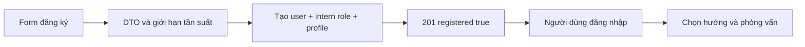

# Tài khoản, đăng ký và quyền truy cập

## Đăng ký tạo ra điều gì?

Đăng ký public là cổng vào dành cho sinh viên, không phải cách tạo staff. `POST /auth/register` nhận họ tên, email, password và `acceptedTerms=true`. BE tạo user active, đúng role intern, recruitment profile chưa bắt đầu, audit và thông báo chào mừng trong cùng transaction.

Đăng ký thành công chưa có nghĩa đã đăng nhập, xác minh email, đậu phỏng vấn hoặc có assignment.

## Dữ liệu được kiểm tra

| Field | Quy tắc |
|---|---|
| Họ tên | 2–128 ký tự |
| Email | Trim/lowercase, giới hạn 320 ký tự, uniqueness |
| Password | Ít nhất 8 ký tự, không chỉ khoảng trắng, tối đa 72 byte UTF-8 trước bcrypt |
| Terms | Boolean true, không dùng chuỗi `"true"` thay thế |
| Role/quyền/status | Không nhận từ client trong signup |

Không trim password vì thao tác đó làm thay bí mật người dùng đã nhập. Hai request cùng email có thể cạnh tranh; unique constraint và transaction phải cho kết quả rõ ràng, không tạo một nửa tài khoản.

## Các nhánh kết quả

| Tình huống | Kết quả cần hiểu |
|---|---|
| Input hợp lệ, email mới | 201 `{registered:true}` |
| Email đã tồn tại | 409 `REGISTRATION_CONFLICT` |
| Signup đã đóng | 403 `REGISTRATION_CLOSED` |
| Field không cho phép hoặc input sai | 400, không tạo tài khoản |
| Quá giới hạn đăng ký | 429 |
| Thiếu role nền hoặc lỗi ghi | Rollback toàn transaction |

`AUTH_PUBLIC_REGISTRATION=false` đóng luồng này. Mặc định limiter đăng ký 5/IP/phút; đây là bộ đếm theo process, không phải limiter phân tán.

## Đăng nhập và phiên

API dùng Bearer access token và refresh cookie HttpOnly có rotation/replay detection. Quyền hiệu lực được resolve từ dữ liệu server; không tin một role tự khai trong body. Thông tin trả về frontend không chứa password hash hoặc refresh plaintext trong JSON.

Khi sửa lỗi đăng nhập, kiểm tra origin/cookie và account status trước khi đổi JWT secret. Thay secret có thể làm các phiên đang dùng mất hiệu lực.

## Chức năng chưa có

Signup hiện không gửi email xác minh. Không diễn giải nút Google hoặc quên mật khẩu thành một tích hợp đã hoạt động nếu chưa cấu hình/xây dựng tương ứng. Staff vẫn do Admin quản lý qua luồng được phân quyền.

Nguồn: [auth controller](../../src/auth/auth.controller.ts), [auth module](../../src/auth), [users](../../src/users), [RBAC](../../src/rbac), [SECURITY](../SECURITY.md).
