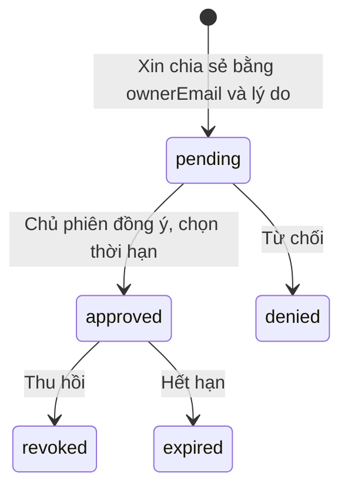

# Chia sẻ phiên giữa giảng viên

## Chia sẻ là quyền đọc có thời hạn

Một giảng viên có thể xin xem dữ liệu phiên của đồng nghiệp. Chủ sở hữu phải đồng ý. Việc đồng ý không đổi lead, không thêm co-instructor và không mở các API quản lý.

## Từng bước và điều kiện

Requester và owner đều là instructor active, không tự xin chính mình. Pending được serialize và có uniqueness để bấm lại không nhân đôi request. Approve chỉ gắn những phiên có lead đúng owner và thời hạn 1–30 ngày. Notification/audit được ghi cùng giao dịch.

Khi đọc `GET /session-sharing/:id/snapshot`, server kiểm tra requester, approved, expiry, revoked và owner hiện tại. Đổi chủ trì không ngầm chuyển consent sang chủ mới. Các điều kiện được kiểm tra lại mỗi lần đọc, không chỉ lúc mở menu.

## Snapshot cho phép xem gì?

Session, projects, members và trang task theo đúng `sprint.sessionId`. Không trả evaluation draft riêng tư và không cấp quyền write. Truy vấn snapshot dùng transaction ngắn/HOLDLOCK cho phần check/read liên quan, tránh thu hồi giữa chừng rồi vẫn đọc tiếp như còn quyền.

Ví dụ: cô Mai cho thầy Nam xem một phiên trong 7 ngày. Thầy Nam có thể đọc snapshot qua luồng sharing nhưng không PATCH task bằng endpoint quản lý. Ngày thứ 8, hoặc khi cô Mai thu hồi, snapshot phải bị từ chối dù tab cũ vẫn còn mở.

Nguồn: [sharing service/policy](../../src/sharing), [ownership model](domain-model.md).
