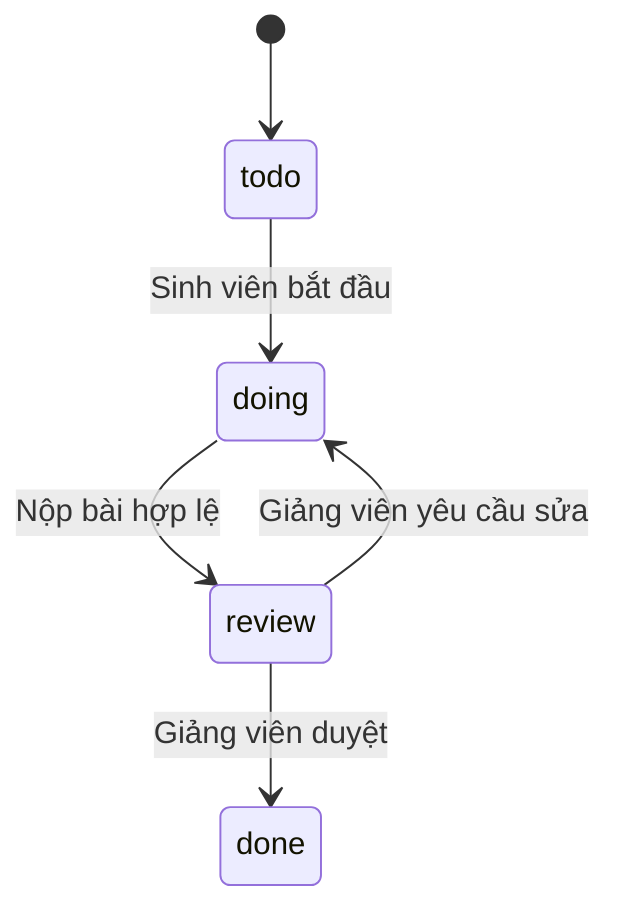

# Sprint, Kanban, nhiệm vụ và bài nộp

## Trạng thái là quy tắc, không chỉ là màu

UI có thể trình bày danh sách hoặc Kanban, nhưng cả hai gọi cùng nghiệp vụ BE. Kéo thẻ không được bỏ bước, đổi assignee hoặc tự xác nhận hoàn thành.

## Sprint đang chạy

Sprint có `planned`, `active`, `completed`, `cancelled`. Một project chỉ có tối đa một Sprint active, được bảo vệ cả service lẫn filtered unique index. Hoàn tất Sprint khi còn task mở mặc định bị chặn với `SPRINT_HAS_OPEN_TASKS`; override có chủ ý và audit không xóa công việc còn lại.

## Điều kiện trước khi cập nhật task

| Kiểm tra | Nếu không đạt |
|---|---|
| Task tồn tại và thuộc scope | Từ chối đọc/ghi |
| Sinh viên là assignee của task own | Không cho thao tác task người khác |
| Transition hợp lệ | Không cho nhảy bước |
| Version hiện tại | Yêu cầu tải lại khi xung đột |
| Mọi predecessor đã Done | `TASK_DEPENDENCIES_PENDING`, có task đang chặn |
| Nộp bài template có evidence hợp lệ | Không dùng generic update để lách submission |

Task list trả metadata Sprint và repository đã qua scope, hydrate theo trang, không gọi GitHub trên từng thẻ. Thiếu repo có trạng thái rõ; không suy diễn là đã sẵn sàng.

## Submission khác với task

Task là yêu cầu cần làm. Submission là **một lần** gửi kết quả của task đó. Mỗi submission khóa repository/base/head SHA/ref và người nộp. Withdraw bài pending rồi nộp lần mới là hai sự kiện, không phải xóa sạch lịch sử.

Nếu PR đổi base/head sau lúc nộp, BE phát hiện freshness trước khi duyệt. Thay source trong branch không âm thầm thay bài đã chấm. Hệ thống không auto-merge PR khi task Done.

## Giảng viên duyệt thế nào?

Rubric gồm chức năng, chất lượng code, test, xử lý lỗi, bảo mật và DoD. BE tính điểm, lưu decision/feedback/version/history/audit. Điểm AI là tham khảo. Thiếu bằng chứng phù hợp có thể cần lý do manual override; review còn running không được coi là đã xong.

Bài legacy chưa có SHA dùng human review theo policy của dữ liệu đó; không tạo SHA/test evidence giả để làm đẹp lịch sử.

Nguồn: [task machine](../../src/tasks/task-status.machine.ts), [sprint machine](../../src/sprints/sprint-status.machine.ts), [submissions](../../src/submissions), [GitHub review](github-code-review.md).
