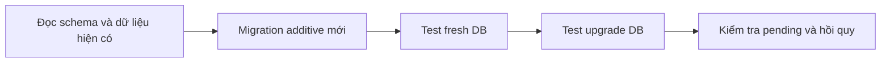

# Thay đổi schema bằng migration

## Migration là lịch sử đã áp dụng

TypeORM `synchronize=false`; ứng dụng không tự sửa schema khi boot. Migration đã chạy là lịch sử: không đổi nội dung cũ để một database mới trông giống database đã chạy. Thay đổi tiếp theo phải có migration mới và được đăng ký trong data source.

## Quy trình phát triển

1. Xác định cần schema mới hay chỉ thay policy/JSON; tránh thêm cột khi dữ liệu hiện có đã biểu diễn đúng.
2. Viết up và đọc kỹ down, index, constraint và backfill.
3. Đăng ký migration trong source; build và xem `migration:show`.
4. Test trên DB mới và DB đã có dữ liệu đại diện trong môi trường riêng.
5. Kiểm tra uniqueness, concurrent write, null/legacy và thứ tự deploy.
6. Ghi cách áp dụng/khôi phục trước khi chạy trên dữ liệu đang sử dụng.

## Những trường hợp cần giữ nguyên

Backfill chỉ bổ sung dữ liệu có căn cứ, không ghi đè câu hỏi đã chỉnh hoặc snapshot phỏng vấn. Template definition có version riêng; sửa cấu trúc JSON không tự cho phép đổi run cũ. Chứng nhận legacy không có ngày hoàn thành thì không bịa một ngày.

GitHub token rotation và ledger cảnh báo có invariant về version/lease/history; migration phải giữ chúng. Không hardcode tổng số migration trong tài liệu như authority: data-source registry và `migration:show` mới là kết quả cần đối chiếu.

## Rollback không phải reset

Một down có thể từ chối nếu schema cũ không biểu diễn lịch sử mới, ví dụ trạng thái submission mới. Không xóa lịch sử để buộc revert. Chọn forward fix hoặc khôi phục theo quy trình dữ liệu phù hợp.

Reset local là thao tác riêng cần phạm vi được xác định; không thuộc việc chạy UI/test thông thường. Trong workspace hiện tại phải bảo toàn DB chính và tài khoản gốc.

Thay đổi ba mức điểm phỏng vấn ngày 21/10 dùng feedback/decision hiện hữu, không thêm migration và không viết lại kết quả cũ. Xem [ADR 0003](../decisions/0003-recruitment-score-bands.md).

Nguồn: [migrations](../../src/database/migrations), [data source](../../src/database/data-source.ts), [SQL setup](SQLSERVER2019_SETUP.md).
