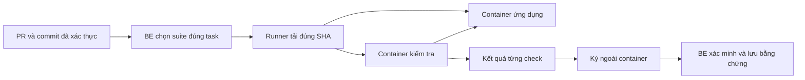

# Runner chấm bài: từ commit sinh viên đến bằng chứng thực thi

Runner là dịch vụ Node.js 22 chạy trên Linux có Docker. Nó tải đúng commit đã nộp, mở ứng dụng sinh viên trong container bị giới hạn, dùng container độc lập để kiểm tra chức năng, rồi ký kết quả bên ngoài cả hai container. Bản thân dịch vụ không cần thư viện Node bên ngoài.

Tài liệu này dành cho người vận hành máy chấm hoặc bổ sung bộ kiểm tra. Để hiểu luồng nộp bài, đọc [GitHub và chấm code](../docs/architecture/github-code-review.md); để hiểu chữ ký và cách BE xác minh, đọc [kiến trúc runner](../docs/architecture/grading-runner.md).

## 1. Runner giải quyết phần nào?

Ví dụ: sinh viên nộp PR cho nhiệm vụ “Tạo ghi chú”. AI nhận xét cấu trúc code; runner thực sự mở ứng dụng, thử lưu ghi chú hợp lệ và thử gửi tiêu đề trống. Hai nguồn bằng chứng được giữ riêng để giảng viên xem xét.



Một suite là **bộ kiểm tra đã được người vận hành duyệt cho một task cụ thể**. Không có suite phù hợp thì chưa đủ bằng chứng để tự động cho bài đạt. Suite Notes không chứng minh mọi dự án hoặc công nghệ đều chạy được.

Repository mới được tạo bằng **tài khoản GitHub chung do Admin cấu hình**. Giảng viên và sinh viên tham gia repository theo luồng cộng tác của hệ thống. Repository đã có giữ nguyên chủ sở hữu; bằng chứng cũ dùng repo giảng viên không mô tả chính sách tạo repo mới.

## 2. Các file nên đọc trước

| File/thư mục | Trách nhiệm |
|---|---|
| [server.mjs](server.mjs) | Xác thực /grade, giới hạn request, chống replay, một job đồng thời và ký kết quả |
| [docker-worker.mjs](docker-worker.mjs) | Tải source theo SHA bất biến, điều khiển hai container và xác nhận dọn dẹp |
| [policy.mjs](policy.mjs) | Kiểm tra request, digest và cấu hình sandbox |
| [prepare-catalog.mjs](prepare-catalog.mjs) | Sinh catalog runner và binding BE từ kế hoạch đã duyệt |
| [images/runtime](images/runtime) | Môi trường ứng dụng và launcher tin cậy |
| [images/tester](images/tester) | Bộ kiểm tra HTTP/Playwright độc lập |
| [suites](suites) | Bộ kiểm tra mẫu Notes và Tasks API |
| [test](test) | Unit test, fixture đúng/sai và smoke Docker |

## 3. Code sinh viên bị giới hạn thế nào?

Source chỉ tải qua GitHub codeload HTTPS cố định, tại SHA đã nộp, archive tối đa **20 MiB**. Worker không giải nén bài lên host; source chỉ được giải nén vào tmpfs trong container ứng dụng.

Cả hai container chạy non-root, root filesystem chỉ đọc, bỏ capabilities và bật no-new-privileges. CPU, RAM, PID, output, thời gian và tmpfs có giới hạn. Không mount host secret, Docker socket hoặc IPC vào bài.

App dùng `--network none`. Tester tham gia network namespace đó bằng `--network container:...`, chỉ gọi 127.0.0.1:3000. Không có Internet, bridge, host gateway hoặc cổng công khai. Xem [Docker none driver](https://docs.docker.com/engine/network/drivers/none/) và [shared namespace](https://docs.docker.com/engine/network/).

Tester không đọc filesystem sinh viên, không lấy counts từ stdout hoặc test sinh viên viết. Signer kiểm tra counts trước khi ký; BE kiểm tra lại schema, binding, SHA và chữ ký. Lỗi hạ tầng trả 503, không sinh kết quả đạt. Daemon Docker vẫn có đặc quyền: triển khai ngoài local cần host Linux riêng đã vá và smoke trên chính cấu hình đó.

## 4. Kiểm tra và build image

Trên workspace Windows hiện tại, mở PowerShell trong repository BE:

```powershell
& ..\manual-runtime\Use-ProjectStorage.ps1
Set-Location grading-runner
npm test
```

Lệnh test chạy `node --test test/*.test.mjs`, không cần cài dependency cho dịch vụ. Unit test không thay thế smoke Docker.

Trên worker Linux chuyên dụng, sau khi review digest image nền:

```sh
docker build --build-arg NODE_IMAGE='node@sha256:<reviewed-digest>' -t vintern-runtime images/runtime
docker build --build-arg NODE_IMAGE='node@sha256:<reviewed-digest>' -t vintern-tester images/tester
docker image inspect vintern-runtime --format '{{.Id}}'
docker image inspect vintern-tester --format '{{.Id}}'
```

Đặt RUNTIME_IMAGE/TESTER_IMAGE bằng image ID sha256 bất biến vừa kiểm tra hoặc manifest digest đã pin. Chạy `node test/docker-smoke.mjs`: fixture đúng phải đạt, fixture bỏ validation phải bị phát hiện.

[provision-ubuntu.sh](provision-ubuntu.sh) chỉ dành cho **worker Ubuntu 24.04/amd64 mới**, cài Docker từ apt repository chính thức có chữ ký và Node 22 kiểm tra checksum. Script cần root trên worker đó; không dùng để thay đổi máy Windows hiện tại. [build-and-smoke.sh](build-and-smoke.sh) build image và kiểm tra fixture. Lockfile và npm ci --ignore-scripts trong image kiểm soát dependency; không chạy install script của bài.

Workflow GitHub Actions có smoke trên Ubuntu dùng fixture, không cần secret ứng dụng. Kết quả một run chỉ có giá trị với source/config của run đó; việc resolve image fixture không tự phê duyệt image production.

## 5. Gắn bộ kiểm tra vào task thật

### Bước 1 — lấy đúng specification

Người có quyền gọi `GET /api/v1/tasks/:id/spec/source`, lưu **object specification nguyên gốc** vào file riêng task-spec.json, bỏ envelope API nếu có. Giữ thứ tự key: adapter hash JSON.stringify của object đã lưu.

Không seal response /spec: endpoint hiển thị bổ sung dependency live và blocked nên hash khác, có thể đổi khi nhiệm vụ trước hoàn thành.

### Bước 2 — chọn checks đúng yêu cầu

Chỉ lấy check thuộc tiêu chí task. Task tạo form chưa yêu cầu persistence thì không gắn toàn bộ suite dự án. Thống nhất selector/API với người học trước khi seal.

### Bước 3 — chuẩn bị kế hoạch vận hành

Ví dụ sau dùng placeholder. Thay repository, task UUID và image ID bằng giá trị thật đã kiểm tra. Kế hoạch là dữ liệu người vận hành tin cậy, không nhận trực tiếp từ sinh viên hoặc phản hồi AI.

```json
[
  {
    "id": "notes-foundation-reviewed-v1",
    "templateCode": "LEARN-NOTES-V1",
    "repository": "https://github.com/ADMIN-OWNER/SESSION-REPO",
    "taskId": "REAL-TASK-UUID",
    "specFile": "task-spec.json",
    "checksFile": "suites/notes-foundation.json",
    "runtimeImage": "sha256:IMAGE-ID",
    "testerImage": "sha256:IMAGE-ID",
    "command": ["node", "/runner/launch.mjs"],
    "operator": {"version": "v1", "reviewer": "nguoi-duyet"}
  }
]
```

specFile/checksFile được resolve theo thư mục kế hoạch. Nếu kế hoạch nằm riêng, dùng đường dẫn tương đối đúng hoặc tuyệt đối đến suite đã duyệt.

### Bước 4 — sinh và nạp cấu hình

```sh
node prepare-catalog.mjs /private/operator-plan.json > /private/generated.json
```

| Phần kết quả | Nạp ở đâu? |
|---|---|
| generated.catalog | Lưu JSON, trỏ RUNNER_CATALOG_PATH của runner vào file đó |
| generated.backendSuites | Đặt vào GRADING_SUITES_JSON của BE |

Binding dùng key **templateCode:taskId**. Digest gắn repository, task, hash spec, image bất biến, command và toàn bộ checks. Khi có operator, metadata gồm version/reviewer/sealedAt/runtimeImage/testerImage; metadata không đổi cách tính digest.

Admin xem tại /admin/services, mục “Hợp đồng chấm điểm đã seal”. Đổi yêu cầu, image hoặc checks thì review và sinh lại cả hai phía. Không sửa digest bằng tay để bỏ qua mismatch.

## 6. Hợp đồng ứng dụng Notes

Runtime hỗ trợ React/Vite với dependency đã cài sẵn trong image. Notes dùng các data-testid:

| Selector | Chức năng |
|---|---|
| note-new | Mở thao tác tạo ghi chú |
| note-title, note-content | Nhập tiêu đề và nội dung |
| note-save | Lưu |
| note-error | Thông báo validation |
| note-card, note-edit | Xem và sửa ghi chú |

Check tiêu đề trống mẫu tìm từ title; UI tiếng Việt cần sửa check theo nội dung thống nhất **trước khi seal**. Mỗi browser check bắt đầu storage sạch ở viewport 390px.

Action hỗ trợ: fill/click/press/reload/text/count/value; không thực thi JavaScript từ kế hoạch. `{{nonce}}` tạo giá trị ngẫu nhiên riêng mỗi check, tránh tính dữ liệu demo cố định thành chức năng thật. Mỗi action chờ tối đa 5 giây trong deadline worker tổng 85 giây; thiếu chức năng vẫn trượt.

## 7. Native Node HTTP và Tasks API

Lệnh cho ứng dụng native Node:

```json
["node", "/runner/launch.mjs", "node-http", "server.mjs"]
```

Launcher chỉ nhận file thật trong /work, chặn traversal/symlink ra ngoài và cấp env test với PORT=3000, HOST=127.0.0.1. Nó chạy trong container, không trên host. Không cài package, chạy npm script tùy ý hoặc cấp SQL ngoài. Framework/dependency khác cần image và entry contract được duyệt.

[suites/tasks-api.json](suites/tasks-api.json) kiểm tra /api/register và /api/tasks:

| Nhóm | Điều được kiểm tra |
|---|---|
| Validation | 422 input sai, 409 email trùng, 401 thiếu xác thực; đăng ký hợp lệ trả id/token, không lộ password/hash |
| CRUD | Tạo/đọc/sửa/liệt kê items,total bằng Bearer token |
| Quyền sở hữu | Tài khoản khác không được đọc/sửa/xóa; task thiếu/khác chủ trả 404 |
| Xóa | Chủ sở hữu xóa được và lần đọc sau xác nhận task không còn |

Bốn check này **chưa chứng minh** password hash đúng, dữ liệu tồn tại sau restart hoặc database engine cụ thể. Yêu cầu đó cần checks riêng đã duyệt.

Với kind api, mỗi check tối đa 20 bước. Mỗi bước có path/method/status; có thể thêm body JSON, bearer, jsonIncludes theo dot-path, jsonAbsent top-level và capture `{variable:"response.path"}`. Capture chỉ nhận primitive có giới hạn. `{{variable}}` giữ kiểu trong body/assertion, URL-encode trong path; biến chỉ tồn tại trong một check.

Tester chỉ gọi origin app, chặn redirect, giới hạn response **256 KiB**, **3 giây/request**. Token capture chỉ ở bộ nhớ tester, không trả ra log. HTTP check đơn giản còn hỗ trợ body/status và jsonIncludes top-level. Không evaluate code trong plan.

## 8. Chạy local và kết nối BE

Hai credential phải khác nhau, ngẫu nhiên, ít nhất 32 ký tự: GRADING_RUNNER_TOKEN xác thực request và GRADING_RUNNER_SIGNING_KEY ký kết quả. Cấp cùng giá trị tương ứng cho BE và worker qua cấu hình riêng; không commit vào repository.

```sh
HOST=127.0.0.1 PORT=8090 node server.mjs
```

Service chỉ khởi động khi Docker xác nhận Linux. Đặt RUNNER_CATALOG_PATH đúng catalog. BE local dùng URL /grade ở cổng 8090. Khi triển khai riêng sau này, dùng HTTPS hạn chế truy cập, reverse proxy timeout trên 120 giây và GRADING_RUNNER_URL=https://your-private-worker/grade. Không công khai Docker daemon hoặc worker cho sinh viên.

Workspace hiện có WSL VIntern-Grader, VHD và Docker storage dưới dự án. Các đường dẫn Linux sau nằm trong distribution đó:

| Thành phần | Vị trí/tên |
|---|---|
| systemd service | vintern-grader.service |
| Secret chỉ root đọc | /etc/vintern-grader.env |
| Catalog | /etc/vintern-grader-catalog.json |
| Tạm worker | TMPDIR=/var/lib/vintern-grader/tmp |

TMPDIR giúp Docker daemon đọc archive bind mount khi bật PrivateTmp=true. Startup/stop cleanup chỉ dọn container có nhãn và archive thuộc worker.

Từ BE dùng [scripts/start-grading-worker.ps1](../scripts/start-grading-worker.ps1), giữ terminal mở để WSL tiếp tục chạy. Không cài lại hoặc di chuyển ứng dụng Windows/SQL/Docker như một phần chạy local.

## 9. Đọc lỗi và phạm vi bằng chứng

| Hiện tượng | Cần kiểm tra |
|---|---|
| Không có suite | Binding templateCode:taskId, repository và raw spec đúng task |
| Digest/request mismatch | Hai phía nạp cùng catalog; spec/image/checks có đổi sau seal không |
| 503/timeout/cleanup lỗi | Docker/service/deadline; chưa đủ bằng chứng để cho đạt |
| Check trượt | Tên check, diagnostic, selector, API contract và chức năng thật |
| Chữ ký bị từ chối | Signing key và payload hai phía; không bỏ xác minh để retry |

Kết quả **lịch sử 16/10/2026**: 16 runner tests đạt trên Windows/WSL; Docker Notes đạt 2/2, bài bỏ validation 1/2; Tasks API đạt 4/4, bài bỏ validation hoặc quyền sở hữu 3/4. Môi trường khi đó: Ubuntu 24.04.5/WSL2, Docker 29.9.0, Node 22.23.3; Windows automount/interop tắt.

Nghiệm thu GitHub trước đây dùng hai danh tính và PR sinh viên: tải commit thật, bài lỗi 1/2, bài sửa 2/2; lưu kết quả ký cùng feedback Gemini và phê duyệt giảng viên. Đây là fixture tổng hợp thuộc quyền kiểm soát, không phải kết quả mọi bài hiện tại. Lỗi UMask 0077 làm archive 0444 thành 0400 đã sửa bằng chmod rõ ràng, giữ thư mục riêng 0700 và mount chỉ đọc.

Xem [GitHub lịch sử](../docs/LIVE-GITHUB.md) và [kiểm chứng hiện hành](../docs/VERIFICATION.md). Không diễn giải tài liệu này thành vừa chạy lại Docker/GitHub/remote CI trong lượt UI/tài liệu. Catalog đã nghiệm thu có một task QA; task khác cần binding riêng.
