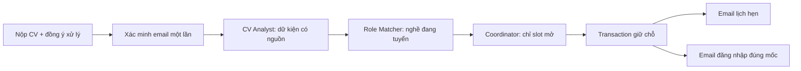

> **Cập nhật 27/10:** [kiểm thử nghiệp vụ hiện hành](../docs/BUSINESS-ACCEPTANCE-20261027.md) và [tiến độ](final-integration-execution.md). Các trạng thái ngày 24–25/10 dưới đây được giữ như lịch sử; phần billing/native/live đã có receipt mới.

# G3 — Hồ sơ CV, email và lịch phỏng vấn

G3 kế tiếp G2, giữ nguyên dữ liệu, 3 lượt phỏng vấn và API hiện hành. G4 mới áp dụng cổng bắt đầu/đi trễ 15 phút. Không coi SMTP chấp nhận là email đã tới hộp thư.

## Luồng và trách nhiệm

Agent chỉ đọc dữ liệu đã giới hạn và đề xuất có schema. Domain kiểm chứng nguồn, nghề, giờ và sức chứa; domain mới ghi DB, tạo tài khoản và xếp mail. CV là dữ liệu không tin cậy, không phải chỉ dẫn. Không gửi CV hay credential sang telemetry.

## Các lát triển khai và tiêu chí nghiệm thu

| Mục | Kết quả cần đạt | Kiểm chứng bắt buộc | Trạng thái |
|---|---|---|---|
| E01 | Outbox SQL, lease, retry, lịch gửi, receipt, dead letter | Hai worker; lỗi chắc chắn/không chắc chắn; khôi phục lease | Đạt local |
| E02 | Email HTML/text V-Intern; CTA cùng origin; encode | Nội dung độc hại; mobile/desktop | Đạt local |
| E03 | Admin xem/gửi lại; cooldown; không trả bí mật | Quyền, bấm đôi, credential không reset | Đạt local |
| V01 | Đợt mở, consent, chống trùng; token xác minh TTL | Sai email, token hết hạn/lặp, spam | Đạt local |
| V02 | CV PDF/DOCX ≤5MB; đọc có giới hạn | MIME giả, zip bomb, scan, timeout | Đạt local |
| V03 | Theo dõi, timeline, bổ sung; staff đúng phạm vi | IDOR, lỗi/tải lại | Đạt local |
| V04 | Hai Agent riêng; dữ kiện có trang/đoạn, role động | Injection, nghề thứ 6, archived, ít dữ kiện | Đạt local |
| S01 | Đợt/slot, capacity, timezone, chuẩn bị | Owner, giờ quá khứ, readiness | Đạt local |
| S02 | Coordinator + giữ chỗ atomic + waitlist | Tranh chỗ cuối, retry, cancel | Đạt local |
| S03 | Email verified; mật khẩu tạm hash/TTL/đổi lần đầu | Không reset người cũ; chống rò credential | Đạt local |
| S04 | Hai email riêng; lịch sửa/hủy vô hiệu job cũ | Fake clock, timeout, nhiều worker | Đạt local |

## Chính sách vận hành

- Chưa cấu hình mail: outbox giữ nguyên, không báo đã gửi. SMTP sandbox là bằng chứng local; inbox thật là một lần nghiệm thu khác.
- SMTP trả 250: `accepted`; receipt delivery/bounce chỉ được ghi khi có bằng chứng tương ứng. Mất kết nối sau DATA: `uncertain`, cần người vận hành quyết định, không tự gửi lại gây trùng.
- Credential nếu cần chờ gửi được mã hóa AES-GCM bằng khóa server riêng; xóa payload sau accepted/TTL. Resend không tạo hoặc đổi mật khẩu ngầm.
- Candidate capability truyền bằng POST/header, không nhúng credential vào URL/log. Token xác minh chỉ lưu hash, single-use.
- Mọi kiểm thử ghi dữ liệu trên database disposable; chỉ migration bổ sung đã kiểm chứng mới chạy lên DB native.

## Bằng chứng

Mỗi hàng chỉ đánh dấu hoàn thành khi ghi rõ command, thời điểm, SHA và kết quả. Không cộng các nhóm test ở DB khác nhau thành một lần chạy toàn bộ. Đã kiểm local; xem [báo cáo, nguồn log và giới hạn](../docs/reports/g3-completion-20261024.md), [manifest hash](../docs/reports/g3-evidence-20261024.json). Provider ngoài và SMTP hộp thư thật chưa được chứng minh.
